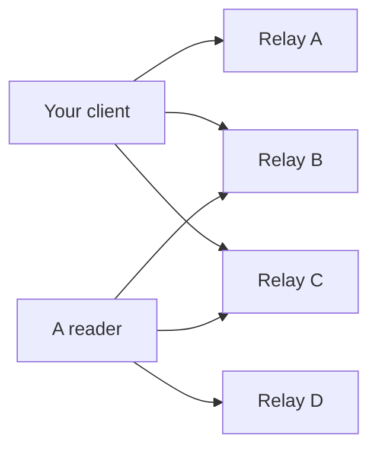

# Choosing relays

!!! info "Learning objectives"
    After this lesson you can:

    - Explain what a relay **is** (and what it is not)
    - Inspect a relay’s public policy with [NIP-11](https://github.com/nostr-protocol/nips/blob/master/11.md)
    - Write to **several** relays so one operator cannot silence you
    - Advertise read/write relays with [NIP-65](https://github.com/nostr-protocol/nips/blob/master/65.md) — and know when **not** to
    - Name what a relay operator can log (IP, filters, events)

    This page is for **people using relays**. Deploying one is optional and later: [Relay setup](relay-setup.md).

---

## A relay is a mailbox, not a platform

Clients open a WebSocket to a relay and send JSON arrays defined in [NIP-01](https://github.com/nostr-protocol/nips/blob/master/01.md):

| Client sends | Meaning |
|--------------|---------|
| `["EVENT", <event>]` | Store and/or forward this signed event |
| `["REQ", <id>, <filter>, …]` | Send me events that match |
| `["CLOSE", <id>]` | Stop that subscription |

The relay answers with `EVENT`, `EOSE` (end of stored events), `OK` (accepted or rejected), `CLOSED`, or `NOTICE`. It **cannot** forge a note from your key. It **can** refuse, drop, delay, or log.

Censorship resistance comes from **sending the same signed event to more than one independent operator**, not from finding a perfectly virtuous server.



If A bans you, readers still find the note on B and C — **if you wrote there**, and **if they look there**. That second “if” is why relay lists exist.

---

## What the operator can see

Assume every relay you use can record:

- Your **IP** and connection time (unless you used Tor/VPN **before** the client)
- Events you **publish**
- **Filters** you subscribe with — often “notes from pubkey X”, which reveals who you read
- Whether you completed [NIP-42](https://github.com/nostr-protocol/nips/blob/master/42.md) `AUTH` (then the relay also knows your **pubkey** on that connection)

They usually cannot read NIP-17 gift-wrapped message **content**. They can still see that a `kind 1059` event arrived from some IP.

Paid or authenticated relays can reduce spam. They can also require a Lightning invoice or an account in your legal name. That is a trade: less junk, more linkage.

---

## Inspect a relay before you trust it { #nip-11 }

Relays may publish a JSON document on the **same HTTPS URL** as the WebSocket, when you ask for `Accept: application/nostr+json`.

```bash
curl -sH "Accept: application/nostr+json" https://relay.damus.io | jq '{
  name,
  description,
  pubkey,
  supported_nips,
  limitation
}'
```

Useful `limitation` fields ([NIP-11](https://github.com/nostr-protocol/nips/blob/master/11.md)):

| Field | Why it matters |
|-------|----------------|
| `auth_required` | You may have to prove a pubkey (NIP-42) before anything works |
| `payment_required` | Writes (or reads) may need sats — and a wallet history |
| `restricted_writes` | Whitelist, topic, or other condition; not a public soapbox |
| `min_pow_difficulty` | Notes may need proof-of-work ([NIP-13](https://github.com/nostr-protocol/nips/blob/master/13.md)) |
| `relay_countries` | Jurisdiction. Mix these on purpose. |

`supported_nips` is a list of integers (`1` means NIP-01). Client-only NIPs advertised here can be ignored.

!!! tip "Relays come and go"
    Do not memorize a “best list” from a screenshot. Inspect live NIP-11 documents. Public indexes such as [nostr.watch](https://nostr.watch) help you see **liveness**, not virtue.

---

## How many, and the outbox idea (NIP-65)

[NIP-65](https://github.com/nostr-protocol/nips/blob/master/65.md) defines replaceable `kind 10002` events: relays you **write** to, and relays where you **read mentions**.

```json
{
  "kind": 10002,
  "tags": [
    ["r", "wss://alicerelay.example.com"],
    ["r", "wss://brando-relay.com"],
    ["r", "wss://expensive-relay.example2.com", "write"],
    ["r", "wss://nostr-relay.example.com", "read"]
  ],
  "content": ""
}
```

The spec asks clients to keep this list **small** (about 2–4 of each). When someone wants **your** notes, they should query your **write** relays. When they mention you, they should send that mention to your **read** relays.

**Tradeoff for at-risk users:** publishing `kind 10002` helps friends find you. It also tells an adversary **where to watch**. You can write to several relays in the client **without** publishing the list. Discoverability vs. a smaller target — pick with your threat model.

Direct messages use a **different** list: `kind 10050` with `relay` tags ([NIP-17](https://github.com/nostr-protocol/nips/blob/master/17.md)). See [Private messages](private-messages.md).

---

## Practical mix (beginner default)

1. **Three or more write relays**, at least two jurisdictions if you can.
2. **Tor or VPN first** if the note must not be tied to home or newsroom IP.
3. Prefer relays whose NIP-11 you actually read (logging, payment, auth).
4. After you publish, **verify on a relay you did not just write to** — or in a second client. One green checkmark in your app is not enough.
5. Do not pay a relay from a KYC wallet attached to a secret npub.

Community or family relays are useful for a **known** group. They are a poor sole home for a public broadcast: one raid, one seized laptop, one angry admin.

---

## Code: publish to several relays and see who accepted

This signs **once** and sends the same event to multiple relays. A rejection on one is not a global ban.

=== "JavaScript (nostr-tools)"

    ```javascript
    import { generateSecretKey, finalizeEvent } from 'nostr-tools'
    import { SimplePool } from 'nostr-tools/pool'

    const sk = generateSecretKey()
    const event = finalizeEvent({
      kind: 1,
      created_at: Math.floor(Date.now() / 1000),
      tags: [],
      content: 'Same signed note, several mailboxes.',
    }, sk)

    const relays = [
      'wss://relay.damus.io',
      'wss://nos.lol',
      'wss://relay.primal.net',
    ]

    const pool = new SimplePool()
    const results = await Promise.allSettled(pool.publish(relays, event))
    results.forEach((r, i) => {
      console.log(relays[i], r.status)
    })
    pool.close(relays)
    ```

=== "Python (nostr-sdk)"

    ```python
    import asyncio
    from nostr_sdk import Client, EventBuilder, Keys, NostrSigner

    async def main():
        keys = Keys.generate()
        client = Client(NostrSigner.keys(keys))

        for url in (
            "wss://relay.damus.io",
            "wss://nos.lol",
            "wss://relay.primal.net",
        ):
            await client.add_relay(url)

        await client.connect()
        output = await client.send_event_builder(
            EventBuilder.text_note("Same signed note, several mailboxes.")
        )
        print("id:", output.id)
        print("accepted:", output.success)
        print("rejected:", output.failed)

    asyncio.run(main())
    ```

=== "Rust (nostr-sdk)"

    ```rust
    use nostr_sdk::prelude::*;

    #[tokio::main]
    async fn main() -> Result<()> {
        let keys = Keys::generate();
        let client = Client::builder().signer(keys).build();

        for url in [
            "wss://relay.damus.io",
            "wss://nos.lol",
            "wss://relay.primal.net",
        ] {
            client.add_relay(url).await?;
        }
        client.connect().await;

        let output = client
            .send_event_builder(EventBuilder::text_note(
                "Same signed note, several mailboxes.",
            ))
            .await?;

        println!("id: {}", output.id());
        println!("accepted: {:?}", output.success);
        println!("rejected: {:?}", output.failed);
        Ok(())
    }
    ```

=== "CLI (nak + NIP-11)"

    ```bash
    # Relay policy document (HTTPS, same host as the WebSocket)
    curl -sH "Accept: application/nostr+json" https://relay.damus.io | jq '{name, limitation}'

    # Fetch recent notes by a public key (hex or npub) — no login
    nak req -k 1 --limit 5 --author npub1… wss://relay.damus.io wss://nos.lol
    ```

---

## Hands-on exercises

!!! example "Exercise 1 — NIP-11 comparison"
    Pick two public relays. Fetch each NIP-11 document. Write down: payment, auth, country if listed, and whether writes look open. Choose a mix, not two clones.

!!! example "Exercise 2 — one mailbox fails"
    Publish a test note to three relays. Then, in a second client, add **only** one of those relays and search your `npub`. Remove it, add a **different** one, search again. Notice that “I was banned” on one server is not the end of the identity.

!!! example "Exercise 3 — outbox tradeoff"
    In your client, find the relay list. Decide explicitly: will you **publish** `kind 10002` (easier for others to find you) or keep the list local (smaller map for an adversary)? Write the reason on paper next to your threat sentence.

---

## Next

- [Publish and verify](../tutorials/publish-and-verify.md) — workshop: prove a note landed, and what “delete” actually does
- [Field guide](high-risk-users.md) — IP hygiene, sources, organizers
- [Relays (concept)](../concepts/relays.md) · [Module 4](../modules/module-04-relays-architecture.md)
