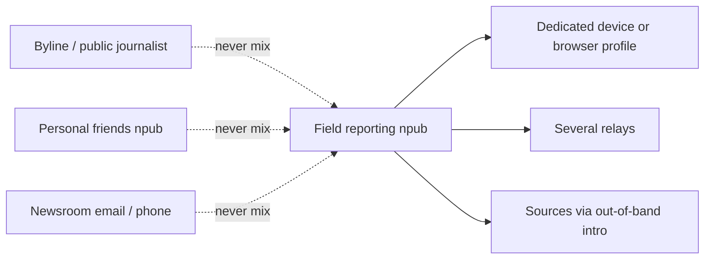

# For Journalists & At-Risk Users

!!! info "Who this guide is for"
    This is a **field guide**, not a developer tutorial. It is for journalists, organizers, researchers, and people who need to publish or talk **without handing a company their real name, phone number, or social graph**.

    You do not need to write code. You do need to be honest about who might be watching.

    By the end you should be able to:

    - Build a **threat model** (who, what, how long)
    - Create a **compartment**: a Nostr identity that is not your byline, workplace, or family account
    - Choose clients, signers, and relays so a single operator cannot silence or unmask you
    - Talk to sources without leaking their identity through DMs, follows, or zaps
    - Know what Nostr **cannot** hide (IP, photos, payments, writing style, timing)

!!! warning "This is not a guarantee"
    Nostr gives you **portable keys** and **no single company that can delete your account globally**. It does **not** make you anonymous.

    Relays can log IPs. Notes are public unless you encrypt. Lightning payments can be tied to KYC exchanges. A photo of a street sign can do more damage than a leaked key.

    If you are facing targeted surveillance, combine this with advice from a digital-security trainer who knows your **local** laws and risks. This page is education, not legal advice.

---

## 1. Threat model (do this before you install anything)

Write three sentences on paper:

1. **Who** might try to unmask or silence me? (police, employer, militia, abusive partner, platform, random trolls)
2. **What** happens if they succeed? (job loss, arrest, source burned, family targeted)
3. **How long** must this identity last? (one story, one protest, years)

That answer changes everything. A reporter documenting a public demonstration has a different setup than someone hiding from a violent partner.

### What Nostr actually protects

| Capability | Protected? | What that means in practice |
|------------|------------|-----------------------------|
| Account takeover without the key | Yes | Nobody can post as you without `nsec` |
| One app or one relay banning you | Partial | You republish to other relays; they cannot erase every copy |
| Proof a note came from a key | Yes | Signatures are verifiable |
| Hiding *that* you posted | No | Events are public; `pubkey` and `created_at` are visible |
| Hiding your IP from relays | No | Not unless you use Tor/VPN **before** the client |
| Hiding who you talk to | No by default | Old DMs (NIP-04) leak metadata; prefer NIP-17 |
| Recovering a stolen or lost key | No | There is no password reset |

### Compartments, not “one account for life”

Think in **boxes**:

If the field key is ever linked to your name, **burn it** and start a new box. Do not “rebrand” the same `nsec`.

---

## 2. Identity: keys, profiles, and accidental unmasking

### Generate a new key — and keep it boring

1. Create the key **on the device that will use it**, or in a signer app, not on a website.
2. Store `nsec` **offline** (paper, metal). Not Screenshots, not Photos, not WhatsApp “saved messages”, not a work laptop backup.
3. Profile (`kind 0`) should describe a **role**, not a person: `Field notes · civic coverage`, generic avatar, empty website.
4. Do **not** add:

    - Your real name, newsroom, or city if that city is rare
    - A **NIP-05** address on a domain you own (DNS is a name tag)
    - A **Lightning address** on a KYC wallet in your legal name
    - A link to Twitter/Instagram/GitHub that is already tied to you

5. Follow lists (`kind 3`) are public. Following your own public journalist npub from the field npub **links them**.

### Signers: never paste `nsec` into the web

| Pattern | Use when | Avoid |
|---------|----------|--------|
| Key in a mobile app (Damus, Amethyst) | One dedicated phone | Same phone as your real-name iCloud/Google account |
| NIP-07 browser extension | Laptop + web clients | Pasting `nsec` into Coracle/Snort |
| Remote signer (NIP-46, Amber, nsec.app) | You want web apps without giving them the key | Signers you have not verified |

If a site asks you to paste `nsec` to “log in”, leave.

### Backup and death of a key

- Two paper copies, separate physical places, if the story is long-running.
- Test that you can restore **before** you need it.
- If a device is seized, assume the key on it is burned. Rotate. Tell sources on a **different** channel.

---

## 3. Network and relays (this is where most people get unmasked)

Nostr clients open a WebSocket to each relay. That relay sees **your IP** and **which pubkeys you ask for**.

### Practical network hygiene

- Turn on **Tor or a trusted VPN before** opening the Nostr client. Order matters.
- Prefer clients that can use a **proxy** (or run the client on a device that is already on Tor).
- A “privacy VPN” you paid for with a personal credit card is weaker than Tor for anonymity; it may still hide your home IP from the relay.
- Do not post from the newsroom Wi‑Fi on a “secret” npub.

### How many relays, and which

- **Write to several** (outbox idea): if one relay censors you, others still have the note.
- **Read from several**: one relay can lie by omission.
- Mix jurisdictions. One hobby relay in your city can be served a warrant more easily than a set of distant operators.
- Paid or authenticated relays can reduce spam; they can also **require** a Lightning invoice that deanonymizes you. Know what you are trading.
- Your **relay list in the client** may itself be published (`kind 10002`). That tells observers where to watch you.

### What a relay operator can see

- Connection IP and time
- Events you publish
- Filters you subscribe to (often: “give me notes from pubkey X” — which reveals who you read)

They usually **cannot** forge notes from your key. They **can** drop your notes, log you, or hand logs to someone else.

---

## 4. Publishing without handing over the story

### Write as if it will be read in court

- No live location, hotel, checkpoint, or “I just landed in…”.
- No photos until you **strip EXIF** (GPS, phone model, timestamp). Best: do not shoot on the same phone that has your real-name accounts.
- Prefer **text** for breaking updates. Video is a gift to facial recognition and geolocation.
- Avoid unique phrases you also use on your byline blog (stylometry is real enough to worry about).
- Hashtags help discovery **and** help adversaries search. Use them on purpose.

### Deletion is not deletion

NIP-09 asks relays to drop an event. Many will not. Archives, other relays, and screenshots remain. **Assume public notes are forever.**

### Verification without doxxing yourself

Journalists still need to be credible:

- Use a **second**, clearly labeled public npub for work you will stand behind with your name.
- For the field npub, verify facts in the **text** (document IDs, public URLs, timestamps of public events) rather than “trust me, I am on the ground in X.”
- Newsrooms can publish “contact this npub via Signal first” on a **separate** page that is not linked from the secret profile.

---

## 5. Scenario: journalist and sources

**Goal:** cover a sensitive story; sources must not be one leaked follow-list away from exposure.

### Setup

1. Dedicated device or at least a dedicated OS user / browser profile.
2. New key + signer. Paper backup.
3. Boring profile. No NIP-05, no KYC Lightning.
4. 4+ relays. Tor/VPN first.
5. Introduce the npub to sources **out of band** (Signal, in person, existing encrypted mail) — not by posting “DM me leaks” on your public byline.

### DMs: NIP-04 vs NIP-17 (plain language)

- **NIP-04** (legacy “encrypted DM”): content is encrypted, but observers often still see **that** A talked to B, and when. Treat it as postcard-in-an-envelope: better than public notes, not good enough for sources.
- **NIP-17 / gift wrap**: hides much of that metadata. Use a client that actually implements it. If the client is vague, assume NIP-04.

Still: a source who follows you, zaps you, or likes your notes from **their** identifiable npub has linked themselves. Tell them to use a **throwaway key** too.

### What not to do with sources

- Do not add them to a public follow list.
- Do not @-mention them.
- Do not ask them to install an APK you sent.
- Do not keep source names in public bookmarks or public lists (`kind 30000` lists are often public).

### Burn

If the key, device, or a source is compromised: stop posting. New key. New device profile if needed. Notify remaining sources on a channel that is **not** Nostr.

---

## 6. Scenario: organizer

**Goal:** public logistics stay available even if one app store or one relay panics; membership stays off the firehose.

### Three keys, three jobs

| Key | Public? | Job |
|-----|---------|-----|
| Org broadcast | Yes | Time, place, legal hotline, mutual aid — facts only |
| Steward / working group | No | Shared with a handful of people; planning |
| Personal | Maybe | Friends. Never the action. |

Post the **same** announcement to multiple relays. Put the address and time in **text**, not only on a graphic.

Do not use the broadcast key to follow every volunteer — that is a membership list.

If you run a community relay: publish a **policy** (logging, retention, law-enforcement process). NIP-09 deletes are best-effort.

After raids or seizures: rotate the steward key. Treat old working-group history as exposed.

---

## 7. Scenario: at-risk individual (no newsroom, no IT)

**Goal:** speak without a phone-number account, in under an hour.

1. New browser profile or phone user. Not your daily Chrome where you are logged into Google.
2. New key. Paper backup. Boring name.
3. Client that **does not demand** a phone number.
4. Tor or VPN **first**.
5. Read for 20 minutes. Confirm notes appear in a second client (library computer, friend’s phone) before you say anything identifying.
6. First posts: public facts, no selfies, no workplace, no “only person on this shift”.

If your risk is a **personal** adversary who knows your writing and your city, Nostr is not magic. Reduce unique details. Prefer public-source documentation over diary-like posts.

---

## 8. Money: zaps and why they unmask people

Zaps are Lightning payments. They are useful and **loud**.

- A zap from a wallet KYC’d to your passport ties **this npub** to you.
- Even non-KYC wallets can leak if you funded them from a personal exchange.
- Receiving zaps on a “secret” profile advertised on your real blog ties the two.

If this compartment must stay unnamed: **disable Lightning on the profile** and do not zap from it.

---

## 9. Clients (starting points, not endorsements)

Always verify the publisher. These move fast:

- **iOS:** Damus, Primal  
- **Android:** Amethyst, Primal (F-Droid / official site, not random APKs)  
- **Web:** Coracle, Snort — **only** with a NIP-07 signer  
- **Signer:** browser extension or Amber-style app so the website never holds `nsec`

Re-check permissions after every app update.

---

## 10. Incident checklist

Keep this **on paper** (or another device) — not on the phone that holds the key.

!!! example "Before you publish"

    - [ ] Threat model written (who / what / how long)
    - [ ] New key; not reused from a public account
    - [ ] `nsec` offline, restore tested
    - [ ] No real name, face, NIP-05, or KYC Lightning on the profile
    - [ ] No follows that point at your real identity
    - [ ] Tor/VPN connected *before* the client
    - [ ] Several relays, more than one country if you can
    - [ ] Sources introduced out of band; throwaway keys for them too
    - [ ] NIP-17 (or no DMs) for sensitive talk
    - [ ] No live location, no EXIF, no unique byline voice on the secret npub
    - [ ] Rotation plan if the device is seized

---

## How this connects to the rest of LearnNostr

- Keys and backups: [Keys](../concepts/keys.md) · [Module 2](../modules/module-02-keys-identity.md)
- Relays: [Relays](../concepts/relays.md) · [Module 4](../modules/module-04-relays-architecture.md)
- Encryption, DMs, NIP-44 / NIP-17: [Module 9: Security & Privacy](../modules/module-09-security.md)
- Building a client (technical): [Build a Simple Client](../tutorials/simple-client.md)
