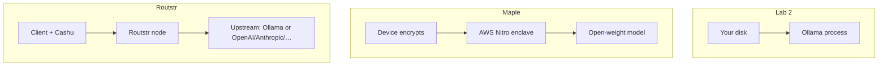

# Maple AI and Routstr (when local is not enough)

!!! info "Lab 3 — remote inference without a ChatGPT login"
    Use this only after [lab 1](cloud-surveillance.md) and, if the machine can, [lab 2](run-local.md).

    LearnNostr is **not** Maple or Routstr. Below is what **their current public docs** say, plus labs that call **documented** endpoints. Re-read those pages if a flag or URL moved.

!!! warning "Payment privacy is not prompt privacy"
    A Cashu token or a Bitcoin top-up can hide **who paid**. It does not automatically hide **what you typed** from the machine that runs the model. Read each product’s trust model before you paste a field draft.

---

## Two different designs



| | [Maple](https://www.trymaple.ai) | [Routstr](https://docs.routstr.com/) |
|--|------|---------|
| Job | Cloud chat/API with **hardware isolation** | **Marketplace** of inference nodes |
| Discovery | Their app / API | **Nostr** `kind 38421` ads ([discovery docs](https://docs.routstr.com/provider/discovery/)) |
| Payment (as they describe it) | Anonymous accounts: Bitcoin / Lightning / ecash; no credit card on that path | **Cashu** eCash or Lightning-funded `sk-` session; no credit card |
| Where the prompt is decrypted | Inside a **TEE** (AWS Nitro Enclaves), per [trymaple.ai/proof](https://www.trymaple.ai/proof) | On the **provider node**, which may **forward** to OpenAI, Anthropic, vLLM, or Ollama ([overview](https://docs.routstr.com/overview/)) |
| You still trust | Nitro hardware, their open-source enclave build, **AWS’s jurisdiction**, your IP unless you add Tor | That node operator, **and whoever they proxy to**, plus mint/payment metadata |

Maple’s own comparison says a “privacy proxy” that still sends plaintext to a frontier lab is **not** the same as their TEE design. Routstr’s architecture diagram **includes** OpenAI/Anthropic as possible upstream. For a dissident, that sentence is the whole lesson: **choose the node (or do not use Routstr for column-1 secrets).**

---

## Maple — as documented

From [How Maple Works](https://www.trymaple.ai/proof) and Maple’s public notes:

- Prompts are encrypted on the device and decrypted **only inside** hardware-isolated infrastructure. Their proof page currently lists device encryption, a secure enclave, GPU TEE, and open-source attestation.
- They publish open-source client/server code and a **live attestation** page so you can compare PCR hashes to a build. Hashes rotate; we do not freeze a PCR in this lesson.
- They say data is not used for training/ads.
- **Anonymous accounts**: unique ID you must save, password you set, pay with Bitcoin / Lightning / ecash — no email on that path (Maple’s own [2.0 notes](https://blog.trymaple.ai/maple-2-0-now-with-live-data/) and their public announcement of that signup).
- They run **open-weight** models in that infrastructure; Maple Teams FAQ states prompts are not sent to OpenAI, Anthropic, or Google.
- **Maple Proxy** ([docs](https://blog.trymaple.ai/maple-proxy-documentation/)): OpenAI-compatible local proxy (`localhost:8080/v1`) that does TEE handshake, attestation, and encryption. Desktop app can start it; Docker image `ghcr.io/opensecretcloud/maple-proxy:latest` with `MAPLE_BACKEND_URL=https://enclave.trymaple.ai`. Streaming is **required**. Model IDs change — `GET /v1/models` is the source of truth.

Honest limits Maple’s own FAQ admits: you still trust **AWS Nitro** and the published code. The enclave is in AWS’s cloud. Your ISP still sees a connection to Maple unless you add Tor. Account ID + password are a secret — treat them like an `nsec`.

### Lab: verify, then a non-sensitive call

1. Open [trymaple.ai/proof](https://www.trymaple.ai/proof). Confirm you are looking at **attestation**, not a marketing slogan. (Hashes rotate; we do not freeze a PCR in this lesson.)
2. If you create an account, use the **anonymous** path they document — not Google login. Save the ID **offline**.
3. Do **not** paste `draft.txt` from lab 2. Use a sentence you would already publish:

Desktop proxy (from Maple Proxy docs) once it is listening:

```python
from openai import OpenAI

client = OpenAI(
    base_url="http://localhost:8080/v1",
    api_key="your-maple-api-key",  # desktop app may auto-configure
)

# Maple Proxy documents streaming as required
stream = client.chat.completions.create(
    model="llama-3.3-70b",  # list models: GET /v1/models
    messages=[{"role": "user", "content": "One sentence: why a prompt log is evidence."}],
    stream=True,
)
for chunk in stream:
    delta = chunk.choices[0].delta.content
    if delta:
        print(delta, end="")
```

Docker (same docs; do not bake secrets into compose for a shared server):

```bash
docker pull ghcr.io/opensecretcloud/maple-proxy:latest
docker run -p 8080:8080 \
  -e MAPLE_BACKEND_URL=https://enclave.trymaple.ai \
  ghcr.io/opensecretcloud/maple-proxy:latest
```

If you cannot install the app, **stop after step 1**. Reading the proof page is still a completed lab. Do not invent a third-party “Maple web wrapper.”

---

## Routstr — as documented

From [docs.routstr.com](https://docs.routstr.com/):

- No central login. Buy inference with **Cashu** or a Lightning-funded session key.
- Clients point any OpenAI SDK at a node: `base_url` + `api_key` = `sk-…` **or** a raw `cashuA…` token ([integration](https://docs.routstr.com/client/integration/)).
- Providers **announce** on Nostr as `kind 38421` (Routstr’s advertisement format, not a NIP we invented) with URL, models, prices, optional `.onion`.
- Nodes may sit in front of **OpenAI / Anthropic / vLLM / Ollama**.
- Tor: integration docs show SOCKS5 to an onion `base_url`.

### Lab A — see the directory, do not pay yet

Discover advertisements the same way you query notes. Kind `38421` is what Routstr tells operators to publish:

```bash
nak req -k 38421 --limit 5 wss://relay.damus.io wss://nos.lol
```

Or in JavaScript:

```javascript
import { SimplePool } from 'nostr-tools/pool'

const relays = ['wss://relay.damus.io', 'wss://nos.lol']
const pool = new SimplePool()
const events = await pool.querySync(relays, { kinds: [38421], limit: 5 })
pool.close(relays)

for (const ev of events) {
  console.log(ev.pubkey, ev.content.slice(0, 200))
}
```

Read `content`: endpoint, models. If models look like `gpt-4o` / `claude-*`, that node is **not** a local-only box. Do not send column-1 text there.

### Lab B — OpenAI-compatible call (throwaway prompt)

Only after you picked a node whose upstream you accept. Token is a **secret**; do not commit it. Example shape from Routstr’s integration page (`https://api.routstr.com/v1` is their documented gateway URL — any provider URL from lab A can replace it):

```bash
curl https://api.routstr.com/v1/chat/completions \
  -H "Content-Type: application/json" \
  -H "Authorization: Bearer cashuA…" \
  -d '{
    "model": "gpt-4o-mini",
    "messages": [{"role": "user", "content": "Reply with the single word: pong"}]
  }'
```

Python:

```python
from openai import OpenAI

client = OpenAI(
    base_url="https://api.routstr.com/v1",  # or a node URL from kind 38421
    api_key="cashuA…",  # or sk-…
)
print(
    client.chat.completions.create(
        model="gpt-4o-mini",
        messages=[{"role": "user", "content": "Reply with the single word: pong"}],
    )
    .choices[0]
    .message.content
)
```

`402` means insufficient Cashu/session balance ([integration errors](https://docs.routstr.com/client/integration/)).

!!! danger "Upstream is the privacy model"
    If the node proxies to OpenAI, **OpenAI gets the prompt**. Cashu hid the card; it did not hide the words. For field notes, prefer a node that lists **self-hosted** models, or stay on [lab 2](run-local.md) / Maple’s TEE path.

---

## Hands-on checklist

!!! example "Lab 3 complete when"

    - [ ] You can explain TEE vs proxy-to-OpenAI in one sentence
    - [ ] You opened Maple’s [proof](https://www.trymaple.ai/proof) page (or documented why you cannot)
    - [ ] You fetched at least one Routstr `kind 38421` event and named its likely upstream
    - [ ] Any remote completion used a **throwaway** sentence, not `draft.txt`
    - [ ] You did not mix a KYC card with a field npub to buy credits

---

## Next

[Publish or teach without leaking the prompt](publish-without-leaking.md)
