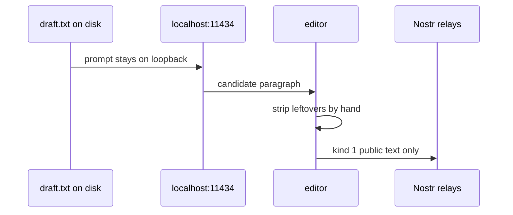

# Publish without leaking the prompt

!!! info "Lab 4 — the worked example"
    You already know how to [publish a note](../tutorials/publish-and-verify.md) and how to [run a local model](run-local.md). This lab is the **joint**: inference stays on localhost; only a **public-safe** paragraph hits relays.

    If you skip the local step and paste the internal draft into ChatGPT, then post the reply, you have a pretty `kind 1` **and** a vendor log. That is the failure mode this grant track exists to prevent.

---

## How the three systems collide

| System | Sees the **prompt** | Sees the **published note** | Sees your **IP** |
|--------|---------------------|----------------------------|------------------|
| Ollama on this laptop | Yes (local process) | No | No (unless you later upload) |
| Maple TEE | Yes, inside the enclave they document | No | Maple/AWS edge, unless Tor |
| Routstr node + upstream | **Yes, at the node; maybe also OpenAI** | No | Node (and ISP) unless Tor/onion |
| Nostr relays | Only if you paste it into `content` | Yes | Yes, unless Tor/VPN **before** the client |
| Readers of your `npub` | No | Yes | No |

Follow lists, zaps, and NIP-05 still link identities — [field guide](../getting-started/high-risk-users.md). AI does not cancel that.

Rules:

1. **Never** put `nsec` in a prompt.
2. **Never** put the internal draft in a `kind 1`.
3. Do not use the **field** npub as a ChatGPT/Maple/Routstr login, display name, or filename you then share.
4. Prefer **local** inference for anything from column 1–2. Remote only for text you would publish anyway.
5. After the model replies, **you** are the editor. Publish the edited paragraph, not the chat transcript.



---

## Worked example (copy-paste)

Same fiction as lab 2. Internal file stays in `draft.txt`. Public file will be `public.txt`.

### Step 1 — infer locally

```bash
# Use the local tag from `ollama list`. No :cloud.
NOTES=$(cat draft.txt)
curl -s http://localhost:11434/api/chat -d "$(python3 - <<PY
import json, os
print(json.dumps({
  "model": "gemma4",
  "stream": False,
  "messages": [{
    "role": "user",
    "content": "Rewrite INTERNAL notes into one public paragraph. "
               "Remove names, phones, vehicles, buildings, exact times, minors, quotes that identify a place. "
               "Notes:\\n\\n" + open("draft.txt", encoding="utf-8").read()
  }]
}))
PY
)" | python3 -c "import sys,json; print(json.load(sys.stdin)['message']['content'])" > public.txt
```

Open `public.txt`. Delete anything that could still point at Source A. **You** sign off, not the model.

### Step 2 — publish only `public.txt`

Throwaway key for the exercise (not your field `nsec`):

=== "JavaScript"

    ```javascript
    import { readFileSync } from 'node:fs'
    import { generateSecretKey, getPublicKey, finalizeEvent } from 'nostr-tools'
    import { npubEncode } from 'nostr-tools/nip19'
    import { SimplePool } from 'nostr-tools/pool'

    const body = readFileSync('public.txt', 'utf8').trim()
    if (/INTERNAL|phone|van|minor|19:40|blue building/i.test(body)) {
      throw new Error('public.txt still looks like the internal draft — edit by hand')
    }

    const sk = generateSecretKey()
    console.log('throwaway npub', npubEncode(getPublicKey(sk)))

    const event = finalizeEvent({
      kind: 1,
      created_at: Math.floor(Date.now() / 1000),
      tags: [['t', 'learnnostr']],
      content: body,
    }, sk)

    const relays = ['wss://relay.damus.io', 'wss://nos.lol']
    const pool = new SimplePool()
    await Promise.any(pool.publish(relays, event))
    pool.close(relays)
    console.log('published', event.id)
    ```

=== "Python"

    ```python
    import asyncio, re
    from pathlib import Path
    from nostr_sdk import Client, EventBuilder, Keys, NostrSigner

    body = Path("public.txt").read_text(encoding="utf-8").strip()
    if re.search(r"INTERNAL|phone|van|minor|19:40|blue building", body, re.I):
        raise SystemExit("public.txt still looks internal — edit by hand")

    async def main():
        keys = Keys.generate()
        print("throwaway npub:", keys.public_key().to_bech32())
        client = Client(NostrSigner.keys(keys))
        await client.add_relay("wss://relay.damus.io")
        await client.add_relay("wss://nos.lol")
        await client.connect()
        await client.send_event_builder(EventBuilder.text_note(body))

    asyncio.run(main())
    ```

=== "No-code"

    Paste **only** `public.txt` into a client signed in with a **throwaway** key. Then verify from a second client as in [publish and verify](../tutorials/publish-and-verify.md).

### Step 3 — negative test

Do **not** run this with real secrets. It exists so you recognize the anti-pattern:

```text
Bad:  ChatGPT("summarize draft.txt") → paste reply to Damus on your byline npub
Good: Ollama(draft.txt) → human edit → kind 1 on a compartment that matches the threat model
```

If you used Maple or Routstr in lab 3, the published note must **not** quote the prompt. Relays do not need to know you used a model at all.

---

## Teaching others

When you show this to a newsroom or a community:

- Demo **offline** Ollama on a throwaway draft, not a live source file.
- Show `kind 38421` as “how Routstr finds nodes,” not as “Nostr is an AI product.”
- Show Maple’s [proof](https://www.trymaple.ai/proof) page as **their** attestation, not ours.
- Send people to LearnNostr for the path; send them to each project’s repo for the software.

---

## Checklist

!!! example "Lab 4 complete when"

    - [ ] `draft.txt` never left localhost (no ChatGPT, no paste into a web LLM)
    - [ ] `public.txt` has no INTERNAL markers or identifying scraps
    - [ ] Note published from a **throwaway** key, or from the correct compartment
    - [ ] Note fetched from a second relay/client
    - [ ] You can explain who would have seen the prompt in the bad path vs this path

---

## Path complete

Return to [Private AI overview](index.md) or continue Nostr ops: [field guide](../getting-started/high-risk-users.md) · [keys without cloud accounts](../getting-started/keys-without-accounts.md).
