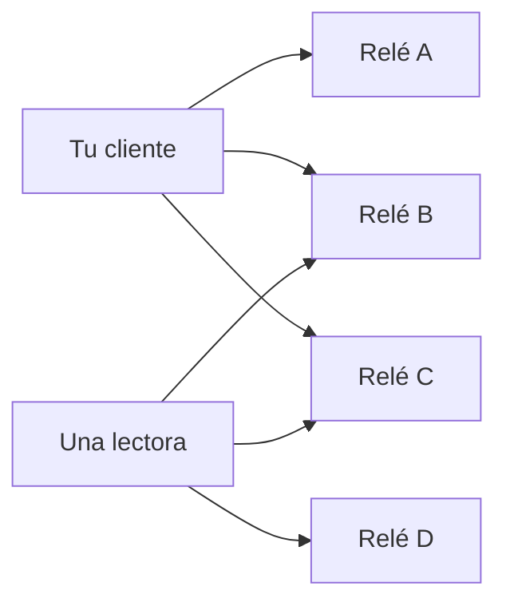

# Elegir relés

!!! info "Objetivos de aprendizaje"
    Al terminar podrás:

    - Explicar qué **es** un relé (y qué no es)
    - Inspeccionar la política pública de un relé con [NIP-11](https://github.com/nostr-protocol/nips/blob/master/11.md)
    - Escribir en **varios** relés para que un operador no te silencie
    - Anunciar relés de lectura/escritura con [NIP-65](https://github.com/nostr-protocol/nips/blob/master/65.md) — y saber **cuándo no**
    - Nombrar lo que un operador puede registrar (IP, filtros, eventos)

    Esta página es para **quien usa relés**. Operar uno es opcional y viene después: [Configuración de relé](relay-setup.md).

---

## Un relé es un buzón, no una plataforma

Los clientes abren un WebSocket a un relé y envían arreglos JSON definidos en [NIP-01](https://github.com/nostr-protocol/nips/blob/master/01.md):

| El cliente envía | Significa |
|------------------|-----------|
| `["EVENT", <evento>]` | Guarda y/o reenvía este evento firmado |
| `["REQ", <id>, <filtro>, …]` | Envíame eventos que coincidan |
| `["CLOSE", <id>]` | Cierra esa suscripción |

El relé responde con `EVENT`, `EOSE` (fin de eventos guardados), `OK` (aceptado o rechazado), `CLOSED` o `NOTICE`. **No puede** falsificar una nota con tu llave. **Sí puede** rechazar, tirar, retrasar o registrar.

La resistencia a la censura sale de **enviar el mismo evento firmado a más de un operador independiente**, no de encontrar un servidor perfectamente virtuoso.



Si A te banea, quien lee aún encuentra la nota en B y C — **si escribiste ahí**, y **si mira ahí**. Ese segundo “si” es la razón de las listas de relés.

---

## Lo que el operador puede ver

Asume que cada relé que uses puede registrar:

- Tu **IP** y la hora de conexión (salvo que usaras Tor/VPN **antes** del cliente)
- Eventos que **publicas**
- **Filtros** con los que te suscribes — a menudo “notas de la pubkey X”, lo que revela a quién lees
- Si completaste `AUTH` de [NIP-42](https://github.com/nostr-protocol/nips/blob/master/42.md) (entonces el relé también conoce tu **pubkey** en esa conexión)

Por lo general no pueden leer el **contenido** de un mensaje NIP-17 envuelto. Sí pueden ver que llegó un evento `kind 1059` desde alguna IP.

Los relés de pago o con autenticación pueden bajar el spam. También pueden exigir una factura Lightning o una cuenta a tu nombre legal. Es un trueque: menos basura, más vínculo.

---

## Inspecciona un relé antes de confiar { #nip-11 }

Los relés pueden publicar un documento JSON en la **misma URL HTTPS** que el WebSocket, cuando pides `Accept: application/nostr+json`.

```bash
curl -sH "Accept: application/nostr+json" https://relay.damus.io | jq '{
  name,
  description,
  pubkey,
  supported_nips,
  limitation
}'
```

Campos útiles de `limitation` ([NIP-11](https://github.com/nostr-protocol/nips/blob/master/11.md)):

| Campo | Por qué importa |
|-------|-----------------|
| `auth_required` | Puede que tengas que probar una pubkey (NIP-42) antes de hacer nada |
| `payment_required` | Escribir (o leer) puede costar sats — y un historial de billetera |
| `restricted_writes` | Lista blanca, tema u otra condición; no es un palco público |
| `min_pow_difficulty` | Las notas pueden exigir prueba de trabajo ([NIP-13](https://github.com/nostr-protocol/nips/blob/master/13.md)) |
| `relay_countries` | Jurisdicción. Mézclalas a propósito. |

`supported_nips` es una lista de enteros (`1` significa NIP-01). Los NIP solo de cliente anunciados aquí se pueden ignorar.

!!! tip "Los relés aparecen y desaparecen"
    No memorices una “mejor lista” de una captura. Inspecciona documentos NIP-11 en vivo. Índices públicos como [nostr.watch](https://nostr.watch) sirven para ver **si está vivo**, no si es virtuoso.

---

## Cuántos, y la idea de outbox (NIP-65)

[NIP-65](https://github.com/nostr-protocol/nips/blob/master/65.md) define eventos reemplazables `kind 10002`: relés a los que **escribes**, y relés donde **lees menciones**.

```json
{
  "kind": 10002,
  "tags": [
    ["r", "wss://alicerelay.example.com"],
    ["r", "wss://brando-relay.com"],
    ["r", "wss://expensive-relay.example2.com", "write"],
    ["r", "wss://nostr-relay.example.com", "read"]
  ],
  "content": ""
}
```

La especificación pide a los clientes mantener esta lista **pequeña** (unas 2–4 de cada tipo). Cuando alguien quiere **tus** notas, debería consultar tus relés de **escritura**. Cuando te mencionan, deberían enviar esa mención a tus relés de **lectura**.

**Trueque para personas en riesgo:** publicar `kind 10002` ayuda a que te encuentren. También le dice a un adversario **dónde vigilarte**. Puedes escribir a varios relés en el cliente **sin** publicar la lista. Visibilidad frente a un mapa más chico — elige con tu modelo de amenaza.

Los mensajes directos usan una lista **distinta**: `kind 10050` con etiquetas `relay` ([NIP-17](https://github.com/nostr-protocol/nips/blob/master/17.md)). Ver [Mensajes privados](private-messages.md).

---

## Mezcla práctica (por defecto para principiantes)

1. **Tres o más relés de escritura**, al menos dos jurisdicciones si puedes.
2. **Tor o VPN primero** si la nota no debe atarse a la IP de casa o de la redacción.
3. Prefiere relés cuyo NIP-11 hayas leído (registro, pago, auth).
4. Después de publicar, **verifica en un relé al que no acabas de escribir** — o en un segundo cliente. Un visto verde en tu app no basta.
5. No pagues un relé desde una billetera KYC atada a un npub secreto.

Los relés de comunidad o familia sirven para un grupo **conocido**. Son un mal único hogar para un anuncio público: una redada, una laptop incautada, un admin enojado.

---

## Código: publicar a varios relés y ver quién aceptó

Esto firma **una vez** y envía el mismo evento a varios relés. Un rechazo en uno no es un baneo global.

=== "JavaScript (nostr-tools)"

    ```javascript
    import { generateSecretKey, finalizeEvent } from 'nostr-tools'
    import { SimplePool } from 'nostr-tools/pool'

    const sk = generateSecretKey()
    const event = finalizeEvent({
      kind: 1,
      created_at: Math.floor(Date.now() / 1000),
      tags: [],
      content: 'La misma nota firmada, varios buzones.',
    }, sk)

    const relays = [
      'wss://relay.damus.io',
      'wss://nos.lol',
      'wss://relay.primal.net',
    ]

    const pool = new SimplePool()
    const results = await Promise.allSettled(pool.publish(relays, event))
    results.forEach((r, i) => {
      console.log(relays[i], r.status)
    })
    pool.close(relays)
    ```

=== "Python (nostr-sdk)"

    ```python
    import asyncio
    from nostr_sdk import Client, EventBuilder, Keys, NostrSigner

    async def main():
        keys = Keys.generate()
        client = Client(NostrSigner.keys(keys))

        for url in (
            "wss://relay.damus.io",
            "wss://nos.lol",
            "wss://relay.primal.net",
        ):
            await client.add_relay(url)

        await client.connect()
        output = await client.send_event_builder(
            EventBuilder.text_note("La misma nota firmada, varios buzones.")
        )
        print("id:", output.id)
        print("aceptados:", output.success)
        print("rechazados:", output.failed)

    asyncio.run(main())
    ```

=== "Rust (nostr-sdk)"

    ```rust
    use nostr_sdk::prelude::*;

    #[tokio::main]
    async fn main() -> Result<()> {
        let keys = Keys::generate();
        let client = Client::builder().signer(keys).build();

        for url in [
            "wss://relay.damus.io",
            "wss://nos.lol",
            "wss://relay.primal.net",
        ] {
            client.add_relay(url).await?;
        }
        client.connect().await;

        let output = client
            .send_event_builder(EventBuilder::text_note(
                "La misma nota firmada, varios buzones.",
            ))
            .await?;

        println!("id: {}", output.id());
        println!("aceptados: {:?}", output.success);
        println!("rechazados: {:?}", output.failed);
        Ok(())
    }
    ```

=== "CLI (nak + NIP-11)"

    ```bash
    # Documento de política del relé (HTTPS, el mismo host que el WebSocket)
    curl -sH "Accept: application/nostr+json" https://relay.damus.io | jq '{name, limitation}'

    # Trae notas recientes de una llave pública (hex o npub) — sin iniciar sesión
    nak req -k 1 --limit 5 --author npub1… wss://relay.damus.io wss://nos.lol
    ```

---

## Ejercicios

!!! example "Ejercicio 1 — comparar NIP-11"
    Elige dos relés públicos. Descarga cada documento NIP-11. Anota: pago, auth, país si figura, y si la escritura parece abierta. Elige una mezcla, no dos clones.

!!! example "Ejercicio 2 — un buzón falla"
    Publica una nota de prueba a tres relés. Luego, en un segundo cliente, añade **solo** uno de esos relés y busca tu `npub`. Quítalo, añade **otro**, busca otra vez. Nota que “me banearon” en un servidor no es el fin de la identidad.

!!! example "Ejercicio 3 — el trueque del outbox"
    En tu cliente, encuentra la lista de relés. Decide con claridad: ¿vas a **publicar** `kind 10002` (más fácil que te encuentren) o a dejar la lista local (mapa más chico para un adversario)? Escribe la razón en papel junto a tu frase de amenaza.

---

## Siguiente

- [Publicar y verificar](../tutorials/publish-and-verify.md) — taller: prueba que una nota aterrizó, y qué hace de verdad “borrar”
- [Guía de campo](high-risk-users.md) — higiene de IP, fuentes, organizadores
- [Relés (concepto)](../concepts/relays.md) · [Módulo 4](../modules/module-04-relays-architecture.md)
