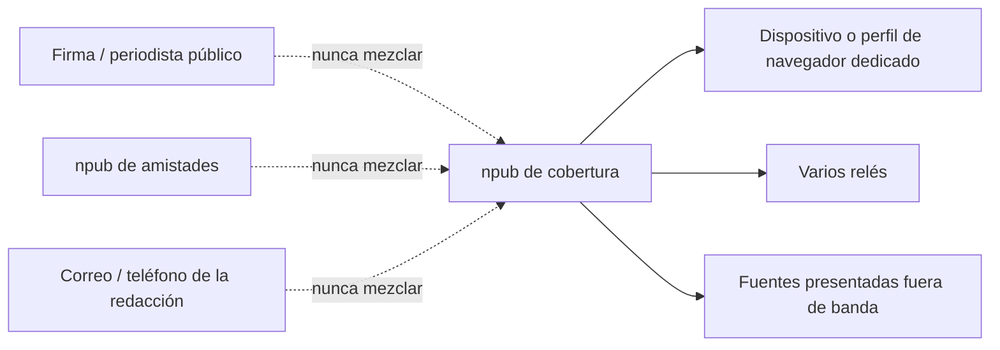

# Para periodistas y personas en riesgo

!!! info "Para quién es esta guía"
    Esto es una **guía de campo**, no un tutorial para programar. Sirve a periodistas, organizadores, investigadoras y cualquiera que necesite publicar o hablar **sin entregar a una empresa su nombre real, teléfono o grafo social**.

    No hace falta escribir código. Sí hace falta ser honesta/o sobre quién podría estar mirando.

    Al terminar deberías poder:

    - Armar un **modelo de amenaza** (quién, qué, por cuánto tiempo)
    - Crear un **compartimento**: una identidad Nostr que no sea tu firma, tu trabajo ni tu cuenta familiar
    - Elegir clientes, firmantes y relés para que un solo operador no te silencie ni te desenmascare
    - Hablar con fuentes sin filtrar su identidad por DM, follows o zaps
    - Saber qué Nostr **no** puede ocultar (IP, fotos, pagos, estilo de escritura, horarios)

!!! warning "Esto no es una garantía"
    Nostr te da **llaves portables** y **ninguna empresa única que pueda borrar tu cuenta en todo el mundo**. **No** te hace anónima/o.

    Los relés pueden registrar IPs. Las notas son públicas si no las cifras. Los pagos Lightning pueden atarse a exchanges con KYC. Una foto con un letrero de calle puede hacer más daño que una llave filtrada.

    Si enfrentas vigilancia dirigida, combina esto con alguien que entienda **tus** leyes y riesgos locales. Esta página es educación, no asesoría legal.

---

## 1. Modelo de amenaza (antes de instalar nada)

Escribe tres frases en papel:

1. **¿Quién** podría intentar desenmascararme o silenciarme? (policía, empleador, milicia, pareja violenta, una plataforma, trolls)
2. **¿Qué** pasa si lo logran? (perder el trabajo, detención, fuente quemada, familia en riesgo)
3. **¿Cuánto tiempo** debe vivir esta identidad? (una nota, una protesta, años)

Esa respuesta lo cambia todo. Documentar una manifestación pública no es lo mismo que esconderse de una pareja violenta.

### Qué protege Nostr de verdad

| Capacidad | ¿Protegido? | En la práctica |
|------------|------------|----------------|
| Que te usurpen la cuenta sin la llave | Sí | Nadie publica como tú sin el `nsec` |
| Que una app o un relé te banee | Parcial | Republicas en otros relés; no pueden borrar todas las copias |
| Probar que una nota salió de una llave | Sí | Las firmas se verifican |
| Ocultar *que* publicaste | No | Los eventos son públicos; se ven `pubkey` y `created_at` |
| Ocultar tu IP a los relés | No | Salvo Tor/VPN **antes** del cliente |
| Ocultar con quién hablas | No por defecto | Los DM viejos (NIP-04) filtran metadatos; prefiere NIP-17 |
| Recuperar una llave robada o perdida | No | No hay restablecer contraseña |

### Compartimentos, no “una cuenta para siempre”

Piensa en **cajas**:

Si la llave de campo se vincula a tu nombre, **quémala** y abre otra caja. No “rebrandees” el mismo `nsec`.

---

## 2. Identidad: llaves, perfiles y desenmascaramiento accidental

### Genera una llave nueva — y que sea aburrida

1. Créala **en el dispositivo que la va a usar**, o en una app firmante, no en una web.
2. Guarda el `nsec` **fuera de línea** (papel, metal). No capturas, no Fotos, no “mensajes guardados” de WhatsApp, no copias de seguridad del portátil del trabajo.
3. El perfil (`kind 0`) debe describir un **rol**, no a una persona: `Notas de campo · cobertura cívica`, avatar genérico, sin sitio web.
4. **No** agregues:

    - Tu nombre real, medio o ciudad si esa ciudad es poco común
    - Una dirección **NIP-05** en un dominio tuyo (el DNS es una etiqueta con nombre)
    - Una **dirección Lightning** de una wallet KYC a tu nombre legal
    - Un enlace a Twitter/Instagram/GitHub que ya esté atado a ti

5. Las listas de follows (`kind 3`) son públicas. Seguir tu npub público de periodista desde el npub de campo **los vincula**.

### Firmantes: nunca pegues `nsec` en la web

| Patrón | Úsalo cuando | Evita |
|---------|----------|--------|
| Llave en una app móvil (Damus, Amethyst) | Un teléfono dedicado | El mismo teléfono que tu iCloud/Google a nombre real |
| Extensión NIP-07 | Portátil + clientes web | Pegar `nsec` en Coracle/Snort |
| Firmante remoto (NIP-46, Amber, nsec.app) | Apps web sin entregarles la llave | Firmantes que no hayas verificado |

Si un sitio te pide pegar `nsec` para “entrar”, vete.

### Respaldo y muerte de una llave

- Dos copias en papel, en sitios físicos distintos, si la historia dura meses.
- Prueba restaurar **antes** de necesitarlo.
- Si decomisan el dispositivo, asume que la llave que había ahí está quemada. Rota. Avisa a las fuentes por **otro** canal.

---

## 3. Red y relés (aquí es donde más gente queda expuesta)

Los clientes abren un WebSocket a cada relé. Ese relé ve **tu IP** y **qué pubkeys pides**.

### Higiene de red práctica

- Activa **Tor o una VPN de confianza antes** de abrir el cliente Nostr. El orden importa.
- Prefiere clientes con **proxy**, o un dispositivo que ya esté en Tor.
- Una VPN “de privacidad” pagada con tu tarjeta personal es más débil que Tor para el anonimato; igual puede ocultar tu IP de casa al relé.
- No publiques el npub “secreto” desde el Wi‑Fi de la redacción.

### Cuántos relés, y cuáles

- **Escribe en varios** (idea de outbox): si uno te censura, otros conservan la nota.
- **Lee de varios**: un relé puede mentir por omisión.
- Mezcla jurisdicciones. Un relé amateur en tu ciudad recibe un oficio judicial más fácil que varios operadores lejanos.
- Relés de pago o autenticados bajan el spam; también pueden **exigir** una factura Lightning que te identifique. Sepa qué estás canjeando.
- La **lista de relés del cliente** a veces se publica (`kind 10002`). Eso indica a quien observa **dónde** mirarte.

### Qué puede ver quien opera un relé

- IP y hora de conexión
- Eventos que publicas
- Filtros a los que te suscribes (a menudo: “notas del pubkey X” — revela a quién lees)

Por lo general **no** pueden falsificar notas con tu llave. **Sí** pueden tirar tus notas, registrarte o entregar logs.

---

## 4. Publicar sin entregar la historia

### Escribe como si se leyera en un tribunal

- Sin ubicación en vivo, hotel, retén ni “acabo de aterrizar en…”.
- Sin fotos hasta **quitar EXIF** (GPS, modelo de teléfono, marca de tiempo). Mejor: no dispares con el mismo teléfono de tus cuentas a nombre real.
- Prefiere **texto** para lo urgente. El vídeo alimenta reconocimiento facial y geolocalización.
- Evita frases únicas que también uses en tu blog con firma (la estilometría basta para preocuparse).
- Los hashtags ayudan a descubrir **y** a buscar. Úsalos a propósito.

### Borrar no es borrar

NIP-09 pide a los relés que suelten un evento. Muchos no lo harán. Quedan archivos, otros relés y capturas. **Asume que lo público es para siempre.**

### Verificar sin doxxearte

El periodismo sigue necesitando credibilidad:

- Usa un **segundo** npub, claramente identificado, para el trabajo que firmarás con tu nombre.
- En el npub de campo, verifica hechos en el **texto** (IDs de documentos, URLs públicas, horas de eventos públicos), no “confía, estoy en X”.
- Los medios pueden publicar “contacta este npub primero por Signal” en una página **aparte**, no enlazada desde el perfil secreto.

---

## 5. Escenario: periodista y fuentes

**Objetivo:** cubrir una historia sensible; las fuentes no deben quedar a un follow list de distancia de quedar expuestas.

### Configuración

1. Dispositivo dedicado, o al menos un usuario del sistema / perfil de navegador dedicado.
2. Llave nueva + firmante. Respaldo en papel.
3. Perfil aburrido. Sin NIP-05, sin Lightning KYC.
4. 4+ relés. Primero Tor/VPN.
5. Presenta el npub a las fuentes **fuera de banda** (Signal, en persona, correo cifrado que ya uses) — no publicando “mándenme filtraciones por DM” en tu firma pública.

### DM: NIP-04 vs NIP-17 (en lenguaje claro)

- **NIP-04** (“DM cifrado” legado): el contenido va cifrado, pero a menudo se ve **que** A habló con B, y cuándo. Trátalo como una postal en un sobre: mejor que una nota pública, insuficiente para fuentes.
- **NIP-17 / gift wrap**: oculta gran parte de esos metadatos. Usa un cliente que lo implemente de verdad. Si el cliente es vago, asume NIP-04.

Aun así: una fuente que te sigue, te hace zap o da like desde **su** npub identificable se ató sola. Pídele también una **llave desechable**.

### Qué no hacer con fuentes

- No las agregues a una lista pública de follows.
- No las menciones con @.
- No les pidas instalar un APK que tú enviaste.
- No guardes nombres de fuentes en marcadores o listas públicas (`kind 30000` suele ser público).

### Quema

Si se compromete la llave, el dispositivo o una fuente: deja de publicar. Llave nueva. Nuevo perfil de dispositivo si hace falta. Avisa al resto por un canal que **no** sea Nostr.

---

## 6. Escenario: organizador

**Objetivo:** que la logística pública siga disponible aunque una tienda de apps o un relé entre en pánico; que el padrón no vaya al firehose.

### Tres llaves, tres trabajos

| Llave | ¿Pública? | Trabajo |
|-----|---------|-----|
| Difusión de la org | Sí | Hora, lugar, línea legal, apoyo mutuo — solo hechos |
| Núcleo / grupo de trabajo | No | Pocas personas; planificación |
| Personal | Quizá | Amistades. Nunca la acción. |

Publica el **mismo** anuncio en varios relés. Dirección y hora en **texto**, no solo en una gráfica.

No uses la llave de difusión para seguir a cada voluntaria — eso es una lista de miembros.

Si operas un relé comunitario: publica una **política** (logs, retención, proceso legal). Los borrados NIP-09 son de mejor esfuerzo.

Tras redadas o decomisos: rota la llave del núcleo. Trata el historial del grupo como expuesto.

---

## 7. Escenario: persona en riesgo (sin redacción ni informática)

**Objetivo:** hablar sin cuenta atada a un teléfono, en menos de una hora.

1. Perfil de navegador o usuario del teléfono nuevo. No tu Chrome de todos los días con Google.
2. Llave nueva. Papel. Nombre aburrido.
3. Cliente que **no exija** número de teléfono.
4. Tor o VPN **primero**.
5. Lee 20 minutos. Confirma que las notas aparecen en un segundo cliente (biblioteca, teléfono de alguien de confianza) antes de decir nada identificable.
6. Primeros posts: hechos públicos, sin selfies, sin trabajo, sin “soy la única de este turno”.

Si el riesgo es un adversario **personal** que conoce tu forma de escribir y tu ciudad, Nostr no es magia. Recorta detalles únicos. Prefiere documentar fuentes públicas, no un diario.

---

## 8. Dinero: zaps y por qué desenmascaran

Los zaps son pagos Lightning. Son útiles y **ruidosos**.

- Un zap desde una wallet KYC con tu pasaporte ata **este npub** a ti.
- Incluso wallets sin KYC filtran si las fondeaste desde un exchange personal.
- Recibir zaps en un perfil “secreto” anunciado en tu blog real une las dos identidades.

Si este compartimento debe seguir sin nombre: **desactiva Lightning en el perfil** y no hagas zap desde ahí.

---

## 9. Clientes (puntos de partida, no avales)

Verifica siempre quién publica la app. Esto cambia rápido:

- **iOS:** Damus, Primal  
- **Android:** Amethyst, Primal (F-Droid / sitio oficial, no APKs raros)  
- **Web:** Coracle, Snort — **solo** con firmante NIP-07  
- **Firmante:** extensión de navegador o app tipo Amber para que el sitio nunca tenga el `nsec`

Revisa permisos después de cada actualización.

---

## 10. Lista de incidente

Guárdala **en papel** (u otro dispositivo), no en el teléfono que tiene la llave.

!!! example "Antes de publicar"

    - [ ] Modelo de amenaza escrito (quién / qué / cuánto tiempo)
    - [ ] Llave nueva; no reutilizada de una cuenta pública
    - [ ] `nsec` fuera de línea; restauración probada
    - [ ] Sin nombre real, cara, NIP-05 ni Lightning KYC en el perfil
    - [ ] Sin follows que apunten a tu identidad real
    - [ ] Tor/VPN conectado *antes* del cliente
    - [ ] Varios relés, más de un país si puedes
    - [ ] Fuentes presentadas fuera de banda; también con llaves desechables
    - [ ] NIP-17 (o nada de DM) para lo sensible
    - [ ] Sin ubicación en vivo, sin EXIF, sin tu voz de firma en el npub secreto
    - [ ] Plan de rotación si decomisan el dispositivo

---

## Cómo se conecta con el resto de LearnNostr

- Primera hora (sin código): [Tu primera hora](first-session.md)
- Llaves y respaldos: [Llaves sin cuentas en la nube](keys-without-accounts.md) · [Llaves](../concepts/keys.md) · [Módulo 2](../modules/module-02-keys-identity.md)
- Relés: [Elegir relés](choose-relays.md) · [Relés](../concepts/relays.md) · [Módulo 4](../modules/module-04-relays-architecture.md)
- Probar que una nota aterrizó: [Publicar y verificar](../tutorials/publish-and-verify.md)
- Cifrado, DM, NIP-44 / NIP-17: [Mensajes privados](private-messages.md) · [Módulo 9: Seguridad y privacidad](../modules/module-09-security.md)
- Construir un cliente (técnico): [Construir un cliente simple](../tutorials/simple-client.md)
