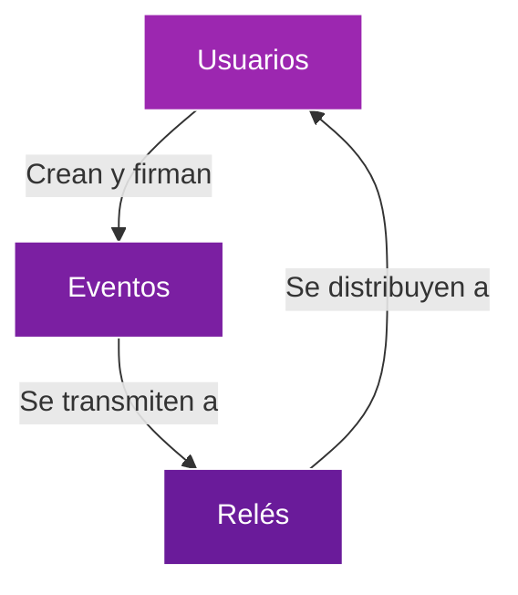

# Módulo 1: Introducción a Nostr

!!! info "Visión general del módulo"
    **Duración**: 2-3 horas  
    **Nivel**: Principiante  
    **Prerrequisitos**: Ninguno  
    **Objetivo**: Entender qué es Nostr, por qué existe y cómo funciona en lo fundamental

## 📋 Objetivos de aprendizaje

Al final de este módulo, podrás:

- ✅ Entender qué es Nostr y su filosofía central
- ✅ Conocer los problemas que Nostr resuelve
- ✅ Comprender la arquitectura básica
- ✅ Crear tu primera cuenta de Nostr
- ✅ Enviar tu primer mensaje en Nostr

## 1.1 ¿Qué es Nostr?

### El nombre

**Nostr** significa "**N**otes and **O**ther **S**tuff **T**ransmitted by **R**elays" (Notas y otras cosas transmitidas por relés). Es un protocolo simple y abierto que permite una red social global verdaderamente descentralizada y resistente a la censura.

### Concepto central

En esencia, Nostr es:

- **Un protocolo**, no una plataforma ni una empresa
- **Descentralizado**: ninguna entidad lo controla por sí sola
- **Simple**: se basa en ideas directas y fáciles de entender
- **Flexible**: sirve para muchas aplicaciones más allá de las redes sociales

!!! quote "Idea clave"
    "Nostr no es una app, es un protocolo: como el correo electrónico o la web. Cualquiera puede construir sobre él y nadie puede apagarlo."

## 1.2 Por qué existe Nostr

### Problemas de las redes sociales actuales

Las plataformas tradicionales de redes sociales enfrentan varios problemas críticos:

1. **Control centralizado**
   - Una sola empresa controla tus datos
   - Puede banear o censurar usuarios de forma arbitraria
   - Puede desaparecer y llevarse tu contenido consigo

2. **Propiedad de los datos**
   - Las plataformas son dueñas de tu contenido
   - No es fácil moverse de una plataforma a otra
   - Tu grafo social queda encerrado

3. **Censura**
   - Moderación de contenido por autoridades centrales
   - Estándares distintos según la región
   - El usuario no elige las políticas de moderación

4. **Portabilidad de identidad**
   - Los nombres de usuario están atados a una plataforma concreta
   - Hay que reconstruir los seguidores en cada red
   - No existe una identidad digital universal

### Las soluciones de Nostr

| Problema | Solución de Nostr |
|---------|---------------|
| Servidores centralizados | Múltiples relés independientes |
| Encierro en una plataforma | Identidad portable mediante claves criptográficas |
| Censura | Eliges tus propios relés y filtros |
| Propiedad de los datos | Tú firmas y eres dueño de tu contenido |
| Portabilidad de identidad | Una sola identidad funciona en todas partes |

## 1.3 Cómo funciona Nostr

### Los tres pilares



1. **Usuarios (clientes)**
   - Crean y consumen contenido
   - Guardan claves privadas para la identidad
   - Se conectan a varios relés

2. **Eventos**
   - Todos los datos en Nostr son un "evento"
   - Mensajes firmados criptográficamente
   - Contienen contenido, metadatos y una firma

3. **Relés**
   - Servidores simples que almacenan y reenvían eventos
   - Cualquiera puede operar un relé
   - Los usuarios eligen a qué relés conectarse

### Ejemplo sencillo de arquitectura

Imagina que Alice quiere enviar un mensaje:

1. Alice escribe "¡Hola Nostr!" en su cliente
2. Su cliente crea un evento y lo firma con su clave privada
3. El cliente envía ese evento a los relés que ella eligió
4. El cliente de Bob consulta esos relés en busca de eventos nuevos
5. Bob ve el mensaje de Alice y puede verificar que realmente es de ella

## 1.4 Innovaciones clave

### 1. Identidad criptográfica

En lugar de nombres de usuario, Nostr usa pares de claves criptográficas:

- **Clave privada**: tu contraseña secreta (¡nunca la compartas!)
- **Clave pública**: tu identidad, la que los demás ven

!!! warning "Importante"
    Tu clave privada ES tu identidad. Si la pierdes, pierdes la cuenta. Si alguien más la obtiene, puede hacerse pasar por ti.

### 2. Arquitectura cliente-relé

- **Clientes** son las apps que usas (como Damus, Amethyst, Snort)
- **Relés** son servidores que almacenan mensajes
- Puedes usar varios clientes con la misma identidad
- Puedes conectarte a varios relés para tener redundancia

### 3. Resistencia a la censura

- Ningún relé por sí solo puede censurarte por completo
- Si un relé te banea, usas otros
- Los usuarios eligen sus propios filtros de contenido
- La selección de relés funciona como un mercado

## 1.5 Práctica: tu primera experiencia con Nostr

### Paso 1: Elige un cliente

Clientes web populares para principiantes:

- [Snort.social](https://snort.social) - Cliente web con muchas funciones
- [Iris.to](https://iris.to) - Interfaz simple y limpia
- [Coracle.social](https://coracle.social) - Funciones avanzadas

### Paso 2: Crea tu cuenta

1. Visita el cliente que elegiste
2. Haz clic en "Create Account" o "Get Started"
3. **¡Guarda tu clave privada de inmediato!**

!!! danger "Crítico: guarda tus claves"
    ```
    Private Key (nsec): nsec1xxxxx... (NUNCA COMPARTAS ESTO)
    Public Key (npub): npub1xxxxx... (Esta es tu identidad pública)
    ```
    ¡Guarda tu clave privada en un gestor de contraseñas o anótala de forma segura!

### Paso 3: Completa tu perfil

- Añade un nombre para mostrar
- Escribe una bio corta
- Añade una foto de perfil (opcional)
- Configura una dirección Lightning para propinas (opcional)

### Paso 4: Envía tu primera nota

1. Busca el botón de redactar/publicar
2. Escribe tu primer mensaje: "Hello #Nostr! Just joined this decentralized network 🚀"
3. Haz clic en enviar/publicar

### Paso 5: Sigue a otras personas y explora

Cuentas recomendadas para seguir:
- Desarrolladores y constructores de Nostr
- Creadores de contenido de tus temas de interés
- Cuentas de noticias y actualizaciones

## 1.6 Ejercicios prácticos

### Ejercicio 1: Experiencia con varios clientes
1. Inicia sesión en un segundo cliente usando tu clave privada
2. Observa cómo tu perfil y tus publicaciones aparecen de inmediato
3. Publica desde un cliente y míralo en el otro

### Ejercicio 2: Exploración de relés
1. Revisa qué relés está usando tu cliente (normalmente en ajustes)
2. Añade un relé nuevo: `wss://relay.damus.io`
3. Quita un relé y comprueba si sigues viendo contenido

### Ejercicio 3: Verificar un mensaje
1. Encuentra un mensaje de una cuenta popular
2. Busca marcas de verificación o indicadores
3. Entiende cómo la firma demuestra autenticidad

## 1.7 Ideas erróneas comunes

| Idea errónea | Realidad |
|--------------|---------|
| "Nostr es solo otra app de redes sociales" | Nostr es un protocolo; las apps son solo clientes |
| "Solo es para gente de Bitcoin/crypto" | Nostr es para todos; la integración con Bitcoin es opcional |
| "Es demasiado técnico para usuarios normales" | Los clientes modernos son tan fáciles como las redes sociales tradicionales |
| "No hay moderación" | Usuarios y relés pueden implementar su propia moderación |
| "No puede escalar" | La arquitectura de Nostr permite el escalado horizontal |

## 1.8 Casos de uso más allá de las redes sociales

Nostr no se limita a las redes sociales:

- **Mensajería**: mensajes directos cifrados
- **Blogging**: plataformas de contenido largo
- **Marketplace**: comercio descentralizado
- **Juegos**: puntuaciones altas y logros
- **Identidad**: sistema de inicio de sesión universal
- **IoT**: comunicación de máquina a máquina

## 📝 Cuestionario del módulo 1

Pon a prueba lo que entendiste:

1. **¿Qué significa Nostr?**
   <details>
   <summary>Respuesta</summary>
   Notes and Other Stuff Transmitted by Relays (Notas y otras cosas transmitidas por relés)
   </details>

2. **¿Cuáles son los tres componentes principales de Nostr?**
   <details>
   <summary>Respuesta</summary>
   Usuarios (clientes), eventos y relés
   </details>

3. **¿Por qué es importante tu clave privada?**
   <details>
   <summary>Respuesta</summary>
   Es tu identidad y tu contraseña juntas: perderla significa perder la cuenta, y cualquiera que la tenga puede hacerse pasar por ti
   </details>

4. **¿Puede un solo relé censurarte por completo en Nostr?**
   <details>
   <summary>Respuesta</summary>
   No, porque puedes usar varios relés. Si uno te bloquea, otros pueden seguir distribuyendo tu contenido
   </details>

5. **¿Qué hace distinto a Nostr de Twitter o Facebook?**
   <details>
   <summary>Respuesta</summary>
   Nostr es un protocolo (no una empresa), está descentralizado (sin un único punto de control), da a los usuarios la propiedad de sus datos y ofrece portabilidad de identidad
   </details>

## 🎯 Punto de control del módulo 1

Antes de pasar al módulo 2, asegúrate de haber:

- [ ] Creado una cuenta de Nostr y guardado tus claves de forma segura
- [ ] Publicado al menos una nota con éxito
- [ ] Iniciado sesión en dos clientes distintos con la misma clave
- [ ] Seguido al menos 5 cuentas
- [ ] Añadido o quitado al menos un relé
- [ ] Entendido la diferencia entre claves públicas y privadas

## 📚 Recursos adicionales

- [Documentación del protocolo Nostr](https://github.com/nostr-protocol/nostr)
- [Awesome Nostr](https://github.com/aljazceru/awesome-nostr) - Lista curada de recursos de Nostr
- [Nostr.how](https://nostr.how) - Guías para principiantes
- Video: ["What is Nostr?" Explained Simply](https://www.youtube.com/watch?v=example)

## 💬 Discusión comunitaria

Únete a nuestro Discord para hablar del módulo 1:
- Comparte tu primera experiencia con Nostr
- Haz preguntas sobre los conceptos
- Ayuda a otros principiantes
- Encuentra gente a quien seguir

---

!!! success "¡Felicitaciones!"
    ¡Completaste el módulo 1! Ya entiendes qué es Nostr, por qué importa y tienes experiencia práctica usándolo. ¡Listo para el módulo 2, donde profundizaremos en claves e identidad!

[Continuar al módulo 2: Claves e identidad →](module-02-keys-identity.md)
