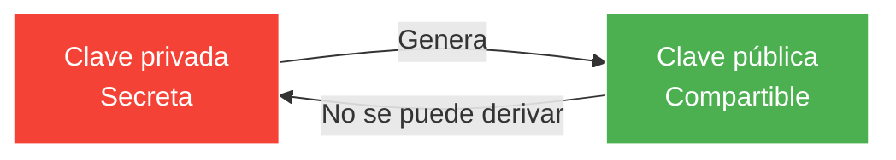
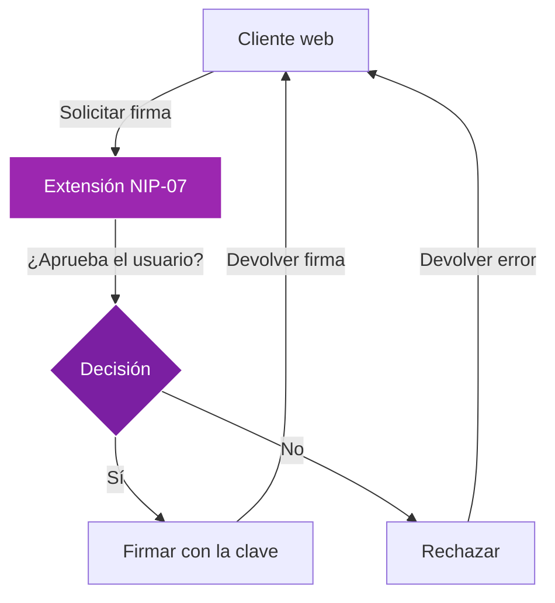

# Módulo 2: Claves e identidad

!!! info "Visión general del módulo"
    **Duración**: 3-4 horas  
    **Nivel**: Principiante  
    **Prerrequisitos**: Módulo 1 completado  
    **Objetivo**: Dominar el sistema de identidad criptográfica de Nostr y la gestión de claves

## 📋 Objetivos de aprendizaje

Al final de este módulo, podrás:

- ✅ Entender lo básico de la criptografía de clave pública
- ✅ Dominar los formatos de claves de Nostr (hex, npub, nsec)
- ✅ Aplicar prácticas seguras de gestión de claves
- ✅ Usar extensiones de navegador NIP-07
- ✅ Comprender los conceptos de delegación y rotación de claves
- ✅ Construir tu identidad criptográfica

## 2.1 Fundamentos de criptografía

### ¿Qué es la criptografía de clave pública?

La criptografía de clave pública usa un par de claves relacionadas matemáticamente:



**Propiedades clave:**
- **Relación unidireccional**: la clave pública se deriva de la privada, nunca al revés
- **Firmas digitales**: la clave privada firma, la pública verifica
- **Cifrado**: la clave pública cifra, la privada descifra

### Cómo funciona en Nostr

1. **Creación de identidad**
   ```
   Private Key → Public Key → Your Nostr Identity
   ```

2. **Firma de mensajes**
   ```
   Your Message + Private Key → Signed Event
   ```

3. **Verificación**
   ```
   Signed Event + Public Key → Verified as Authentic
   ```

!!! example "Analogía del mundo real"
    Piénsalo como un sello de lacre en una carta:
    - Tu clave privada es el sello único (¡guárdalo en secreto!)
    - Tu clave pública es el patrón que todos reconocen como tuyo
    - La impresión en lacre demuestra que la carta vino de ti

## 2.2 Formatos de claves de Nostr

### Entender las codificaciones de claves

Nostr usa distintos formatos para las mismas claves:

| Formato | Prefijo | Uso | Ejemplo |
|--------|--------|----------|---------|
| **Hex** | Ninguno | Formato crudo, 64 caracteres | `7e7e9c42a91b...` |
| **npub** | npub1 | Clave pública (se puede compartir) | `npub1xxxxx...` |
| **nsec** | nsec1 | Clave privada (¡SECRETA!) | `nsec1xxxxx...` |

### Codificación Bech32 (npub/nsec)

Nostr usa codificación Bech32 para una mejor experiencia de usuario:

- **Prefijo legible** (npub/nsec)
- **Detección de errores** incorporada
- **Sin distinción de mayúsculas** (excepto el prefijo)
- **Más corto** que hex al mostrarlo

### Ejemplo de conversión de claves

```javascript
// La misma clave en distintos formatos:
Hex Private:  "5426b5f89a7a5e1c8f4e9b5a8d7c3b2a1e9f8d7c6b5a4e3d2c1b0a9f8e7d6c5b"
nsec Format:  "nsec1gaafdhet7fu5uu38f8nf3lemlt5cj32kfduxsjwudxy8ehdrqmrs8ktqmz"

Hex Public:   "8e9f3d5c7b4a2e1f9d8c7b6a5e4d3c2b1a0f9e8d7c6b5a4e3d2c1b0a9f8e7d6c"
npub Format:  "npub136lsxmeac6fqslvce76n4y9swfvslf65d73hykgjvs5u5a089kwqg43ezk"
```

## 2.3 Generación de claves

### Métodos para generar claves

#### Método 1: Generación en el cliente (el más fácil)
La mayoría de los clientes de Nostr pueden generar claves por ti:
1. Haz clic en "Create New Account"
2. Las claves se generan en tu navegador
3. ¡Guárdalas de inmediato!

#### Método 2: Línea de comandos (técnico)
Usando `openssl`:
```bash
# Generar clave privada
openssl rand -hex 32

# O usando herramientas de Nostr
npm install -g nostr-tools
nostr-keygen
```

#### Método 3: Hardware wallets (el más seguro)
Algunas hardware wallets soportan Nostr:
- Generan claves fuera de línea
- Nunca exponen la clave privada a internet
- Firman eventos en el dispositivo

### Mejores prácticas de generación de claves

!!! danger "Reglas de seguridad"
    1. **Genera las claves fuera de línea** cuando sea posible
    2. **Usa aleatoriedad criptográficamente segura**
    3. **Nunca uses brain wallets** (claves derivadas de contraseñas)
    4. **No reutilices claves** para propósitos distintos
    5. **Genera claves de respaldo** para recuperación

## 2.4 Gestión de claves

### Opciones de almacenamiento

#### 🔒 Gestores de contraseñas (recomendado)
**Ventajas:**
- Almacenamiento cifrado
- Sincronización entre dispositivos
- Respaldo fácil

**Ejemplo de configuración (Bitwarden):**
1. Crea una nota segura nueva
2. Nombre: "Nostr Identity"
3. Añade campos:
   - nsec: `nsec1xxxxx...`
   - npub: `npub1xxxxx...`
   - Created: `2024-01-15`
   - Clients used: `Damus, Snort`

#### 📝 Respaldo físico (esencial)
**Mejores prácticas:**
- Escríbelo en papel con bolígrafo
- Guárdalo en una caja fuerte ignífuga
- Crea varias copias
- Considera un respaldo en metal para el largo plazo

**Plantilla:**
```
NOSTR IDENTITY BACKUP
Date: ___________
Private Key (nsec): _________________
Public Key (npub): __________________
Recovery Words (if applicable): ______
```

#### 🔐 Seguridad de hardware

**Almacenamiento en frío:**
- Computadora air-gapped
- Hardware wallet
- Unidad USB cifrada

**Configuración multifirma** (avanzado):
- Divide la clave en fragmentos
- Exige M-de-N fragmentos para reconstruirla
- Distribuye los fragmentos entre personas de confianza

### Amenazas de seguridad y mitigaciones

| Amenaza | Nivel de riesgo | Mitigación |
|--------|------------|------------|
| Sitios de phishing | Alto | Verifica siempre la URL, usa marcadores |
| Malware en el portapapeles | Medio | Usa extensiones de navegador, verifica las direcciones |
| Cliente comprometido | Medio | Usa clientes de confianza y de código abierto |
| Robo físico | Bajo-medio | Cifra los dispositivos, usa contraseñas fuertes |
| Ingeniería social | Alto | Nunca compartas el nsec, ni siquiera con "soporte" |

## 2.5 NIP-07: Firma con extensión de navegador

### ¿Qué es NIP-07?

NIP-07 define un estándar para que las extensiones de navegador gestionen las claves:

- **Las claves se quedan en la extensión** (nunca se exponen a los sitios web)
- **Firma basada en permisos** (tú apruebas cada acción)
- **Funciona en todos los clientes web**

### Extensiones NIP-07 populares

1. **Alby** (recomendada para principiantes)
   - Integración con wallet Lightning
   - Soporte de varias cuentas
   - Disponible para Chrome/Firefox/Edge

2. **nos2x** (mínima y segura)
   - Simple y enfocada
   - Código abierto
   - Firefox y Chrome

3. **Flamingo**
   - Funciones avanzadas
   - Soporte de derivación de claves
   - Amigable para desarrolladores

### Configurar Alby

**Instalación:**
1. Visita [getalby.com](https://getalby.com)
2. Instala la extensión del navegador
3. Crea una cuenta nueva o importa una existente

**Importar una clave existente:**
1. Haz clic en el icono de la extensión Alby
2. Selecciona "Import Nostr Key"
3. Pega tu clave `nsec`
4. Define una contraseña de gasto
5. Configura los permisos

**Uso con clientes:**
1. Visita cualquier cliente web de Nostr
2. Elige "Login with Extension"
3. Alby pide permiso
4. Aprueba y ya estás conectado

### Modelo de seguridad de NIP-07



## 2.6 Conceptos avanzados de identidad

### Delegación de claves (NIP-26)

La delegación permite un permiso temporal para que otra clave actúe en tu nombre:

**Casos de uso:**
- Gestores de redes sociales
- Servicios de publicación programada
- Acceso temporal desde un dispositivo

**Cómo funciona:**
1. Crea un token de delegación con tu clave principal
2. Especifica la pubkey delegada y las condiciones
3. La clave delegada puede publicar con prueba de delegación

### Estrategias de rotación de claves

Como Nostr ata la identidad a las claves, rotarlas es un desafío:

**Enfoque 1: Migración social**
1. Crea un par de claves nuevo
2. Anuncia la migración desde la cuenta antigua
3. Pide a tus seguidores que sigan la cuenta nueva
4. Mantén la cuenta antigua activa con una redirección

**Enfoque 2: Identidad con varias claves**
- Usa varias claves para distintos propósitos
- Profesional vs. personal
- Alta seguridad vs. conveniencia

### Verificación de identidad

**Métodos para demostrar que controlas una identidad:**

1. **Verificación entre plataformas**
   - Publica el mismo mensaje en Twitter/GitHub
   - Incluye tu npub de Nostr en la bio

2. **Verificación de dominio** (NIP-05)
   - Vincula tu npub a tu dominio
   - Ejemplo: `bob@example.com` → `npub1xxx...`

3. **Red de confianza (web of trust)**
   - Recibe el respaldo de cuentas conocidas
   - Construye reputación con el tiempo

## 2.7 Ejercicios prácticos

### Ejercicio 1: Conversión de formatos de clave
1. Toma tu clave pública en hex
2. Conviértela a formato npub a mano (o usa una herramienta)
3. Verifica que ambas representen la misma identidad

### Ejercicio 2: Crear un respaldo seguro
1. Crea un respaldo completo de tu identidad Nostr
2. Incluye:
   - Ambos formatos de clave
   - El identificador NIP-05 asociado
   - Lista de relés principales
   - Fecha de recuperación
3. Guárdalo en al menos dos lugares seguros

### Ejercicio 3: Configuración y prueba de NIP-07
1. Instala una extensión NIP-07
2. Importa tu clave
3. Inicia sesión en tres clientes web distintos usando solo la extensión
4. Configura distintos niveles de permiso

### Ejercicio 4: Verificación de identidad
1. Configura verificación NIP-05 (si tienes un dominio)
2. Verifícate de forma cruzada en otra plataforma
3. Consigue que al menos otro usuario te verifique

## 2.8 Escenarios de recuperación

### Escenario 1: Perdiste el gestor de contraseñas
**Prevención:**
- Respaldos cifrados periódicos
- Respaldo en papel físico
- Un contacto de confianza con un fragmento de recuperación

**Recuperación:**
- Revisa todos los lugares de respaldo
- Usa el respaldo físico para restaurar
- Crea una identidad nueva si realmente se perdió

### Escenario 2: Clave comprometida
**Acciones inmediatas:**
1. Crea un par de claves nuevo de inmediato
2. Publica una advertencia desde la cuenta comprometida (si es posible)
3. Avisa a tus contactos cercanos de forma directa
4. Actualiza todas las verificaciones NIP-05

### Escenario 3: Robo del dispositivo
**Si el dispositivo tenía las claves:**
1. Asume que las claves están comprometidas
2. Migra a una identidad nueva
3. Revoca cualquier delegación
4. Actualiza tus prácticas de seguridad

## 📝 Cuestionario del módulo 2

1. **¿Cuál es la relación entre las claves privada y pública?**
   <details>
   <summary>Respuesta</summary>
   La clave pública se deriva de la privada con una función criptográfica unidireccional. No puedes derivar la clave privada a partir de la pública.
   </details>

2. **¿Qué significa "nsec" y cuándo deberías compartirlo?**
   <details>
   <summary>Respuesta</summary>
   "nsec" es el formato Bech32 de las claves secretas (privadas) de Nostr. NUNCA deberías compartirlo con nadie ni con ningún servicio.
   </details>

3. **¿Qué es NIP-07 y por qué es importante?**
   <details>
   <summary>Respuesta</summary>
   NIP-07 es un estándar para que las extensiones de navegador gestionen las claves de Nostr de forma segura. Mantiene las claves privadas en la extensión, sin exponerlas a los sitios web, y permite firmar con permisos.
   </details>

4. **Nombra tres formas seguras de guardar tu clave privada de Nostr**
   <details>
   <summary>Respuesta</summary>
   1. Gestor de contraseñas cifrado (como Bitwarden)
   2. Respaldo en papel físico en una caja fuerte
   3. Hardware wallet o dispositivo air-gapped
   </details>

5. **¿Qué deberías hacer si tu clave privada queda comprometida?**
   <details>
   <summary>Respuesta</summary>
   Crea un par de claves nuevo de inmediato, avisa a tus seguidores desde la cuenta antigua si es posible, notifica a tus contactos cercanos, actualiza todas las verificaciones y migra a la identidad nueva.
   </details>

## 🎯 Punto de control del módulo 2

Antes de pasar al módulo 3, asegúrate de haber:

- [ ] Entendido la relación entre claves públicas y privadas
- [ ] Guardado tus claves en al menos dos lugares seguros
- [ ] Creado un respaldo físico de tus claves
- [ ] Instalado y configurado una extensión de navegador NIP-07
- [ ] Usado la extensión con éxito para iniciar sesión en varios clientes
- [ ] Configurado al menos una forma de verificación de identidad
- [ ] Practicado la conversión de formatos de clave
- [ ] Creado un plan de recuperación de claves

## 📚 Recursos adicionales

- [NIP-01: Basic Protocol](https://github.com/nostr-protocol/nips/blob/master/01.md)
- [NIP-07: Browser Extensions](https://github.com/nostr-protocol/nips/blob/master/07.md)
- [NIP-26: Delegated Event Signing](https://github.com/nostr-protocol/nips/blob/master/26.md)
- [Key Management Best Practices](https://github.com/nostr-protocol/nostr)
- Herramienta: [Nostr Army Knife](https://nak.nostr.com) - Utilidades de conversión de claves

## 💬 Discusión comunitaria

Únete a nuestro Discord para hablar del módulo 2:
- Comparte tus estrategias de gestión de claves
- Pide ayuda con la configuración de NIP-07
- Discute métodos de verificación de identidad
- Aprende de las prácticas de seguridad de otros

---

!!! success "¡Felicitaciones!"
    ¡Dominaste el sistema de identidad de Nostr! Ya entiendes las claves criptográficas, puedes gestionarlas de forma segura y usar funciones avanzadas como NIP-07. ¡Listo para el módulo 3, donde exploraremos cómo Nostr estructura y transmite los datos!

[Continuar al módulo 3: Eventos y mensajes →](module-03-events-messages.md)
