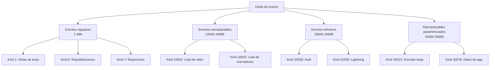
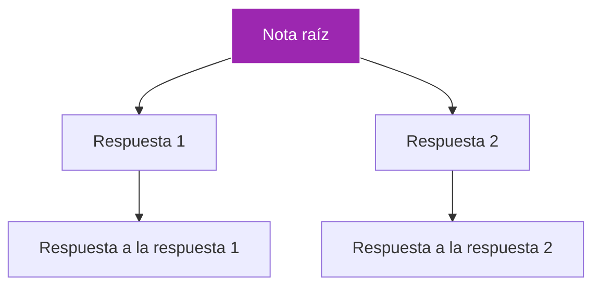

# Módulo 3: Eventos y mensajes

!!! info "Visión general del módulo"
    **Duración**: 4-5 horas  
    **Nivel**: Principiante-intermedio  
    **Prerrequisitos**: Módulos 1-2 completados  
    **Objetivo**: Dominar el sistema de eventos de Nostr, los tipos de mensaje y las estructuras de datos

## 📋 Objetivos de aprendizaje

Al final de este módulo, podrás:

- ✅ Entender la estructura de un evento Nostr y su formato JSON
- ✅ Dominar los distintos kinds de evento y sus propósitos
- ✅ Crear y validar eventos de forma programática
- ✅ Implementar filtros y suscripciones
- ✅ Manejar respuestas, menciones e hilos
- ✅ Trabajar con metadatos y tipos especiales de evento

## 3.1 Entender los eventos de Nostr

### ¿Qué es un evento?

En Nostr, **todo es un evento**. Un evento es un objeto JSON que contiene:

- **Contenido** (el mensaje o dato en sí)
- **Metadatos** (quién, cuándo, de qué tipo)
- **Firma criptográfica** (prueba de autenticidad)

```json
{
  "id": "4376c65d2f232afbe9b882a35baa4f6fe8667c4e684749af565f981833ed6a65",
  "pubkey": "6e468422dfb74a5738702a8823b9b28168abab8655faacb6853cd0ee15e3d882",
  "created_at": 1673347337,
  "kind": 1,
  "tags": [],
  "content": "Hello Nostr! This is my first event.",
  "sig": "908a15e46fb4d8675bab026fc230a0e3542bfade63da02d542fb78b2a8513fcd..."
}
```

### Campos del evento, explicados

| Campo | Tipo | Descripción | Requerido |
|-------|------|-------------|----------|
| `id` | string | Hash SHA256 del evento serializado | Sí |
| `pubkey` | string | Clave pública del autor (hex) | Sí |
| `created_at` | number | Timestamp Unix | Sí |
| `kind` | number | Tipo de evento (0, 1, 3, etc.) | Sí |
| `tags` | array | Metadatos y referencias | Sí |
| `content` | string | Contenido principal del evento | Sí |
| `sig` | string | Firma Schnorr | Sí |

### Cálculo del ID del evento

El ID del evento es un hash SHA256 de un formato serializado específico:

```javascript
// Formato de serialización para calcular el ID
[
  0,                    // Reservado para uso futuro
  pubkey,              // Clave pública del autor
  created_at,          // Timestamp Unix
  kind,                // Kind del evento
  tags,                // Array de tags
  content              // String de contenido
]
```

## 3.2 Kinds de evento

### Kinds estándar (NIP-01)

| Kind | Tipo | Descripción | Ejemplo de uso |
|------|------|-------------|-------------|
| 0 | Metadata | Información de perfil del usuario | Nombre, about, picture |
| 1 | Text Note | Mensaje de texto corto | Publicaciones de redes sociales |
| 2 | Recommend Relay | Recomendación de relé | (Obsoleto) |
| 3 | Contact List | Lista de seguidos | A quién sigues |
| 4 | Encrypted DM | Mensaje privado | Mensajes directos |
| 5 | Event Deletion | Solicitud de eliminación | Borrar tus publicaciones |
| 6 | Repost | Compartir la nota de alguien | Como un retweet |
| 7 | Reaction | Reaccionar al contenido | Likes, emojis |

### Kinds de evento extendidos



### Rangos de kind

- **0-999**: Eventos regulares (se almacenan y se transmiten)
- **1000-9999**: Eventos regulares (reservados para el futuro)
- **10000-19999**: Eventos reemplazables (solo se guarda el más reciente)
- **20000-29999**: Eventos efímeros (no se almacenan)
- **30000-39999**: Eventos reemplazables parametrizados

## 3.3 Trabajar con tags

### Estructura de las tags

Las tags son arrays dentro de arrays que añaden metadatos a los eventos:

```json
"tags": [
  ["e", "event_id", "relay_url", "marker"],
  ["p", "pubkey", "relay_url", "petname"],
  ["t", "hashtag"],
  ["r", "reference_url"]
]
```

### Tipos comunes de tag

| Tag | Nombre | Propósito | Ejemplo |
|-----|------|---------|---------|
| `e` | Event | Referenciar otro evento | Respuesta, mención de evento |
| `p` | Pubkey | Referenciar a un usuario | Mención, responder a |
| `t` | Hashtag | Etiqueta de tema | #nostr #bitcoin |
| `r` | Reference | Enlace externo | URL de un sitio web |
| `a` | Address | Referenciar un evento reemplazable | Artículo, lista |
| `d` | Identifier | Identificador único | Para eventos reemplazables |

### Ejemplos de tags en la práctica

#### Ejemplo 1: Responder a una nota
```json
{
  "kind": 1,
  "tags": [
    ["e", "original_event_id", "", "root"],
    ["e", "reply_to_event_id", "", "reply"],
    ["p", "original_author_pubkey", ""]
  ],
  "content": "Great point! I totally agree with this."
}
```

#### Ejemplo 2: Mencionar a alguien
```json
{
  "kind": 1,
  "tags": [
    ["p", "mentioned_user_pubkey", "", "Alice"]
  ],
  "content": "Hey @Alice, check this out!"
}
```

#### Ejemplo 3: Hashtags
```json
{
  "kind": 1,
  "tags": [
    ["t", "nostr"],
    ["t", "decentralized"],
    ["t", "freedom"]
  ],
  "content": "Learning about #nostr #decentralized #freedom"
}
```

## 3.4 Crear eventos de forma programática

### Usando JavaScript/TypeScript

```javascript
import { getPublicKey, getEventHash, signEvent } from 'nostr-tools';

// Tu clave privada (¡guárdala en secreto!)
const privateKey = 'your_hex_private_key_here';
const publicKey = getPublicKey(privateKey);

// Crear un evento
function createTextNote(content) {
  const event = {
    kind: 1,
    pubkey: publicKey,
    created_at: Math.floor(Date.now() / 1000),
    tags: [],
    content: content
  };
  
  // Calcular el ID del evento
  event.id = getEventHash(event);
  
  // Firmar el evento
  event.sig = signEvent(event, privateKey);
  
  return event;
}

// Crear una respuesta
function createReply(originalEventId, replyContent) {
  const event = {
    kind: 1,
    pubkey: publicKey,
    created_at: Math.floor(Date.now() / 1000),
    tags: [
      ['e', originalEventId, '', 'reply']
    ],
    content: replyContent
  };
  
  event.id = getEventHash(event);
  event.sig = signEvent(event, privateKey);
  
  return event;
}
```

### Validación de eventos

```javascript
import { verifySignature } from 'nostr-tools';

function validateEvent(event) {
  // Comprobar campos requeridos
  if (!event.id || !event.pubkey || !event.sig) {
    return { valid: false, error: 'Missing required fields' };
  }
  
  // Verificar firma
  if (!verifySignature(event)) {
    return { valid: false, error: 'Invalid signature' };
  }
  
  // Comprobar el ID del evento
  const calculatedId = getEventHash(event);
  if (event.id !== calculatedId) {
    return { valid: false, error: 'Invalid event ID' };
  }
  
  // Validar timestamp (no demasiado en el futuro)
  const now = Math.floor(Date.now() / 1000);
  if (event.created_at > now + 900) { // tolerancia de 15 minutos
    return { valid: false, error: 'Event timestamp too far in future' };
  }
  
  return { valid: true };
}
```

## 3.5 Eventos de metadatos (Kind 0)

### Estructura de la información de perfil

Los eventos de kind 0 contienen información de perfil del usuario en formato JSON:

```json
{
  "kind": 0,
  "content": "{\"name\":\"Alice\",\"about\":\"Nostr enthusiast\",\"picture\":\"https://example.com/alice.jpg\",\"nip05\":\"alice@example.com\",\"lud16\":\"alice@ln.tips\"}",
  "tags": []
}
```

### Campos estándar de metadatos

| Campo | Descripción | Ejemplo |
|-------|-------------|---------|
| `name` | Nombre para mostrar | "Alice" |
| `about` | Bio/descripción | "Bitcoin & Nostr developer" |
| `picture` | URL del avatar | "https://..." |
| `banner` | Imagen de portada | "https://..." |
| `nip05` | Verificación | "alice@example.com" |
| `lud16` | Dirección Lightning | "alice@ln.tips" |
| `website` | Sitio web personal | "https://alice.com" |

### Crear y actualizar el perfil

```javascript
function updateProfile(profileData) {
  const metadata = {
    name: profileData.name,
    about: profileData.about,
    picture: profileData.picture,
    nip05: profileData.nip05,
    lud16: profileData.lightning
  };
  
  const event = {
    kind: 0,
    pubkey: publicKey,
    created_at: Math.floor(Date.now() / 1000),
    tags: [],
    content: JSON.stringify(metadata)
  };
  
  event.id = getEventHash(event);
  event.sig = signEvent(event, privateKey);
  
  return event;
}
```

## 3.6 Filtros y suscripciones

### Entender los filtros

Los filtros le dicen a los relés qué eventos quieres recibir:

```json
{
  "ids": ["event_id1", "event_id2"],
  "authors": ["pubkey1", "pubkey2"],
  "kinds": [0, 1, 7],
  "since": 1673347337,
  "until": 1673347937,
  "limit": 100,
  "#t": ["nostr", "bitcoin"],
  "#p": ["pubkey_to_find"]
}
```

### Parámetros de filtro

| Parámetro | Tipo | Descripción |
|-----------|------|-------------|
| `ids` | string[] | IDs de eventos a obtener |
| `authors` | string[] | Claves públicas de los autores |
| `kinds` | number[] | Kinds de evento a obtener |
| `since` | number | Eventos posteriores a este timestamp |
| `until` | number | Eventos anteriores a este timestamp |
| `limit` | number | Máximo de eventos a devolver |
| `#e` | string[] | Eventos con estas tags e |
| `#p` | string[] | Eventos con estas tags p |
| `#t` | string[] | Eventos con estos hashtags |

### Ejemplos de suscripción

#### Obtener las notas recientes de un usuario
```javascript
const filter = {
  authors: ["user_pubkey"],
  kinds: [1],
  limit: 20
};
```

#### Obtener respuestas a un evento
```javascript
const filter = {
  kinds: [1],
  "#e": ["original_event_id"]
};
```

#### Obtener perfil y notas de un usuario
```javascript
const filters = [
  {
    authors: ["user_pubkey"],
    kinds: [0],  // Perfil
    limit: 1
  },
  {
    authors: ["user_pubkey"],
    kinds: [1],  // Notas
    limit: 50
  }
];
```

## 3.7 Trabajar con hilos

### Estructura de un hilo

Nostr usa tags `e` con marcadores para crear conversaciones en hilo:



### Marcadores de tag en hilos

- **`root`**: la nota original que inició el hilo
- **`reply`**: la nota a la que se responde de forma directa
- **`mention`**: solo se menciona un evento

### Crear una respuesta en un hilo

```javascript
function createThreadedReply(rootId, replyToId, content) {
  const event = {
    kind: 1,
    pubkey: publicKey,
    created_at: Math.floor(Date.now() / 1000),
    tags: [
      ['e', rootId, '', 'root'],
      ['e', replyToId, '', 'reply'],
      ['p', authorPubkey]  // Autor original
    ],
    content: content
  };
  
  event.id = getEventHash(event);
  event.sig = signEvent(event, privateKey);
  
  return event;
}
```

## 3.8 Tipos especiales de evento

### Mensajes directos cifrados (Kind 4)

```javascript
import { nip04 } from 'nostr-tools';

async function sendEncryptedMessage(recipientPubkey, message) {
  // Cifrar el mensaje
  const ciphertext = await nip04.encrypt(
    privateKey,
    recipientPubkey,
    message
  );
  
  const event = {
    kind: 4,
    pubkey: publicKey,
    created_at: Math.floor(Date.now() / 1000),
    tags: [['p', recipientPubkey]],
    content: ciphertext
  };
  
  event.id = getEventHash(event);
  event.sig = signEvent(event, privateKey);
  
  return event;
}
```

### Reacciones (Kind 7)

```javascript
function createReaction(eventId, reaction = '+') {
  const event = {
    kind: 7,
    pubkey: publicKey,
    created_at: Math.floor(Date.now() / 1000),
    tags: [
      ['e', eventId],
      ['p', authorPubkey]
    ],
    content: reaction  // '+', '-', '❤️', '🔥', etc.
  };
  
  event.id = getEventHash(event);
  event.sig = signEvent(event, privateKey);
  
  return event;
}
```

### Solicitudes de eliminación (Kind 5)

```javascript
function deleteEvents(eventIds, reason = '') {
  const event = {
    kind: 5,
    pubkey: publicKey,
    created_at: Math.floor(Date.now() / 1000),
    tags: eventIds.map(id => ['e', id]),
    content: reason
  };
  
  event.id = getEventHash(event);
  event.sig = signEvent(event, privateKey);
  
  return event;
}
```

## 3.9 Ejercicios prácticos

### Ejercicio 1: Crea tus primeros eventos
1. Crea una nota de texto (kind 1) con contenido
2. Crea un evento de metadatos de perfil (kind 0)
3. Verifica que ambos eventos tengan firmas válidas
4. Calcula y verifica los IDs de evento a mano

### Ejercicio 2: Construye una cadena de respuestas
1. Crea una nota original
2. Crea una respuesta a esa nota
3. Crea una respuesta a la respuesta
4. Usa correctamente los marcadores root y reply

### Ejercicio 3: Implementa menciones
1. Crea una nota que mencione a 3 usuarios
2. Usa tags `p` adecuadas para las menciones
3. Incluye marcadores de mención en el contenido
4. Prueba con direcciones npub reales

### Ejercicio 4: Trabaja con filtros
1. Crea un filtro para tus últimas 10 notas
2. Crea un filtro para todas las respuestas a un evento concreto
3. Crea un filtro para notas con hashtags específicos
4. Combina varios filtros en una sola suscripción

### Ejercicio 5: Validación de eventos
1. Escribe un validador de eventos completo
2. Pruébalo con eventos válidos
3. Pruébalo con firmas inválidas
4. Pruébalo con IDs de evento alterados

## 3.10 Patrones comunes

### Patrón de paginación
```javascript
// Cargar más eventos a medida que el usuario hace scroll
let lastTimestamp = Math.floor(Date.now() / 1000);

function loadMoreEvents() {
  const filter = {
    kinds: [1],
    until: lastTimestamp,
    limit: 20
  };
  
  // Actualizar lastTimestamp con el evento más antiguo recibido
  // para la siguiente petición de paginación
}
```

### Patrón de tiempo real + historial
```javascript
// Suscribirse a eventos nuevos y cargar historial
const now = Math.floor(Date.now() / 1000);

// Eventos históricos
const historyFilter = {
  kinds: [1],
  until: now,
  limit: 100
};

// Eventos en tiempo real
const realtimeFilter = {
  kinds: [1],
  since: now
};
```

### Patrón de caché de perfiles
```javascript
const profileCache = new Map();

async function getProfile(pubkey) {
  // Consultar la caché primero
  if (profileCache.has(pubkey)) {
    return profileCache.get(pubkey);
  }
  
  // Obtener del relé
  const filter = {
    authors: [pubkey],
    kinds: [0],
    limit: 1
  };
  
  // Guardar en caché
  profileCache.set(pubkey, profile);
  return profile;
}
```

## 📝 Cuestionario del módulo 3

1. **¿Cuáles son los campos requeridos en todo evento de Nostr?**
   <details>
   <summary>Respuesta</summary>
   id, pubkey, created_at, kind, tags, content y sig (firma)
   </details>

2. **¿Cómo se calcula el ID de un evento?**
   <details>
   <summary>Respuesta</summary>
   Es un hash SHA256 de un array serializado que contiene: [0, pubkey, created_at, kind, tags, content]
   </details>

3. **¿Cuál es la diferencia entre eventos de kind 1 y kind 0?**
   <details>
   <summary>Respuesta</summary>
   Kind 0 es para metadatos/información de perfil del usuario (reemplazable), mientras que kind 1 es para notas de texto/publicaciones (eventos regulares)
   </details>

4. **¿Qué tags usarías para crear una respuesta?**
   <details>
   <summary>Respuesta</summary>
   Usa tags 'e' con marcadores: una para la nota raíz (marcada como "root") y otra para la respuesta directa (marcada como "reply"), más una tag 'p' para el autor al que respondes
   </details>

5. **¿Cuál es la diferencia entre eventos reemplazables y efímeros?**
   <details>
   <summary>Respuesta</summary>
   Los eventos reemplazables (10000-19999) solo conservan la versión más reciente, mientras que los efímeros (20000-29999) no los almacenan los relés en absoluto
   </details>

## 🎯 Punto de control del módulo 3

Antes de continuar, asegúrate de haber:

- [ ] Creado y firmado eventos de forma programática
- [ ] Implementado validación de eventos
- [ ] Usado distintos kinds de evento (0, 1, 7)
- [ ] Creado respuestas con hilos correctos
- [ ] Implementado menciones usando tags
- [ ] Construido y probado varios filtros
- [ ] Trabajado con eventos de metadatos
- [ ] Entendido eventos reemplazables vs. regulares

## 📚 Recursos adicionales

- [NIP-01: Basic Protocol Flow](https://github.com/nostr-protocol/nips/blob/master/01.md)
- [Nostr Tools Library](https://github.com/nbd-wtf/nostr-tools)
- [Event Kind Registry](https://github.com/nostr-protocol/nips)
- [Nostr Event Inspector](https://nostr.com/events)
- Video: [Understanding Nostr Events Deep Dive](https://youtube.com/example)

## 💬 Discusión comunitaria

Únete a nuestro Discord para hablar del módulo 3:
- Comparte tu código de creación de eventos
- Depura problemas de validación de eventos
- Discute estrategias de hilos
- Aprende sobre tipos avanzados de evento

---

!!! success "¡Felicitaciones!"
    ¡Dominaste los eventos y mensajes de Nostr! Ya puedes crear, validar y trabajar con todo tipo de eventos. Entiendes tags, filtros y el ciclo de vida completo de un evento. ¡Estás listo para empezar a construir aplicaciones Nostr de verdad!

**Próximos pasos:**
- Módulo 4: Relés y arquitectura de red (próximamente)
- Módulo 5: Construye tu primer cliente Nostr (próximamente)
- Practica creando distintos tipos de evento
- Explora más NIPs para eventos especializados

[← Volver a los módulos](index.md)
