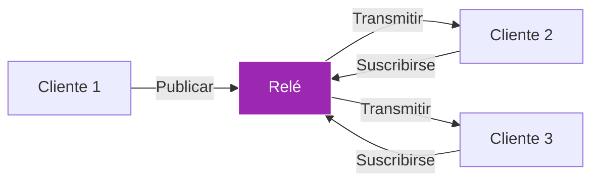
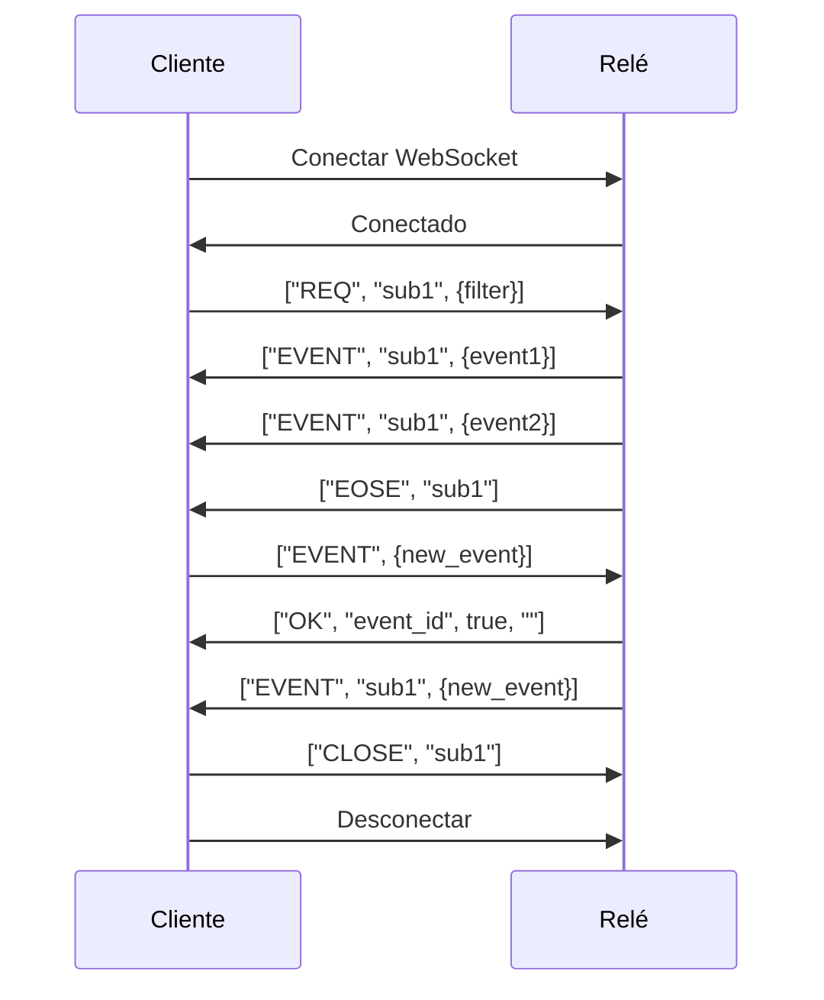
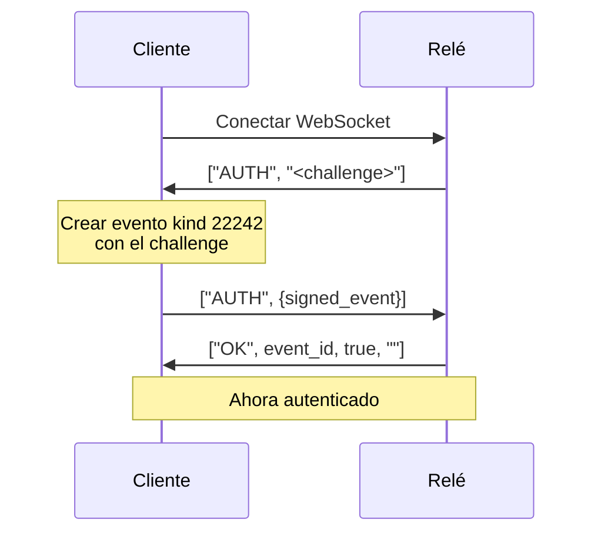

# Módulo 4: Relés y Arquitectura de Red

!!! info "Visión General del Módulo"
    **Duración**: 5-6 horas  
    **Nivel**: Intermedio  
    **Prerrequisitos**: Módulos 1-3 completados  
    **Objetivo**: Dominar la arquitectura de relés de Nostr, la topología de red y las estrategias de selección de relés

## 📋 Objetivos de Aprendizaje

Al final de este módulo, podrás:

- ✅ Entender la arquitectura de relés y los protocolos
- ✅ Dominar las conexiones WebSocket y el flujo de mensajes
- ✅ Implementar la gestión de un pool de relés
- ✅ Configurar estrategias de selección de relés
- ✅ Instalar y ejecutar tu propio relé
- ✅ Optimizar el rendimiento y la fiabilidad de la red

## 4.1 Entender los Relés

### ¿Qué es un Relé?

Un relé es un servidor sencillo que:
- **Acepta** eventos de los clientes
- **Almacena** eventos (según su política)
- **Reenvía** eventos a los clientes interesados
- **Filtra** eventos según las suscripciones



### Responsabilidades del Relé

| Función | Descripción | Implementación |
|----------|-------------|----------------|
| **Aceptar eventos** | Validar y almacenar eventos entrantes | Verificar firmas, aplicar políticas |
| **Almacenar eventos** | Persistir eventos en una base de datos | PostgreSQL, MongoDB, SQLite |
| **Consultar eventos** | Recuperar según filtros | Indexar por id, pubkey, kind, tags |
| **Transmitir** | Enviar eventos a los suscriptores | Conexiones WebSocket |
| **Aplicar políticas** | Hacer cumplir reglas y límites | Limitación de tasa, filtrado de contenido |

### Tipos de Relés

1. **Relés públicos**
   - Abiertos a todo el mundo
   - Gratuitos o de pago
   - Pueden tener políticas de contenido
   - Ejemplos: relay.damus.io, nos.lol

2. **Relés privados**
   - Acceso restringido
   - Lista blanca / solo por invitación
   - Personalizados para comunidades
   - Privacidad reforzada

3. **Relés especializados**
   - Contenido de formato largo
   - Almacenamiento de medios
   - Específicos de una zona geográfica
   - Enfocados en un tema

4. **Relés personales**
   - Operados por particulares
   - Control total
   - Almacenamiento de respaldo
   - Enfocados en la privacidad

## 4.2 Protocolo WebSocket

### Ciclo de Vida de la Conexión

```javascript
// Conectarse a un relé
const relay = new WebSocket('wss://relay.example.com');

// Estados de la conexión
relay.onopen = () => {
  console.log('Connected to relay');
};

relay.onmessage = (event) => {
  const message = JSON.parse(event.data);
  handleRelayMessage(message);
};

relay.onerror = (error) => {
  console.error('Relay error:', error);
};

relay.onclose = () => {
  console.log('Disconnected from relay');
  // Implementar lógica de reconexión
};
```

### Tipos de Mensajes

Nostr usa tres tipos principales de mensajes entre clientes y relés:

#### 1. Mensajes CLIENTE → RELÉ

**EVENT** - Publicar un evento:
```json
["EVENT", {event_object}]
```

**REQ** - Solicitar/suscribirse a eventos:
```json
["REQ", "subscription_id", {filter1}, {filter2}, ...]
```

**CLOSE** - Cancelar una suscripción:
```json
["CLOSE", "subscription_id"]
```

#### 2. Mensajes RELÉ → CLIENTE

**EVENT** - Enviar el evento solicitado:
```json
["EVENT", "subscription_id", {event_object}]
```

**OK** - Confirmar el estado del evento:
```json
["OK", "event_id", true, "message"]
```

**EOSE** - Fin de los eventos almacenados:
```json
["EOSE", "subscription_id"]
```

**NOTICE** - Mensaje del relé:
```json
["NOTICE", "message"]
```

**AUTH** - Autenticación requerida:
```json
["AUTH", "challenge"]
```

### Objetos de Filtro

Los filtros son objetos JSON usados en los mensajes `REQ` para especificar qué eventos quieres recibir. Entender los filtros es esencial para una comunicación eficiente con los relés.

#### Propiedades del Filtro

| Propiedad | Tipo | Descripción | Ejemplo |
|----------|------|-------------|---------|
| `ids` | array | IDs de eventos (coincidencia por prefijo) | `["abc123...", "def456..."]` |
| `authors` | array | Prefijos de pubkey | `["npub1abc..."]` |
| `kinds` | array | Números de kind de evento | `[0, 1, 3]` |
| `#e` | array | IDs de eventos referenciados | `["event_id"]` |
| `#p` | array | Pubkeys referenciadas | `["pubkey"]` |
| `#t` | array | Hashtags | `["bitcoin", "nostr"]` |
| `since` | integer | Timestamp Unix (inclusivo) | `1640000000` |
| `until` | integer | Timestamp Unix (inclusivo) | `1650000000` |
| `limit` | integer | Máximo de eventos a devolver | `100` |

#### Ejemplos de Filtros

```javascript
// Obtener todas las notas de texto de un usuario concreto
const userNotesFilter = {
  authors: ["user_pubkey"],
  kinds: [1],
  limit: 50
};

// Obtener el feed global reciente
const globalFeedFilter = {
  kinds: [1],
  since: Math.floor(Date.now() / 1000) - 3600, // Última hora
  limit: 100
};

// Obtener respuestas a una nota concreta
const repliesFilter = {
  kinds: [1],
  "#e": ["note_event_id"]
};

// Obtener perfil y metadatos del usuario
const profileFilter = {
  authors: ["user_pubkey"],
  kinds: [0, 3] // Metadatos y contactos
};

// Obtener eventos con hashtags concretos
const hashtagFilter = {
  kinds: [1],
  "#t": ["bitcoin", "nostr"],
  limit: 20
};

// Combinar varias condiciones
const complexFilter = {
  authors: ["user1", "user2", "user3"],
  kinds: [1, 6, 7], // Notas, reposts, reacciones
  since: 1640000000,
  limit: 100
};
```

#### Varios Filtros en una Sola Suscripción

Puedes pasar varios objetos de filtro en un único `REQ`: el resultado será la unión:

```javascript
// Suscribirse a notas de usuarios seguidos Y menciones a ti
relay.send([
  "REQ",
  "combined_feed",
  // Filtro 1: Notas de personas que sigo
  {
    authors: followedPubkeys,
    kinds: [1],
    limit: 50
  },
  // Filtro 2: Menciones a mí
  {
    "#p": [myPubkey],
    kinds: [1],
    limit: 20
  }
]);
```

### Flujo de Comunicación



## 4.3 Gestión del Pool de Relés

### ¿Por Qué Usar Varios Relés?

1. **Redundancia** - Si un relé cae
2. **Resistencia a la censura** - Sin un único punto de fallo
3. **Distribución geográfica** - Mejor latencia
4. **Disponibilidad de contenido** - Distintos relés tienen distintos eventos
5. **Balanceo de carga** - Distribuir el tráfico

### Implementar un Pool de Relés

```javascript
class RelayPool {
  constructor() {
    this.relays = new Map();
    this.subscriptions = new Map();
  }
  
  addRelay(url, options = {}) {
    if (this.relays.has(url)) return;
    
    const relay = {
      url,
      ws: null,
      status: 'disconnected',
      stats: {
        eventsReceived: 0,
        eventsSent: 0,
        latency: null
      },
      options
    };
    
    this.connect(relay);
    this.relays.set(url, relay);
  }
  
  connect(relay) {
    relay.ws = new WebSocket(relay.url);
    
    relay.ws.onopen = () => {
      relay.status = 'connected';
      console.log(`Connected to ${relay.url}`);
      this.syncSubscriptions(relay);
    };
    
    relay.ws.onmessage = (event) => {
      relay.stats.eventsReceived++;
      this.handleMessage(relay, JSON.parse(event.data));
    };
    
    relay.ws.onerror = (error) => {
      console.error(`Error with ${relay.url}:`, error);
      this.reconnect(relay);
    };
    
    relay.ws.onclose = () => {
      relay.status = 'disconnected';
      this.reconnect(relay);
    };
  }
  
  publish(event) {
    const results = [];
    
    this.relays.forEach((relay) => {
      if (relay.status === 'connected') {
        relay.ws.send(JSON.stringify(['EVENT', event]));
        relay.stats.eventsSent++;
        results.push({ relay: relay.url, status: 'sent' });
      }
    });
    
    return results;
  }
  
  subscribe(filters, callback, id = null) {
    const subId = id || Math.random().toString(36).substring(7);
    
    this.subscriptions.set(subId, {
      filters,
      callback,
      events: new Set() // Deduplicación
    });
    
    this.relays.forEach((relay) => {
      if (relay.status === 'connected') {
        relay.ws.send(JSON.stringify(['REQ', subId, ...filters]));
      }
    });
    
    return subId;
  }
  
  handleMessage(relay, message) {
    const [type, ...args] = message;
    
    switch (type) {
      case 'EVENT':
        const [subId, event] = args;
        const sub = this.subscriptions.get(subId);
        
        if (sub && !sub.events.has(event.id)) {
          sub.events.add(event.id);
          sub.callback(event, relay.url);
        }
        break;
        
      case 'EOSE':
        console.log(`End of stored events from ${relay.url}`);
        break;
        
      case 'OK':
        const [eventId, success, message] = args;
        console.log(`Event ${eventId}: ${success ? 'accepted' : 'rejected'} - ${message}`);
        break;
        
      case 'NOTICE':
        console.log(`Notice from ${relay.url}: ${args[0]}`);
        break;
    }
  }
  
  reconnect(relay, delay = 5000) {
    setTimeout(() => {
      console.log(`Reconnecting to ${relay.url}...`);
      this.connect(relay);
    }, delay);
  }
}
```

### Estrategias de Selección de Relés

#### 1. Estrategia Geográfica
```javascript
function selectRelaysByLocation(userLocation) {
  const relayLocations = {
    'wss://relay.damus.io': { lat: 37.7749, lon: -122.4194 }, // SF
    'wss://relay.nostr.band': { lat: 52.5200, lon: 13.4050 }, // Berlín
    'wss://relay.snort.social': { lat: 40.7128, lon: -74.0060 }, // NYC
  };
  
  return Object.entries(relayLocations)
    .map(([url, location]) => ({
      url,
      distance: calculateDistance(userLocation, location)
    }))
    .sort((a, b) => a.distance - b.distance)
    .slice(0, 3)
    .map(r => r.url);
}
```

#### 2. Estrategia de Rendimiento
```javascript
class PerformanceRelaySelector {
  constructor() {
    this.metrics = new Map();
  }
  
  updateMetrics(relayUrl, latency, uptime, eventsPerSecond) {
    this.metrics.set(relayUrl, {
      latency,
      uptime,
      eventsPerSecond,
      score: this.calculateScore(latency, uptime, eventsPerSecond)
    });
  }
  
  calculateScore(latency, uptime, eventsPerSecond) {
    return (uptime * 100) + (eventsPerSecond * 10) - (latency * 0.1);
  }
  
  selectBestRelays(count = 5) {
    return Array.from(this.metrics.entries())
      .sort((a, b) => b[1].score - a[1].score)
      .slice(0, count)
      .map(([url]) => url);
  }
}
```

#### 3. Estrategia de Contenido
```javascript
function selectRelaysByContent(desiredEventKinds) {
  const relaySpecialties = {
    'wss://relay.damus.io': [0, 1, 3, 7], // Propósito general
    'wss://relay.nostr.band': [1, 6, 7], // Contenido social
    'wss://nostr.wine': [0, 1, 30023], // Formato largo
    'wss://purplepag.es': [0, 3], // Perfiles
  };
  
  return Object.entries(relaySpecialties)
    .filter(([url, kinds]) => 
      desiredEventKinds.some(k => kinds.includes(k))
    )
    .map(([url]) => url);
}
```

## 4.4 Ejecutar Tu Propio Relé

### Implementaciones Populares de Relés

| Implementación | Lenguaje | Características | Ideal para |
|----------------|----------|----------|----------|
| **nostr-rs-relay** | Rust | Rápido, eficiente | Uso en producción |
| **strfry** | C++ | Alto rendimiento | Gran escala |
| **nostream** | TypeScript | Rico en funcionalidades | Personalización |
| **nostr-relay-nestjs** | TypeScript | Modular | Desarrollo |
| **knostr** | Kotlin | Ecosistema JVM | Desarrolladores Java |

### Configurar nostr-rs-relay

#### Paso 1: Instalación
```bash
# Usando Docker
docker pull scsibug/nostr-rs-relay
docker run -p 7000:8080 scsibug/nostr-rs-relay

# Desde el código fuente
git clone https://github.com/scsibug/nostr-rs-relay.git
cd nostr-rs-relay
cargo build --release
```

#### Paso 2: Configuración
```toml
# config.toml
[info]
relay_url = "wss://your-relay.com/"
name = "Your Relay Name"
description = "A Nostr relay"
pubkey = "your-hex-pubkey"
contact = "admin@your-relay.com"

[database]
engine = "sqlite"
data_directory = "./data"

[network]
port = 8080
address = "0.0.0.0"

[limits]
messages_per_sec = 10
max_event_bytes = 65536
max_ws_message_bytes = 131072
max_subscriptions = 20
max_filters = 100

[authorization]
pubkey_whitelist = []
pubkey_blacklist = []

[retention]
# Días para conservar eventos
default = 30
```

#### Paso 3: Proxy Inverso con Nginx
```nginx
server {
    listen 443 ssl http2;
    server_name relay.yoursite.com;
    
    ssl_certificate /path/to/cert.pem;
    ssl_certificate_key /path/to/key.pem;
    
    location / {
        proxy_pass http://localhost:8080;
        proxy_http_version 1.1;
        proxy_set_header Upgrade $http_upgrade;
        proxy_set_header Connection "upgrade";
        proxy_set_header Host $host;
        proxy_set_header X-Real-IP $remote_addr;
        proxy_set_header X-Forwarded-For $proxy_add_x_forwarded_for;
        proxy_set_header X-Forwarded-Proto $scheme;
        proxy_read_timeout 86400;
    }
}
```

### Políticas del Relé

#### Filtrado de Contenido
```javascript
// Ejemplo de implementación de política de relé
class RelayPolicy {
  constructor() {
    this.rules = [];
  }
  
  addRule(rule) {
    this.rules.push(rule);
  }
  
  async validateEvent(event) {
    for (const rule of this.rules) {
      const result = await rule.validate(event);
      if (!result.valid) {
        return {
          accepted: false,
          reason: result.reason
        };
      }
    }
    return { accepted: true };
  }
}

// Regla de filtro de spam
class SpamFilterRule {
  constructor() {
    this.recentEvents = new Map();
  }
  
  async validate(event) {
    const key = event.pubkey;
    const now = Date.now();
    
    if (!this.recentEvents.has(key)) {
      this.recentEvents.set(key, []);
    }
    
    const recent = this.recentEvents.get(key)
      .filter(time => now - time < 60000); // Último minuto
    
    if (recent.length > 10) {
      return {
        valid: false,
        reason: 'Rate limit exceeded'
      };
    }
    
    recent.push(now);
    this.recentEvents.set(key, recent);
    
    return { valid: true };
  }
}
```

### Autenticación en Relés (NIP-42)

Algunos relés requieren autenticación para acceder a ciertas funciones o contenido. NIP-42 define cómo los clientes se autentican con los relés.

#### Flujo de Autenticación



#### Evento de Autenticación (Kind 22242)

```javascript
async function authenticateToRelay(relay, challenge, privateKey) {
  const authEvent = {
    kind: 22242,
    created_at: Math.floor(Date.now() / 1000),
    tags: [
      ["relay", relay.url],
      ["challenge", challenge]
    ],
    content: ""
  };
  
  const signedEvent = finishEvent(authEvent, privateKey);
  
  relay.send(["AUTH", signedEvent]);
  
  return new Promise((resolve, reject) => {
    const timeout = setTimeout(() => {
      reject(new Error("Authentication timeout"));
    }, 5000);
    
    relay.once("message", (msg) => {
      const [type, eventId, success, message] = JSON.parse(msg.data);
      clearTimeout(timeout);
      
      if (type === "OK" && success) {
        resolve({ authenticated: true });
      } else {
        reject(new Error(`Authentication failed: ${message}`));
      }
    });
  });
}
```

#### Manejar Desafíos AUTH

```javascript
class AuthenticatedRelayConnection {
  constructor(url, privateKey) {
    this.url = url;
    this.privateKey = privateKey;
    this.authenticated = false;
    this.ws = null;
  }
  
  async connect() {
    this.ws = new WebSocket(this.url);
    
    return new Promise((resolve, reject) => {
      this.ws.onopen = () => {
        resolve();
      };
      
      this.ws.onerror = (error) => {
        reject(error);
      };
      
      this.ws.onmessage = async (event) => {
        const message = JSON.parse(event.data);
        
        if (message[0] === "AUTH") {
          const challenge = message[1];
          await this.handleAuthChallenge(challenge);
        }
      };
    });
  }
  
  async handleAuthChallenge(challenge) {
    const authEvent = {
      kind: 22242,
      created_at: Math.floor(Date.now() / 1000),
      tags: [
        ["relay", this.url],
        ["challenge", challenge]
      ],
      content: ""
    };
    
    const signedEvent = finishEvent(authEvent, this.privateKey);
    this.ws.send(JSON.stringify(["AUTH", signedEvent]));
    this.authenticated = true;
  }
  
  send(message) {
    if (this.ws.readyState === WebSocket.OPEN) {
      this.ws.send(JSON.stringify(message));
    } else {
      throw new Error("WebSocket not connected");
    }
  }
}

// Uso
const authedRelay = new AuthenticatedRelayConnection(
  'wss://private-relay.com',
  privateKey
);

await authedRelay.connect();
// El relé enviará un desafío AUTH y el cliente responderá automáticamente
// Ahora puedes usar el relé
authedRelay.send(["REQ", "sub1", { kinds: [1], limit: 10 }]);
```

#### Cuándo se Requiere Autenticación

Los relés pueden exigir autenticación para:
- **Contenido privado** - Acceso a eventos restringidos
- **Permisos de escritura** - Publicar eventos
- **Aumento de límites de tasa** - Límites más altos para usuarios autenticados
- **Funciones premium** - Capacidades especiales
- **Analítica** - Seguimiento de la actividad de usuarios autenticados

## 4.5 Topología de Red

### Descubrimiento de Relés

#### NIP-65: Metadatos de Lista de Relés
```javascript
// Los usuarios publican sus preferencias de relés
const relayListEvent = {
  kind: 10002,
  tags: [
    ["r", "wss://relay.damus.io", "read"],
    ["r", "wss://nos.lol", "write"],
    ["r", "wss://relay.nostr.band", "read"],
  ],
  content: ""
};
```

#### Modelo Gossip
```javascript
class GossipRelayDiscovery {
  constructor(pool) {
    this.pool = pool;
    this.discoveredRelays = new Set();
    this.userRelayMap = new Map();
  }
  
  async discoverRelaysForUser(pubkey) {
    // Obtener la lista de relés del usuario
    const filter = {
      authors: [pubkey],
      kinds: [10002],
      limit: 1
    };
    
    const relayList = await this.pool.queryOne(filter);
    
    if (relayList) {
      const relays = relayList.tags
        .filter(tag => tag[0] === 'r')
        .map(tag => ({
          url: tag[1],
          type: tag[2] || 'both'
        }));
      
      this.userRelayMap.set(pubkey, relays);
      relays.forEach(r => this.discoveredRelays.add(r.url));
      
      return relays;
    }
    
    return [];
  }
  
  async findUserAcrossRelays(pubkey) {
    // Consultar relés conocidos del usuario
    const relays = this.userRelayMap.get(pubkey) || [];
    
    if (relays.length === 0) {
      // Probar relés populares
      return this.tryPopularRelays(pubkey);
    }
    
    return relays.map(r => r.url);
  }
}
```

### Sincronización de Relés

```javascript
class RelaySyncManager {
  constructor(primaryRelay, backupRelays) {
    this.primary = primaryRelay;
    this.backups = backupRelays;
    this.syncedEvents = new Set();
  }
  
  async syncUserData(pubkey) {
    // Obtener todos los eventos del usuario desde el relé principal
    const events = await this.primary.query({
      authors: [pubkey]
    });
    
    // Sincronizar a los respaldos
    for (const backup of this.backups) {
      for (const event of events) {
        if (!this.syncedEvents.has(event.id)) {
          await backup.publish(event);
          this.syncedEvents.add(event.id);
        }
      }
    }
    
    return {
      eventsCount: events.length,
      syncedTo: this.backups.length
    };
  }
  
  async setupBidirectionalSync() {
    // Suscribirse a eventos nuevos en el relé principal
    this.primary.subscribe(
      [{ since: Math.floor(Date.now() / 1000) }],
      (event) => {
        // Reenviar a los respaldos
        this.backups.forEach(backup => {
          backup.publish(event);
        });
      }
    );
    
    // Suscribirse a los respaldos
    this.backups.forEach(backup => {
      backup.subscribe(
        [{ since: Math.floor(Date.now() / 1000) }],
        (event) => {
          // Reenviar al principal y a los demás respaldos
          this.primary.publish(event);
          this.backups
            .filter(b => b !== backup)
            .forEach(b => b.publish(event));
        }
      );
    });
  }
}
```

## 4.6 Optimización de Rendimiento

### Gestión de Conexiones

```javascript
class OptimizedRelayConnection {
  constructor(url) {
    this.url = url;
    this.ws = null;
    this.messageQueue = [];
    this.reconnectDelay = 1000;
    this.maxReconnectDelay = 30000;
    this.pingInterval = null;
  }
  
  connect() {
    this.ws = new WebSocket(this.url);
    
    this.ws.onopen = () => {
      this.reconnectDelay = 1000;
      this.flushQueue();
      this.startPing();
    };
    
    this.ws.onclose = () => {
      this.stopPing();
      this.reconnect();
    };
  }
  
  startPing() {
    this.pingInterval = setInterval(() => {
      if (this.ws.readyState === WebSocket.OPEN) {
        this.ws.send('ping');
      }
    }, 30000);
  }
  
  stopPing() {
    if (this.pingInterval) {
      clearInterval(this.pingInterval);
      this.pingInterval = null;
    }
  }
  
  send(message) {
    if (this.ws.readyState === WebSocket.OPEN) {
      this.ws.send(JSON.stringify(message));
    } else {
      this.messageQueue.push(message);
    }
  }
  
  flushQueue() {
    while (this.messageQueue.length > 0) {
      const message = this.messageQueue.shift();
      this.ws.send(JSON.stringify(message));
    }
  }
  
  reconnect() {
    setTimeout(() => {
      this.connect();
      this.reconnectDelay = Math.min(
        this.reconnectDelay * 2,
        this.maxReconnectDelay
      );
    }, this.reconnectDelay);
  }
}
```

### Procesamiento por Lotes

```javascript
class BatchedRelayClient {
  constructor(relay) {
    this.relay = relay;
    this.eventBatch = [];
    this.batchSize = 10;
    this.batchTimeout = 100; // ms
    this.batchTimer = null;
  }
  
  publishEvent(event) {
    this.eventBatch.push(event);
    
    if (this.eventBatch.length >= this.batchSize) {
      this.flush();
    } else if (!this.batchTimer) {
      this.batchTimer = setTimeout(() => this.flush(), this.batchTimeout);
    }
  }
  
  flush() {
    if (this.batchTimer) {
      clearTimeout(this.batchTimer);
      this.batchTimer = null;
    }
    
    if (this.eventBatch.length === 0) return;
    
    const batch = this.eventBatch.splice(0);
    
    // Enviar todos los eventos de forma eficiente
    batch.forEach(event => {
      this.relay.send(['EVENT', event]);
    });
  }
}
```

### Estrategia de Caché

```javascript
class CachedRelayClient {
  constructor() {
    this.eventCache = new Map();
    this.profileCache = new Map();
    this.cacheExpiry = 5 * 60 * 1000; // 5 minutos
  }
  
  async getEvent(eventId, relay) {
    // Consultar primero la caché
    const cached = this.eventCache.get(eventId);
    if (cached && Date.now() - cached.timestamp < this.cacheExpiry) {
      return cached.event;
    }
    
    // Obtener desde el relé
    const event = await relay.queryOne({ ids: [eventId] });
    
    if (event) {
      this.eventCache.set(eventId, {
        event,
        timestamp: Date.now()
      });
    }
    
    return event;
  }
  
  async getProfile(pubkey, relay) {
    const cached = this.profileCache.get(pubkey);
    if (cached && Date.now() - cached.timestamp < this.cacheExpiry) {
      return cached.profile;
    }
    
    const profileEvent = await relay.queryOne({
      authors: [pubkey],
      kinds: [0],
      limit: 1
    });
    
    if (profileEvent) {
      const profile = JSON.parse(profileEvent.content);
      this.profileCache.set(pubkey, {
        profile,
        timestamp: Date.now()
      });
      return profile;
    }
    
    return null;
  }
  
  pruneCache() {
    const now = Date.now();
    
    for (const [key, value] of this.eventCache.entries()) {
      if (now - value.timestamp > this.cacheExpiry) {
        this.eventCache.delete(key);
      }
    }
    
    for (const [key, value] of this.profileCache.entries()) {
      if (now - value.timestamp > this.cacheExpiry) {
        this.profileCache.delete(key);
      }
    }
  }
}
```

## 4.7 Ejercicios Prácticos

### Ejercicio 1: Construir un Cliente de Relé
1. Crear una conexión WebSocket a un relé
2. Implementar todos los tipos de mensaje (EVENT, REQ, CLOSE)
3. Manejar la reconexión al desconectarse
4. Añadir un manejo de errores adecuado

### Ejercicio 2: Implementar un Pool de Relés
1. Conectarse a 3 relés distintos
2. Implementar deduplicación de eventos
3. Añadir monitorización de salud de los relés
4. Probar el failover cuando un relé se desconecta

### Ejercicio 3: Configurar Tu Propio Relé
1. Instalar nostr-rs-relay o strfry
2. Configurarlo con políticas personalizadas
3. Configurar SSL con Let's Encrypt
4. Probarlo con varios clientes

### Ejercicio 4: Descubrimiento de Relés
1. Implementar la obtención de listas de relés NIP-65
2. Descubrir relés a partir de los contactos del usuario
3. Construir un sistema de recomendación de relés
4. Probarlo con datos reales de Nostr

### Ejercicio 5: Pruebas de Rendimiento
1. Medir la latencia hacia distintos relés
2. Probar el caudal con publicación por lotes
3. Implementar y medir la eficacia de la caché
4. Crear una herramienta de benchmark de relés

## 4.8 Resolución de Problemas Comunes

### Problemas de Conexión

| Problema | Causa | Solución |
|-------|-------|----------|
| La conexión se cae | Inestabilidad de red | Implementar backoff exponencial |
| No se puede conectar | Problemas de firewall/SSL | Comprobar soporte WebSocket y certificados |
| Respuestas lentas | Alta latencia | Usar selección geográfica de relés |
| Eventos que faltan | El relé no los almacenó | Consultar varios relés |

### Problemas de Rendimiento

```javascript
// Herramienta de diagnóstico para el rendimiento de relés
class RelayDiagnostics {
  async runDiagnostics(relayUrl) {
    const results = {
      connectivity: false,
      latency: null,
      throughput: null,
      eventSupport: {},
      errors: []
    };
    
    try {
      // Probar la conexión
      const ws = new WebSocket(relayUrl);
      await new Promise((resolve, reject) => {
        ws.onopen = resolve;
        ws.onerror = reject;
        setTimeout(reject, 5000);
      });
      results.connectivity = true;
      
      // Probar la latencia
      const start = Date.now();
      ws.send(JSON.stringify(['REQ', 'test', { limit: 1 }]));
      await new Promise(resolve => {
        ws.onmessage = resolve;
        setTimeout(resolve, 5000);
      });
      results.latency = Date.now() - start;
      
      ws.close();
    } catch (error) {
      results.errors.push(error.message);
    }
    
    return results;
  }
}
```

## 📝 Cuestionario del Módulo 4

1. **¿Cuáles son los tres tipos principales de mensajes que los clientes envían a los relés?**
   <details>
   <summary>Respuesta</summary>
   EVENT (publicar), REQ (suscribirse/solicitar) y CLOSE (cerrar la suscripción)
   </details>

2. **¿Por qué deberías usar varios relés?**
   <details>
   <summary>Respuesta</summary>
   Por redundancia, resistencia a la censura, distribución geográfica, disponibilidad de contenido y balanceo de carga
   </details>

3. **¿Qué significa EOSE y cuándo se envía?**
   <details>
   <summary>Respuesta</summary>
   "End Of Stored Events" (fin de los eventos almacenados): lo envía el relé después de haber enviado todos los eventos almacenados que coinciden con una suscripción
   </details>

4. **¿Para qué se usa NIP-65?**
   <details>
   <summary>Respuesta</summary>
   Metadatos de Lista de Relés: permite a los usuarios publicar sus relés preferidos para lectura y escritura
   </details>

5. **¿Qué estrategias pueden optimizar el rendimiento de los relés?**
   <details>
   <summary>Respuesta</summary>
   Pool de conexiones, procesamiento por lotes, caché, selección geográfica e implementar reconexión con backoff exponencial
   </details>

## 🎯 Evaluación del Módulo 4

Antes de pasar al Módulo 5, asegúrate de haber:

- [ ] Conectado a varios relés vía WebSocket
- [ ] Implementado un gestor básico de pool de relés
- [ ] Instalado y configurado tu propio relé
- [ ] Manejando todos los tipos de mensaje de relé
- [ ] Implementado el descubrimiento de relés usando NIP-65
- [ ] Creado monitorización de rendimiento para relés
- [ ] Probado el failover y la redundancia
- [ ] Optimizado con caché y procesamiento por lotes

## 📚 Recursos Adicionales

- [NIP-01: Protocolo Básico](https://github.com/nostr-protocol/nips/blob/master/01.md)
- [NIP-65: Metadatos de Lista de Relés](https://github.com/nostr-protocol/nips/blob/master/65.md)
- [Lista de Implementaciones de Relés](https://github.com/aljazceru/awesome-nostr#relay-implementations)
- [Documentación de la API WebSocket](https://developer.mozilla.org/en-US/docs/Web/API/WebSocket)
- Herramienta: [Inspector de Información de Relés](https://nostr.watch)

## 💬 Discusión Comunitaria

Únete a nuestro Discord para discutir el Módulo 4:
- Comparte tu experiencia configurando un relé
- Obtén ayuda con la configuración de relés
- Discute estrategias de selección de relés
- Compara métricas de rendimiento de relés

---

!!! success "¡Felicitaciones!"
    ¡Has dominado la arquitectura de relés de Nostr! Entiendes la comunicación WebSocket, puedes gestionar pools de relés, ejecutar tu propio relé y optimizar el rendimiento de la red. ¡Estás listo para construir aplicaciones Nostr robustas!

[Continuar al Módulo 5: Construyendo Tu Primer Cliente Nostr →](module-05-building-client.md)
