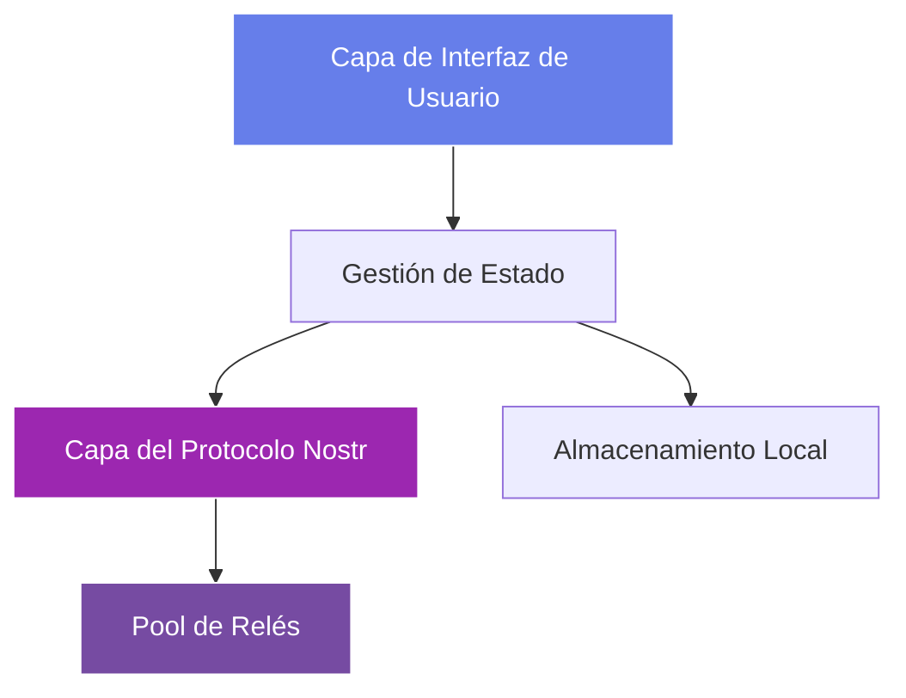

# Módulo 5: Construyendo Tu Primer Cliente Nostr

!!! info "Visión General del Módulo"
    **Duración**: 6-8 horas  
    **Nivel**: Intermedio  
    **Prerrequisitos**: Módulos 1-4 completados  
    **Objetivo**: Construir desde cero una aplicación cliente Nostr completa y lista para producción

## 📋 Objetivos de Aprendizaje

Al final de este módulo, podrás:

- ✅ Diseñar y arquitectar una aplicación cliente Nostr completa
- ✅ Implementar todas las funciones principales del cliente (publicar, leer, perfiles)
- ✅ Crear una interfaz de usuario intuitiva y responsiva
- ✅ Manejar actualizaciones en tiempo real y conexiones WebSocket
- ✅ Implementar un manejo de errores adecuado y casos límite
- ✅ Desplegar tu cliente a producción

## 5.1 Planificar Tu Cliente

### Definir Funcionalidades

Antes de escribir código, definamos qué funciones tendrá nuestro cliente:

**Funciones principales (imprescindibles)**
- ✅ Autenticación de usuario (generación/importación de claves)
- ✅ Crear y publicar notas
- ✅ Ver el feed global
- ✅ Ver perfiles de usuario
- ✅ Seguir/dejar de seguir usuarios
- ✅ Reaccionar a publicaciones (likes)
- ✅ Responder a publicaciones

**Funciones avanzadas (deseables)**
- 🔄 Visualización de hilos
- 🔄 Subida de medios
- 🔄 Funcionalidad de búsqueda
- 🔄 Gestión de relés
- 🔄 Notificaciones

### Visión General de la Arquitectura



## 5.2 Configuración del Proyecto

### Stack Tecnológico

Usaremos tecnologías web modernas:

- **Frontend**: HTML5, CSS3, JavaScript (ES6+)
- **Herramienta de build**: Vite
- **Biblioteca**: nostr-tools
- **Estilos**: CSS personalizado con variables CSS
- **Estado**: Vanilla JS con Proxy para reactividad

### Inicializar el Proyecto

```bash
# Crear el directorio del proyecto
mkdir nostr-client-pro
cd nostr-client-pro

# Inicializar npm
npm init -y

# Instalar dependencias
npm install nostr-tools
npm install --save-dev vite

# Crear la estructura del proyecto
mkdir -p src/{components,utils,services,styles}
touch src/main.js src/index.html
```

### Estructura del Proyecto

```
nostr-client-pro/
├── src/
│   ├── components/
│   │   ├── Auth.js          # Componente de autenticación
│   │   ├── Feed.js          # Componente de visualización del feed
│   │   ├── Composer.js      # Compositor de notas
│   │   ├── Profile.js       # Perfil de usuario
│   │   └── Header.js        # Cabecera de la app
│   ├── services/
│   │   ├── NostrService.js  # Capa del protocolo Nostr
│   │   ├── RelayPool.js     # Gestor de conexiones a relés
│   │   └── Storage.js       # Envoltorio de LocalStorage
│   ├── utils/
│   │   ├── helpers.js       # Funciones de utilidad
│   │   └── constants.js     # Constantes de la app
│   ├── styles/
│   │   ├── main.css         # Estilos principales
│   │   ├── components.css   # Estilos de componentes
│   │   └── theme.css        # Variables de tema
│   ├── main.js              # Punto de entrada de la app
│   └── index.html           # Plantilla HTML
├── package.json
└── vite.config.js
```

## 5.3 Construir los Servicios Principales

### NostrService - Capa de Protocolo

Crea `src/services/NostrService.js`:

```javascript
import { generatePrivateKey, getPublicKey, finishEvent, nip19 } from 'nostr-tools'

class NostrService {
  constructor() {
    this.privateKey = null
    this.publicKey = null
  }

  // Generar claves nuevas
  generateKeys() {
    this.privateKey = generatePrivateKey()
    this.publicKey = getPublicKey(this.privateKey)
    return {
      privateKey: this.privateKey,
      publicKey: this.publicKey,
      npub: nip19.npubEncode(this.publicKey),
      nsec: nip19.nsecEncode(this.privateKey)
    }
  }

  // Importar claves
  importKeys(privateKey) {
    // Manejar tanto formato hex como nsec
    if (privateKey.startsWith('nsec')) {
      const decoded = nip19.decode(privateKey)
      this.privateKey = decoded.data
    } else {
      this.privateKey = privateKey
    }
    this.publicKey = getPublicKey(this.privateKey)
    return this.getKeys()
  }

  // Obtener las claves actuales
  getKeys() {
    if (!this.publicKey) return null
    return {
      publicKey: this.publicKey,
      npub: nip19.npubEncode(this.publicKey)
    }
  }

  // Crear una nota de texto
  createTextNote(content, tags = []) {
    if (!this.privateKey) throw new Error('No keys loaded')
    
    return finishEvent({
      kind: 1,
      created_at: Math.floor(Date.now() / 1000),
      tags: tags,
      content: content,
    }, this.privateKey)
  }

  // Crear una respuesta
  createReply(content, originalEvent) {
    const tags = [
      ['e', originalEvent.id, '', 'reply'],
      ['p', originalEvent.pubkey]
    ]
    
    // Añadir etiqueta root si esta es una respuesta anidada
    const rootTag = originalEvent.tags.find(t => t[0] === 'e' && t[3] === 'root')
    if (rootTag) {
      tags.unshift(['e', rootTag[1], '', 'root'])
    } else {
      tags[0][3] = 'root'
    }

    return this.createTextNote(content, tags)
  }

  // Crear una reacción
  createReaction(eventId, pubkey, emoji = '+') {
    if (!this.privateKey) throw new Error('No keys loaded')
    
    return finishEvent({
      kind: 7,
      created_at: Math.floor(Date.now() / 1000),
      tags: [
        ['e', eventId],
        ['p', pubkey]
      ],
      content: emoji,
    }, this.privateKey)
  }

  // Crear/actualizar perfil
  createProfile(metadata) {
    if (!this.privateKey) throw new Error('No keys loaded')
    
    return finishEvent({
      kind: 0,
      created_at: Math.floor(Date.now() / 1000),
      tags: [],
      content: JSON.stringify(metadata),
    }, this.privateKey)
  }

  // Crear lista de seguimiento
  createFollowList(pubkeys) {
    if (!this.privateKey) throw new Error('No keys loaded')
    
    const tags = pubkeys.map(pk => ['p', pk])
    
    return finishEvent({
      kind: 3,
      created_at: Math.floor(Date.now() / 1000),
      tags: tags,
      content: '',
    }, this.privateKey)
  }
}

export default new NostrService()
```

### RelayPool - Gestor de Conexiones

Crea `src/services/RelayPool.js`:

```javascript
import { relayInit } from 'nostr-tools'

class RelayPool {
  constructor() {
    this.relays = new Map()
    this.subscriptions = new Map()
    this.eventHandlers = new Map()
  }

  // Añadir y conectar a un relé
  async addRelay(url) {
    if (this.relays.has(url)) {
      return this.relays.get(url)
    }

    const relay = relayInit(url)
    
    relay.on('connect', () => {
      console.log(`✅ Connected to ${url}`)
      this.emit('relay:connect', { url })
    })

    relay.on('disconnect', () => {
      console.log(`❌ Disconnected from ${url}`)
      this.emit('relay:disconnect', { url })
    })

    relay.on('error', () => {
      console.log(`⚠️ Error with ${url}`)
      this.emit('relay:error', { url })
    })

    try {
      await relay.connect()
      this.relays.set(url, relay)
      return relay
    } catch (error) {
      console.error(`Failed to connect to ${url}:`, error)
      throw error
    }
  }

  // Quitar un relé
  removeRelay(url) {
    const relay = this.relays.get(url)
    if (relay) {
      relay.close()
      this.relays.delete(url)
    }
  }

  // Suscribirse a eventos
  subscribe(filters, onEvent, subId = null) {
    const id = subId || `sub_${Date.now()}`
    const subs = []

    for (const [url, relay] of this.relays) {
      if (relay.status !== 1) continue // Solo relés conectados
      
      try {
        const sub = relay.sub(filters)
        
        sub.on('event', (event) => {
          onEvent(event, url)
        })

        sub.on('eose', () => {
          this.emit('subscription:eose', { id, url })
        })

        subs.push({ relay: url, sub })
      } catch (error) {
        console.error(`Subscription error on ${url}:`, error)
      }
    }

    this.subscriptions.set(id, subs)
    return id
  }

  // Cancelar suscripción
  unsubscribe(subId) {
    const subs = this.subscriptions.get(subId)
    if (subs) {
      subs.forEach(({ sub }) => sub.unsub())
      this.subscriptions.delete(subId)
    }
  }

  // Publicar evento a todos los relés
  async publish(event) {
    const results = []

    for (const [url, relay] of this.relays) {
      if (relay.status !== 1) continue

      try {
        const pub = await relay.publish(event)
        results.push({ url, success: true, pub })
      } catch (error) {
        results.push({ url, success: false, error })
      }
    }

    return results
  }

  // Obtener relés conectados
  getConnectedRelays() {
    return Array.from(this.relays.entries())
      .filter(([_, relay]) => relay.status === 1)
      .map(([url]) => url)
  }

  // Emisor de eventos
  on(event, handler) {
    if (!this.eventHandlers.has(event)) {
      this.eventHandlers.set(event, [])
    }
    this.eventHandlers.get(event).push(handler)
  }

  emit(event, data) {
    const handlers = this.eventHandlers.get(event)
    if (handlers) {
      handlers.forEach(handler => handler(data))
    }
  }

  // Limpieza
  close() {
    this.subscriptions.forEach((_, id) => this.unsubscribe(id))
    this.relays.forEach(relay => relay.close())
    this.relays.clear()
  }
}

export default new RelayPool()
```

### Servicio de Almacenamiento

Crea `src/services/Storage.js`:

```javascript
class StorageService {
  constructor() {
    this.prefix = 'nostr_client_'
  }

  // Guardar datos
  set(key, value) {
    try {
      const serialized = JSON.stringify(value)
      localStorage.setItem(this.prefix + key, serialized)
      return true
    } catch (error) {
      console.error('Storage error:', error)
      return false
    }
  }

  // Obtener datos
  get(key) {
    try {
      const item = localStorage.getItem(this.prefix + key)
      return item ? JSON.parse(item) : null
    } catch (error) {
      console.error('Storage error:', error)
      return null
    }
  }

  // Eliminar datos
  remove(key) {
    localStorage.removeItem(this.prefix + key)
  }

  // Borrar todos los datos de la app
  clear() {
    const keys = Object.keys(localStorage)
    keys.forEach(key => {
      if (key.startsWith(this.prefix)) {
        localStorage.removeItem(key)
      }
    })
  }

  // Métodos de almacenamiento específicos
  saveKeys(keys) {
    return this.set('keys', keys)
  }

  getKeys() {
    return this.get('keys')
  }

  saveRelays(relays) {
    return this.set('relays', relays)
  }

  getRelays() {
    return this.get('relays') || [
      'wss://relay.damus.io',
      'wss://nos.lol',
      'wss://relay.snort.social',
      'wss://relay.nostr.band'
    ]
  }

  saveProfile(pubkey, profile) {
    const profiles = this.get('profiles') || {}
    profiles[pubkey] = profile
    return this.set('profiles', profiles)
  }

  getProfile(pubkey) {
    const profiles = this.get('profiles') || {}
    return profiles[pubkey]
  }

  saveFollowing(following) {
    return this.set('following', following)
  }

  getFollowing() {
    return this.get('following') || []
  }
}

export default new StorageService()
```

## 5.4 Gestión de Estado y Reactividad

### Crear un Sistema de Estado Reactivo

Antes de construir los componentes de UI, implementa un sistema sencillo de gestión de estado reactivo:

```javascript
// src/utils/state.js
class ReactiveState {
  constructor(initialState = {}) {
    this.listeners = new Map();
    this.state = new Proxy(initialState, {
      set: (target, property, value) => {
        const oldValue = target[property];
        target[property] = value;
        
        // Notificar a los listeners
        if (oldValue !== value) {
          this.notify(property, value, oldValue);
        }
        
        return true;
      }
    });
  }
  
  // Suscribirse a cambios de estado
  subscribe(property, callback) {
    if (!this.listeners.has(property)) {
      this.listeners.set(property, new Set());
    }
    this.listeners.get(property).add(callback);
    
    // Devolver función para cancelar la suscripción
    return () => {
      const listeners = this.listeners.get(property);
      if (listeners) {
        listeners.delete(callback);
      }
    };
  }
  
  // Notificar a todos los listeners de una propiedad
  notify(property, newValue, oldValue) {
    const listeners = this.listeners.get(property);
    if (listeners) {
      listeners.forEach(callback => callback(newValue, oldValue));
    }
    
    // También notificar a los listeners globales
    const globalListeners = this.listeners.get('*');
    if (globalListeners) {
      globalListeners.forEach(callback => 
        callback(property, newValue, oldValue)
      );
    }
  }
  
  // Obtener el valor actual del estado
  get(property) {
    return this.state[property];
  }
  
  // Establecer el valor del estado
  set(property, value) {
    this.state[property] = value;
  }
  
  // Actualizaciones por lotes
  update(updates) {
    Object.entries(updates).forEach(([key, value]) => {
      this.state[key] = value;
    });
  }
}

// Crear el estado global de la app
const appState = new ReactiveState({
  user: null,
  authenticated: false,
  loading: false,
  events: [],
  profiles: new Map(),
  following: new Set(),
  relays: [],
  currentView: 'feed',
  error: null
});

export default appState;
```

### Caché de Eventos y Deduplicación

```javascript
// src/utils/eventCache.js
class EventCache {
  constructor() {
    this.events = new Map();
    this.eventsByKind = new Map();
    this.eventsByAuthor = new Map();
    this.maxSize = 10000; // Evitar problemas de memoria
  }
  
  add(event) {
    // Comprobar si el evento ya existe
    if (this.events.has(event.id)) {
      return false; // Duplicado
    }
    
    // Añadir a la caché principal
    this.events.set(event.id, event);
    
    // Indexar por kind
    if (!this.eventsByKind.has(event.kind)) {
      this.eventsByKind.set(event.kind, new Set());
    }
    this.eventsByKind.get(event.kind).add(event.id);
    
    // Indexar por autor
    if (!this.eventsByAuthor.has(event.pubkey)) {
      this.eventsByAuthor.set(event.pubkey, new Set());
    }
    this.eventsByAuthor.get(event.pubkey).add(event.id);
    
    // Hacer cumplir el tamaño máximo
    if (this.events.size > this.maxSize) {
      this.evictOldest();
    }
    
    return true; // Evento nuevo añadido
  }
  
  get(eventId) {
    return this.events.get(eventId);
  }
  
  getByKind(kind) {
    const eventIds = this.eventsByKind.get(kind) || new Set();
    return Array.from(eventIds).map(id => this.events.get(id));
  }
  
  getByAuthor(pubkey) {
    const eventIds = this.eventsByAuthor.get(pubkey) || new Set();
    return Array.from(eventIds).map(id => this.events.get(id));
  }
  
  evictOldest() {
    // Encontrar el evento más antiguo
    let oldest = null;
    for (const event of this.events.values()) {
      if (!oldest || event.created_at < oldest.created_at) {
        oldest = event;
      }
    }
    
    if (oldest) {
      this.remove(oldest.id);
    }
  }
  
  remove(eventId) {
    const event = this.events.get(eventId);
    if (!event) return;
    
    this.events.delete(eventId);
    
    // Quitar de los índices
    const kindSet = this.eventsByKind.get(event.kind);
    if (kindSet) kindSet.delete(eventId);
    
    const authorSet = this.eventsByAuthor.get(event.pubkey);
    if (authorSet) authorSet.delete(eventId);
  }
  
  clear() {
    this.events.clear();
    this.eventsByKind.clear();
    this.eventsByAuthor.clear();
  }
  
  // Obtener feed ordenado
  getFeed(limit = 50) {
    return Array.from(this.events.values())
      .filter(e => e.kind === 1) // Solo notas de texto
      .sort((a, b) => b.created_at - a.created_at)
      .slice(0, limit);
  }
}

export default new EventCache();
```

### Caché de Perfiles

```javascript
// src/utils/profileCache.js
class ProfileCache {
  constructor() {
    this.profiles = new Map();
    this.pending = new Map(); // Evitar fetches duplicados
  }
  
  async get(pubkey, pool) {
    // Devolver de caché si está disponible
    if (this.profiles.has(pubkey)) {
      return this.profiles.get(pubkey);
    }
    
    // Comprobar si ya se está obteniendo
    if (this.pending.has(pubkey)) {
      return this.pending.get(pubkey);
    }
    
    // Obtener el perfil
    const promise = this.fetch(pubkey, pool);
    this.pending.set(pubkey, promise);
    
    try {
      const profile = await promise;
      this.profiles.set(pubkey, profile);
      return profile;
    } finally {
      this.pending.delete(pubkey);
    }
  }
  
  async fetch(pubkey, pool) {
    const events = await pool.query({
      kinds: [0],
      authors: [pubkey],
      limit: 1
    });
    
    if (events.length > 0) {
      try {
        return JSON.parse(events[0].content);
      } catch {
        return this.getDefaultProfile(pubkey);
      }
    }
    
    return this.getDefaultProfile(pubkey);
  }
  
  getDefaultProfile(pubkey) {
    return {
      name: pubkey.substring(0, 8) + '...',
      display_name: pubkey.substring(0, 8),
      about: '',
      picture: '',
      pubkey
    };
  }
  
  set(pubkey, profile) {
    this.profiles.set(pubkey, profile);
  }
  
  clear() {
    this.profiles.clear();
    this.pending.clear();
  }
}

export default new ProfileCache();
```

## 5.6 Manejo de Errores y Resiliencia

### Manejador de Errores Completo

```javascript
// src/utils/errorHandler.js
class ErrorHandler {
  constructor() {
    this.errors = [];
    this.maxErrors = 100;
    this.listeners = new Set();
  }
  
  handle(error, context = {}) {
    const errorObj = {
      message: error.message || String(error),
      stack: error.stack,
      timestamp: Date.now(),
      context,
      type: this.categorizeError(error)
    };
    
    this.errors.push(errorObj);
    if (this.errors.length > this.maxErrors) {
      this.errors.shift();
    }
    
    // Notificar a los listeners
    this.notify(errorObj);
    
    return errorObj;
  }
  
  categorizeError(error) {
    if (error.message?.includes('relay')) return 'RELAY_ERROR';
    if (error.message?.includes('signature')) return 'CRYPTO_ERROR';
    if (error.message?.includes('network')) return 'NETWORK_ERROR';
    if (error.message?.includes('timeout')) return 'TIMEOUT_ERROR';
    return 'UNKNOWN_ERROR';
  }
  
  subscribe(listener) {
    this.listeners.add(listener);
    return () => this.listeners.delete(listener);
  }
  
  notify(error) {
    this.listeners.forEach(listener => listener(error));
  }
}

export default new ErrorHandler();
```

### Lógica de Reintentos

```javascript
// src/utils/retryHandler.js
class RetryHandler {
  async retry(fn, options = {}) {
    const { maxRetries = 3, baseDelay = 1000 } = options;
    let lastError;
    
    for (let i = 0; i <= maxRetries; i++) {
      try {
        return await fn();
      } catch (error) {
        lastError = error;
        if (i < maxRetries) {
          await new Promise(r => setTimeout(r, baseDelay * Math.pow(2, i)));
        }
      }
    }
    throw lastError;
  }
}

export default new RetryHandler();
```

## 5.7 Construir los Componentes de UI

### Aplicación Principal

Crea `src/main.js`:

```javascript
import NostrService from './services/NostrService.js'
import RelayPool from './services/RelayPool.js'
import Storage from './services/Storage.js'
import './styles/main.css'

class NostrClient {
  constructor() {
    this.state = {
      authenticated: false,
      loading: false,
      currentView: 'feed',
      events: new Map(),
      profiles: new Map(),
      following: new Set()
    }

    this.init()
  }

  async init() {
    // Comprobar si hay claves guardadas
    const savedKeys = Storage.getKeys()
    if (savedKeys) {
      NostrService.importKeys(savedKeys.privateKey)
      this.state.authenticated = true
    }

    // Conectar a los relés
    const relays = Storage.getRelays()
    for (const relay of relays) {
      try {
        await RelayPool.addRelay(relay)
      } catch (error) {
        console.error(`Failed to add relay ${relay}`)
      }
    }

    // Cargar la lista de seguimiento
    const following = Storage.getFollowing()
    this.state.following = new Set(following)

    // Configurar la UI
    this.setupUI()

    if (this.state.authenticated) {
      this.showFeed()
      this.subscribeToFeed()
    } else {
      this.showAuth()
    }
  }

  setupUI() {
    // Implementaremos la UI real en la siguiente sección
    console.log('Setting up UI...')
  }

  showAuth() {
    document.getElementById('app').innerHTML = `
      <div class="auth-container">
        <h1>🔐 Welcome to Nostr</h1>
        <button id="generate-keys">Generate New Keys</button>
        <button id="import-keys">Import Existing Keys</button>
      </div>
    `

    document.getElementById('generate-keys').onclick = () => this.generateKeys()
    document.getElementById('import-keys').onclick = () => this.importKeys()
  }

  generateKeys() {
    const keys = NostrService.generateKeys()
    Storage.saveKeys(keys)
    this.state.authenticated = true
    
    alert(`Your keys have been generated!\n\nNPUB: ${keys.npub}\n\n⚠️ Save your NSEC key securely: ${keys.nsec}`)
    
    this.showFeed()
    this.subscribeToFeed()
  }

  importKeys() {
    const nsec = prompt('Enter your NSEC key:')
    if (nsec) {
      try {
        const keys = NostrService.importKeys(nsec)
        Storage.saveKeys({ privateKey: NostrService.privateKey })
        this.state.authenticated = true
        this.showFeed()
        this.subscribeToFeed()
      } catch (error) {
        alert('Invalid key format')
      }
    }
  }

  showFeed() {
    // Implementaremos la UI completa del feed a continuación
    console.log('Showing feed...')
  }

  subscribeToFeed() {
    const filters = [
      { kinds: [1], limit: 50 },
      { kinds: [0], limit: 100 },
      { kinds: [3], authors: [NostrService.publicKey], limit: 1 }
    ]

    RelayPool.subscribe(filters, (event) => {
      this.handleEvent(event)
    })
  }

  handleEvent(event) {
    switch (event.kind) {
      case 0: // Perfil
        this.state.profiles.set(event.pubkey, JSON.parse(event.content))
        break
      case 1: // Nota de texto
        this.state.events.set(event.id, event)
        break
      case 3: // Contactos
        if (event.pubkey === NostrService.publicKey) {
          const following = event.tags.filter(t => t[0] === 'p').map(t => t[1])
          this.state.following = new Set(following)
          Storage.saveFollowing(following)
        }
        break
    }
  }
}

// Inicializar la app
new NostrClient()
```

## 5.5 Ejercicios Prácticos

### Ejercicio 1: Completar la UI del Feed
Construye una visualización de feed completamente funcional:
1. Renderizar eventos en orden cronológico
2. Mostrar perfiles de autor con avatares
3. Mostrar marcas de tiempo relativas al momento actual
4. Añadir scroll infinito/paginación

### Ejercicio 2: Implementar la Publicación
Crea un compositor de notas:
1. Entrada de texto con contador de caracteres
2. Soporte para adjuntar imágenes
3. Sugerencias de etiquetas (@menciones)
4. Guardado de borradores en localStorage

### Ejercicio 3: Añadir Interacciones
Implementa funciones sociales:
1. Botones de like/reacción
2. Hilos de respuesta
3. Funcionalidad de repost
4. Opciones para compartir

### Ejercicio 4: Gestión de Perfiles
Construye la funcionalidad de perfiles:
1. Ver perfiles de usuario
2. Editar tu propio perfil
3. Seguir/dejar de seguir usuarios
4. Mostrar recuentos de seguidores

### Ejercicio 5: Manejo de Errores y UX
Pule la experiencia:
1. Estados de carga para todas las operaciones asíncronas
2. Mensajes de error con opciones de reintento
3. Detección y manejo de modo sin conexión
4. Notificaciones de éxito

## 📝 Cuestionario del Módulo 5

1. **¿Cuáles son las tres responsabilidades principales de un cliente Nostr?**
   <details>
   <summary>Respuesta</summary>
   1) Gestionar las claves criptográficas de forma segura, 2) Conectarse y comunicarse con los relés, 3) Crear, firmar y mostrar eventos con una interfaz amigable para el usuario
   </details>

2. **¿Por qué deberías conectarte a varios relés en un cliente?**
   <details>
   <summary>Respuesta</summary>
   Por redundancia (si uno cae), mejor descubrimiento de contenido (distintos relés tienen distintos eventos), resistencia a la censura y mejor rendimiento
   </details>

3. **¿Cuál es la forma recomendada de almacenar claves privadas en un cliente?**
   <details>
   <summary>Respuesta</summary>
   Nunca las almacenes en tu app: usa extensiones de navegador NIP-07 que mantienen las claves seguras y solo proporcionan capacidades de firma a la app
   </details>

4. **¿Cómo te aseguras de no perder eventos al suscribirte?**
   <details>
   <summary>Respuesta</summary>
   Usa filtros adecuados con timestamps `since`, maneja el mensaje EOSE para saber cuándo los eventos históricos están completos y mantén las suscripciones para actualizaciones en tiempo real
   </details>

5. **¿Qué consideraciones de gestión de estado son importantes para los clientes Nostr?**
   <details>
   <summary>Respuesta</summary>
   Deduplicación de eventos entre relés, caché para rendimiento, mantenimiento del estado de conexión, manejo del ciclo de vida de las suscripciones y persistencia de las preferencias del usuario
   </details>

## 🎯 Evaluación del Módulo 5

Antes de pasar al Módulo 6, asegúrate de haber:

- [ ] Construido un gestor de conexiones a relés funcional
- [ ] Implementado suscripción y consulta de eventos
- [ ] Creado una UI básica para mostrar eventos
- [ ] Integrado NIP-07 para la gestión de claves
- [ ] Publicado al menos un evento desde tu cliente
- [ ] Manejando actualizaciones de eventos en tiempo real
- [ ] Implementado un manejo de errores adecuado
- [ ] Probado tu cliente con varios relés

## 📚 Recursos Adicionales

- [Documentación de nostr-tools](https://github.com/nbd-wtf/nostr-tools)
- [Guía de Desarrollo de Clientes Nostr](https://github.com/nostr-protocol/nostr)
- [React Nostr Hooks](https://github.com/jesterui/react-nostr-hooks)
- [Vue Nostr Composables](https://github.com/supertestnet/vue-nostr)
- Clientes de ejemplo: [Damus](https://github.com/damus-io/damus), [Snort](https://github.com/v0l/snort), [Nostrudel](https://github.com/hzrd149/nostrudel)

## 💬 Discusión Comunitaria

Únete a nuestro Discord para discutir el Módulo 5:
- Comparte tus proyectos de cliente
- Obtén ayuda depurando conexiones a relés
- Discute buenas prácticas de UI/UX
- Muestra tus implementaciones

---

!!! success "¡Felicitaciones!"
    ¡Has construido tu primer cliente Nostr! Entiendes cómo conectarte a relés, gestionar eventos y crear interfaces de usuario para el protocolo Nostr. ¡Estás listo para explorar NIPs y funciones avanzadas!

[Continuar al Módulo 6: Tipos de Eventos Avanzados y NIPs →](module-06-advanced-nips.md)
