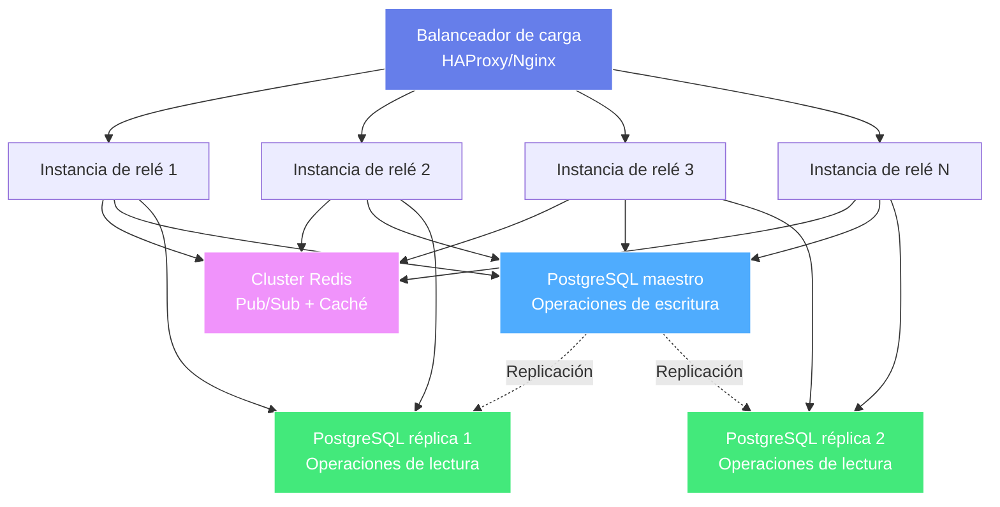

# Módulo 8: Escalado y Optimización del Rendimiento

!!! info "Visión General del Módulo"
    **Duración**: 8-10 horas  
    **Nivel**: Avanzado  
    **Prerrequisitos**: Módulo 7 completado  
    **Objetivo**: Escalar relés Nostr para atender a millones de usuarios con un rendimiento óptimo

## 📋 Objetivos de Aprendizaje

Al final de este módulo, serás capaz de:

- ✅ Implementar estrategias de escalado horizontal
- ✅ Diseñar y desplegar capas de caché
- ✅ Optimizar consultas e indexación de bases de datos
- ✅ Implementar balanceo de carga y failover
- ✅ Construir distribución de eventos estilo CDN
- ✅ Monitorear y optimizar cuellos de botella de rendimiento
- ✅ Implementar agrupación de conexiones y gestión de recursos
- ✅ Diseñar para la distribución geográfica

## 📚 Consideraciones de rendimiento a nivel de protocolo

### Estrategias de optimización basadas en NIPs

Comprender cómo distintos NIPs afectan el rendimiento del relé:

| NIP | Impacto en el rendimiento | Estrategia de optimización | Coste de recursos |
|-----|---------------------------|----------------------------|-------------------|
| **NIP-01** | Alto (núcleo) | Optimizar la validación de eventos | CPU: Medio, I/O: Alto |
| **NIP-02** | Bajo | Cachear listas de contactos | Memoria: Baja |
| **NIP-09** | Medio | Procesar eliminaciones de forma asíncrona | I/O: Medio |
| **NIP-11** | Despreciable | Servir archivo estático | Memoria: Mínima |
| **NIP-13** | Alto | Verificación de PoW | CPU: Alto |
| **NIP-42** | Medio | Gestión del estado de autenticación | Memoria: Media |
| **NIP-45** | Medio-Alto | Optimización de consultas COUNT | CPU: Medio, I/O: Medio |
| **NIP-50** | Muy alto | Índices de búsqueda de texto completo | I/O: Muy alto, Memoria: Alta |
| **NIP-51** | Bajo-Medio | Caché de listas | Memoria: Baja |
| **NIP-57** | Bajo | Reenviar a LNURL | Red: Baja |
| **NIP-65** | Bajo | Cachear listas de relés del usuario | Memoria: Baja |

### Optimización del procesamiento de eventos por kind

```javascript
// Optimizar el procesamiento según las características del evento
class PerformanceOptimizedEventHandler {
  constructor() {
    this.hotCache = new LRU(10000);  // Eventos recientes rápidos
    this.statsTracker = new EventStatsTracker();
  }
  
  async processEvent(event) {
    const kind = event.kind;
    const startTime = performance.now();
    
    // Enrutar al manejador optimizado según el rango de kind
    let result;
    
    if (kind >= 20000 && kind < 30000) {
      // Efímeros: omitir almacenamiento, solo difundir
      result = await this.handleEphemeral(event);
      
    } else if (kind >= 10000 && kind < 20000 || kind === 0 || kind === 3) {
      // Reemplazables: eliminar el antiguo, almacenar el nuevo
      result = await this.handleReplaceable(event);
      
    } else if (kind >= 30000 && kind < 40000) {
      // Reemplazables parametrizados: comprobar etiqueta d
      result = await this.handleParameterizedReplaceable(event);
      
    } else {
      // Eventos regulares: almacenamiento estándar
      result = await this.handleRegular(event);
    }
    
    // Registrar métricas de rendimiento
    const duration = performance.now() - startTime;
    this.statsTracker.record(kind, duration);
    
    return result;
  }
  
  async handleEphemeral(event) {
    // Sin acceso a la base de datos: solo difusión
    // Rendimiento: ~0.1ms por evento
    await this.broadcastToSubscribers(event);
    return { stored: false, broadcasted: true, ttl: 0 };
  }
  
  async handleReplaceable(event) {
    // Un DELETE + INSERT
    // Rendimiento: ~1-2ms por evento
    const key = `${event.pubkey}:${event.kind}`;
    
    // Consultar primero la caché
    const cached = this.hotCache.get(key);
    if (cached && cached.created_at >= event.created_at) {
      return { stored: false, reason: 'older_than_cached' };
    }
    
    // Usar UPSERT para un reemplazo atómico
    await this.db.query(`
      INSERT INTO events (id, pubkey, kind, created_at, content, tags, sig)
      VALUES ($1, $2, $3, $4, $5, $6, $7)
      ON CONFLICT (pubkey, kind) 
      DO UPDATE SET 
        id = EXCLUDED.id,
        created_at = EXCLUDED.created_at,
        content = EXCLUDED.content,
        tags = EXCLUDED.tags,
        sig = EXCLUDED.sig
      WHERE EXCLUDED.created_at > events.created_at
    `, [event.id, event.pubkey, event.kind, event.created_at, 
        event.content, JSON.stringify(event.tags), event.sig]);
    
    this.hotCache.set(key, event);
    await this.broadcastToSubscribers(event);
    
    return { stored: true, broadcasted: true };
  }
  
  async handleParameterizedReplaceable(event) {
    // Extraer la etiqueta d para el reemplazo parametrizado
    const dTag = event.tags.find(t => t[0] === 'd')?.[1] || '';
    const key = `${event.pubkey}:${event.kind}:${dTag}`;
    
    // Similar a reemplazable, pero con etiqueta d
    await this.db.query(`
      INSERT INTO events (id, pubkey, kind, d_tag, created_at, content, tags, sig)
      VALUES ($1, $2, $3, $4, $5, $6, $7, $8)
      ON CONFLICT (pubkey, kind, d_tag) 
      DO UPDATE SET 
        id = EXCLUDED.id,
        created_at = EXCLUDED.created_at,
        content = EXCLUDED.content,
        tags = EXCLUDED.tags,
        sig = EXCLUDED.sig
      WHERE EXCLUDED.created_at > events.created_at
    `, [event.id, event.pubkey, event.kind, dTag, event.created_at, 
        event.content, JSON.stringify(event.tags), event.sig]);
    
    this.hotCache.set(key, event);
    await this.broadcastToSubscribers(event);
    
    return { stored: true, broadcasted: true };
  }
  
  async handleRegular(event) {
    // INSERT estándar: el caso más común
    // Rendimiento: ~0.5-1ms por evento con índices adecuados
    
    try {
      await this.db.query(`
        INSERT INTO events (id, pubkey, kind, created_at, content, tags, sig)
        VALUES ($1, $2, $3, $4, $5, $6, $7)
      `, [event.id, event.pubkey, event.kind, event.created_at,
          event.content, JSON.stringify(event.tags), event.sig]);
      
      // Cachear eventos calientes (típicamente kinds 1 y 7)
      if (event.kind === 1 || event.kind === 7) {
        this.hotCache.set(event.id, event);
      }
      
      await this.broadcastToSubscribers(event);
      return { stored: true, broadcasted: true };
      
    } catch (err) {
      if (err.code === '23505') { // clave duplicada
        return { stored: false, reason: 'duplicate' };
      }
      throw err;
    }
  }
}
```

### Estrategias de optimización de filtros

```javascript
// Optimizar planes de consulta según las características del filtro
class SmartFilterExecutor {
  constructor(db) {
    this.db = db;
    this.queryCache = new LRU(1000);
  }
  
  async executeFilter(filter, limit = 100) {
    // Analizar el filtro para elegir la estrategia de ejecución óptima
    const strategy = this.analyzeFilter(filter);
    
    switch (strategy.type) {
      case 'ids':
        // Búsqueda directa por ID: la más rápida (0.1ms por evento)
        return await this.executeIdQuery(filter.ids, limit);
        
      case 'authors_recent':
        // Autor + rango temporal: muy rápida con el índice adecuado (1-2ms)
        return await this.executeAuthorRecentQuery(
          filter.authors, 
          filter.since || 0,
          filter.kinds,
          limit
        );
        
      case 'kinds_only':
        // Consulta solo por kind: velocidad moderada (5-10ms)
        return await this.executeKindQuery(filter.kinds, limit);
        
      case 'complex_tag':
        // Filtrado complejo de etiquetas: más lento (10-50ms)
        return await this.executeTagQuery(filter, limit);
        
      case 'full_scan':
        // Último recurso: usar límite de COUNT (50-200ms)
        return await this.executeFullScanQuery(filter, Math.min(limit, 100));
        
      default:
        return await this.executeGenericQuery(filter, limit);
    }
  }
  
  analyzeFilter(filter) {
    // Puntuar distintas estrategias de consulta
    const scores = {
      hasIds: filter.ids && filter.ids.length > 0,
      hasAuthors: filter.authors && filter.authors.length > 0,
      hasKinds: filter.kinds && filter.kinds.length > 0,
      hasTimeRange: filter.since || filter.until,
      hasTags: Object.keys(filter).some(k => k.startsWith('#')),
      authorCount: filter.authors?.length || 0,
      kindCount: filter.kinds?.length || 0
    };
    
    // Optimizar para patrones comunes
    if (scores.hasIds) {
      return { type: 'ids', complexity: 1 };
    }
    
    if (scores.hasAuthors && scores.authorCount <= 10 && scores.hasTimeRange) {
      return { type: 'authors_recent', complexity: 2 };
    }
    
    if (scores.hasKinds && !scores.hasAuthors && !scores.hasTags) {
      return { type: 'kinds_only', complexity: 3 };
    }
    
    if (scores.hasTags) {
      return { type: 'complex_tag', complexity: 4 };
    }
    
    return { type: 'full_scan', complexity: 5 };
  }
  
  async executeIdQuery(ids, limit) {
    // Usar ANY para búsqueda por lotes de IDs
    return await this.db.query(`
      SELECT * FROM events 
      WHERE id = ANY($1::text[])
      LIMIT $2
    `, [ids, limit]);
  }
  
  async executeAuthorRecentQuery(authors, since, kinds, limit) {
    // Optimizado para consultas de timeline (las más comunes)
    // Índice: (pubkey, created_at DESC, kind)
    let query = `
      SELECT * FROM events 
      WHERE pubkey = ANY($1::text[])
      AND created_at >= $2
    `;
    
    const params = [authors, since];
    
    if (kinds && kinds.length > 0) {
      query += ` AND kind = ANY($3::integer[])`;
      params.push(kinds);
    }
    
    query += ` ORDER BY created_at DESC LIMIT $${params.length + 1}`;
    params.push(limit);
    
    return await this.db.query(query, params);
  }
}
```

### Agrupación de mensajes para mayor eficiencia

```javascript
// Agrupar mensajes para reducir el overhead de WebSocket
class EfficientMessageBatcher {
  constructor(ws, options = {}) {
    this.ws = ws;
    this.batchSize = options.batchSize || 10;
    this.batchTimeout = options.batchTimeout || 10; // ms
    this.pending = [];
    this.timer = null;
  }
  
  sendEvent(subscriptionId, event) {
    this.pending.push(['EVENT', subscriptionId, event]);
    
    if (this.pending.length >= this.batchSize) {
      this.flush();
    } else if (!this.timer) {
      this.timer = setTimeout(() => this.flush(), this.batchTimeout);
    }
  }
  
  flush() {
    if (this.timer) {
      clearTimeout(this.timer);
      this.timer = null;
    }
    
    if (this.pending.length === 0) return;
    
    // Enviar todos los mensajes pendientes en una sola escritura
    const messages = this.pending.map(msg => JSON.stringify(msg)).join('\n');
    this.ws.send(messages);
    
    this.pending = [];
  }
  
  sendImmediate(message) {
    this.flush();
    this.ws.send(JSON.stringify(message));
  }
}
```

### Optimización de consultas COUNT (NIP-45)

```javascript
// Implementación eficiente de COUNT usando HyperLogLog
class OptimizedCountHandler {
  constructor(db) {
    this.db = db;
    this.countCache = new LRU(500);
    this.hllCache = new Map(); // Almacenar sketches de HyperLogLog
  }
  
  async handleCount(filter) {
    const cacheKey = this.getCacheKey(filter);
    const cached = this.countCache.get(cacheKey);
    
    if (cached && Date.now() - cached.timestamp < 60000) {
      return { count: cached.count };
    }
    
    // Usar recuento aproximado para conjuntos de resultados grandes
    const estimate = await this.estimateCount(filter);
    
    if (estimate > 10000) {
      // Usar HyperLogLog para recuentos muy grandes
      const hll = await this.getHyperLogLog(filter);
      const count = hll.count();
      
      this.countCache.set(cacheKey, { count, timestamp: Date.now() });
      return { count, approximate: true };
    }
    
    // Usar recuento exacto para conjuntos de resultados más pequeños
    const result = await this.db.query(
      this.buildCountQuery(filter)
    );
    
    const count = parseInt(result.rows[0].count);
    this.countCache.set(cacheKey, { count, timestamp: Date.now() });
    
    return { count };
  }
  
  async estimateCount(filter) {
    // Estimación rápida usando estadísticas de la tabla
    const stats = await this.db.query(`
      SELECT reltuples::bigint AS estimate
      FROM pg_class
      WHERE relname = 'events'
    `);
    
    return stats.rows[0].estimate;
  }
  
  buildCountQuery(filter) {
    // Construir consulta COUNT optimizada
    let sql = 'SELECT COUNT(*) FROM events WHERE 1=1';
    const params = [];
    
    if (filter.ids) {
      params.push(filter.ids);
      sql += ` AND id = ANY($${params.length}::text[])`;
    }
    
    if (filter.authors) {
      params.push(filter.authors);
      sql += ` AND pubkey = ANY($${params.length}::text[])`;
    }
    
    if (filter.kinds) {
      params.push(filter.kinds);
      sql += ` AND kind = ANY($${params.length}::integer[])`;
    }
    
    if (filter.since) {
      params.push(filter.since);
      sql += ` AND created_at >= $${params.length}`;
    }
    
    if (filter.until) {
      params.push(filter.until);
      sql += ` AND created_at <= $${params.length}`;
    }
    
    return { sql, params };
  }
}
```

### Alivio de carga consciente del protocolo

```javascript
// Rechazar carga de forma inteligente durante tráfico alto
class ProtocolAwareLoadShedder {
  constructor(options = {}) {
    this.maxConcurrentReqs = options.maxConcurrentReqs || 1000;
    this.maxSubscriptionsPerClient = options.maxSubsPerClient || 20;
    this.activeRequests = 0;
    this.clientSubscriptions = new Map();
  }
  
  async handleRequest(clientId, message, handler) {
    const [type, ...args] = message;
    
    // Distintas estrategias de alivio de carga por tipo de mensaje
    switch (type) {
      case 'EVENT':
        return await this.handleEventWithBackpressure(clientId, args[0], handler);
        
      case 'REQ':
        return await this.handleReqWithLimit(clientId, args[0], args.slice(1), handler);
        
      case 'COUNT':
        return await this.handleCountWithThrottle(clientId, args[0], args[1], handler);
        
      case 'CLOSE':
        return await this.handleClose(clientId, args[0], handler);
        
      default:
        return await handler(message);
    }
  }
  
  async handleEventWithBackpressure(clientId, event, handler) {
    if (this.activeRequests > this.maxConcurrentReqs) {
      // Rechazar kinds de evento no críticos durante sobrecarga
      const criticalKinds = [0, 3, 10002]; // Metadatos, contactos, lista de relés
      
      if (!criticalKinds.includes(event.kind)) {
        return ['OK', event.id, false, 'error: relay overloaded, try again later'];
      }
    }
    
    this.activeRequests++;
    try {
      return await handler(event);
    } finally {
      this.activeRequests--;
    }
  }
  
  async handleReqWithLimit(clientId, subId, filters, handler) {
    // Seguir las suscripciones por cliente
    const subs = this.clientSubscriptions.get(clientId) || new Set();
    
    if (subs.size >= this.maxSubscriptionsPerClient && !subs.has(subId)) {
      return ['CLOSED', subId, 'error: too many subscriptions'];
    }
    
    // Rechazar consultas demasiado amplias durante carga alta
    if (this.activeRequests > this.maxConcurrentReqs * 0.8) {
      for (const filter of filters) {
        if (this.isTooExpensive(filter)) {
          return ['CLOSED', subId, 'error: query too expensive, add more filters'];
        }
      }
    }
    
    subs.add(subId);
    this.clientSubscriptions.set(clientId, subs);
    
    return await handler(subId, filters);
  }
  
  isTooExpensive(filter) {
    // Detectar consultas costosas
    const hasNoFilters = !filter.ids && !filter.authors && !filter.kinds;
    const hasVeryBroadTimeRange = filter.since && 
      (Date.now() / 1000 - filter.since) > 86400 * 30; // 30 días
    const hasNoLimit = !filter.limit || filter.limit > 1000;
    
    return hasNoFilters || (hasVeryBroadTimeRange && hasNoLimit);
  }
}
```

## 8.1 Arquitectura de escalado horizontal

### Despliegue de relé con múltiples instancias



### Diseño de relé sin estado

```javascript
class StatelessRelay {
  constructor(config) {
    this.config = config;
    
    // Estado compartido vía Redis
    this.redis = new Redis.Cluster(config.redisNodes);
    
    // Pool de conexiones a la base de datos
    this.dbPool = this.createDatabasePool(config.database);
    
    // Pub/Sub para difundir eventos entre instancias
    this.pubsub = new RedisPubSub(config.redisNodes);
  }
  
  createDatabasePool(dbConfig) {
    const { Pool } = require('pg');
    
    return new Pool({
      // Conexión al maestro (para escrituras)
      master: {
        host: dbConfig.master.host,
        port: dbConfig.master.port,
        database: dbConfig.database,
        user: dbConfig.user,
        password: dbConfig.password,
        max: 20,
        idleTimeoutMillis: 30000,
        connectionTimeoutMillis: 2000,
      },
      
      // Conexiones a réplicas (para lecturas)
      replicas: dbConfig.replicas.map(replica => ({
        host: replica.host,
        port: replica.port,
        database: dbConfig.database,
        user: dbConfig.user,
        password: dbConfig.password,
        max: 50,
        idleTimeoutMillis: 30000,
        connectionTimeoutMillis: 2000,
      }))
    });
  }
  
  async publishEvent(event) {
    // Escribir en la base de datos maestra
    await this.dbPool.master.query(
      'INSERT INTO events (id, pubkey, created_at, kind, tags, content, sig) VALUES ($1, $2, $3, $4, $5, $6, $7)',
      [event.id, event.pubkey, event.created_at, event.kind, JSON.stringify(event.tags), event.content, event.sig]
    );
    
    // Difundir a todas las instancias del relé vía Redis Pub/Sub
    await this.pubsub.publish('new_event', JSON.stringify(event));
    
    // Cachear el evento para recuperación rápida
    await this.redis.setex(`event:${event.id}`, 3600, JSON.stringify(event));
  }
  
  async queryEvents(filter) {
    // Usar réplica de lectura para las consultas
    const replica = this.dbPool.getRandomReplica();
    const events = await replica.query(this.buildQuery(filter));
    
    return events.rows;
  }
  
  subscribeToNewEvents(callback) {
    // Suscribirse a eventos nuevos de todas las instancias
    this.pubsub.subscribe('new_event', (message) => {
      const event = JSON.parse(message);
      callback(event);
    });
  }
}
```

### Afinidad de sesión frente a sesiones persistentes (sticky sessions)

```javascript
// Configuración de HAProxy para balanceo de carga de WebSocket
class LoadBalancerConfig {
  static generateHAProxyConfig(instances) {
    return `
global
    maxconn 100000
    log stdout format raw local0

defaults
    log global
    mode http
    timeout connect 5s
    timeout client 7d
    timeout server 7d
    option httplog

frontend nostr_relay
    bind *:443 ssl crt /etc/ssl/cert.pem
    
    # Limitación de tasa
    stick-table type ip size 1m expire 10s store http_req_rate(10s)
    http-request track-sc0 src
    http-request deny if { sc_http_req_rate(0) gt 100 }
    
    # Detección de WebSocket
    acl is_websocket hdr(Upgrade) -i WebSocket
    acl is_websocket hdr_beg(Host) -i ws
    
    # Usar hashing consistente para conexiones WebSocket
    # Esto garantiza que el mismo cliente se conecte al mismo backend
    use_backend nostr_backends if is_websocket
    
backend nostr_backends
    balance source  # Sesiones persistentes basadas en IP
    hash-type consistent
    
    # Comprobaciones de salud
    option httpchk GET /health
    
    ${instances.map((instance, i) => 
      `server relay${i + 1} ${instance.host}:${instance.port} check inter 5s fall 3 rise 2`
    ).join('\n    ')}
    `;
  }
}
```

## 8.2 Estrategias de caché

### Arquitectura de caché en múltiples capas

```javascript
class MultiLayerCache {
  constructor(config) {
    // L1: Caché en memoria (la más rápida, la más pequeña)
    this.l1Cache = new LRUCache({
      max: 10000,
      ttl: 60000, // 1 minuto
      updateAgeOnGet: true
    });
    
    // L2: Caché Redis (rápida, compartida entre instancias)
    this.l2Cache = new Redis.Cluster(config.redisNodes);
    
    // L3: Base de datos (más lenta, persistente)
    this.l3Storage = config.database;
  }
  
  async get(key, fetcher) {
    // Intentar caché L1
    let value = this.l1Cache.get(key);
    if (value !== undefined) {
      return { value, source: 'L1' };
    }
    
    // Intentar caché L2
    value = await this.l2Cache.get(key);
    if (value !== null) {
      // Guardar en L1 para la próxima vez
      this.l1Cache.set(key, value);
      return { value: JSON.parse(value), source: 'L2' };
    }
    
    // Obtener de L3 (base de datos)
    value = await fetcher();
    if (value !== null) {
      // Guardar en ambas cachés
      this.l1Cache.set(key, value);
      await this.l2Cache.setex(key, 3600, JSON.stringify(value));
      return { value, source: 'L3' };
    }
    
    return { value: null, source: 'MISS' };
  }
  
  async set(key, value, ttl = 3600) {
    // Escritura a través de todas las capas de caché
    this.l1Cache.set(key, value);
    await this.l2Cache.setex(key, ttl, JSON.stringify(value));
  }
  
  async invalidate(key) {
    // Invalidar todas las capas de caché
    this.l1Cache.delete(key);
    await this.l2Cache.del(key);
  }
  
  async invalidatePattern(pattern) {
    // Invalidar por patrón (p. ej., "user:123:*")
    const keys = await this.l2Cache.keys(pattern);
    if (keys.length > 0) {
      await this.l2Cache.del(...keys);
    }
    
    // La caché L1 no admite coincidencia por patrón, así que se vacía
    this.l1Cache.clear();
  }
}
```

### Caché inteligente de eventos

```javascript
class EventCacheManager {
  constructor(cache) {
    this.cache = cache;
  }
  
  async cacheEvent(event) {
    // Cachear el evento individual
    await this.cache.set(`event:${event.id}`, event, 3600);
    
    // Cachear por kind para filtrado rápido
    await this.cacheEventByKind(event);
    
    // Cachear por autor
    await this.cacheEventByAuthor(event);
    
    // Cachear eventos referenciados
    await this.cacheReferencedEvents(event);
  }
  
  async cacheEventByKind(event) {
    const key = `events:kind:${event.kind}`;
    
    // Añadir a un sorted set (ordenado por created_at)
    await this.cache.l2Cache.zadd(
      key,
      event.created_at,
      event.id
    );
    
    // Conservar solo eventos recientes (los últimos 1000)
    await this.cache.l2Cache.zremrangebyrank(key, 0, -1001);
    await this.cache.l2Cache.expire(key, 3600);
  }
  
  async cacheEventByAuthor(event) {
    const key = `events:author:${event.pubkey}`;
    
    await this.cache.l2Cache.zadd(
      key,
      event.created_at,
      event.id
    );
    
    // Conservar solo los 500 más recientes por autor
    await this.cache.l2Cache.zremrangebyrank(key, 0, -501);
    await this.cache.l2Cache.expire(key, 7200);
  }
  
  async cacheReferencedEvents(event) {
    // Cachear relaciones de hilo
    const eTags = event.tags.filter(t => t[0] === 'e');
    
    for (const [, eventId] of eTags) {
      const key = `event:${eventId}:replies`;
      await this.cache.l2Cache.sadd(key, event.id);
      await this.cache.l2Cache.expire(key, 3600);
    }
  }
  
  async getEventsByFilter(filter) {
    const cacheKey = this.generateCacheKey(filter);
    
    // Intentar obtener el resultado cacheado
    const cached = await this.cache.get(
      cacheKey,
      () => null // No obtener si no está en caché
    );
    
    if (cached.value !== null) {
      return cached;
    }
    
    // Si hay patrones de filtro específicos, intentar usar índices cacheados
    if (filter.kinds && filter.kinds.length === 1) {
      return await this.getEventsByKindFromCache(filter);
    }
    
    if (filter.authors && filter.authors.length === 1) {
      return await this.getEventsByAuthorFromCache(filter);
    }
    
    return { value: null, source: 'MISS' };
  }
  
  async getEventsByKindFromCache(filter) {
    const kind = filter.kinds[0];
    const key = `events:kind:${kind}`;
    
    // Obtener IDs de evento del sorted set
    const eventIds = await this.cache.l2Cache.zrevrange(
      key,
      0,
      (filter.limit || 100) - 1
    );
    
    if (eventIds.length === 0) {
      return { value: null, source: 'MISS' };
    }
    
    // Obtener eventos de la caché
    const events = await Promise.all(
      eventIds.map(id => this.cache.get(`event:${id}`, () => null))
    );
    
    const validEvents = events
      .filter(e => e.value !== null)
      .map(e => e.value);
    
    if (validEvents.length > 0) {
      return { value: validEvents, source: 'L2_INDEX' };
    }
    
    return { value: null, source: 'MISS' };
  }
  
  generateCacheKey(filter) {
    return `filter:${JSON.stringify(filter)}`;
  }
}
```

### Caché de perfiles y metadatos

```javascript
class ProfileCache {
  constructor(cache) {
    this.cache = cache;
    this.profileTTL = 3600; // 1 hora
  }
  
  async getProfile(pubkey) {
    return await this.cache.get(
      `profile:${pubkey}`,
      async () => {
        // Obtener de la base de datos
        const result = await db.query(
          `SELECT * FROM events 
           WHERE pubkey = $1 AND kind = 0 
           ORDER BY created_at DESC 
           LIMIT 1`,
          [pubkey]
        );
        
        if (result.rows.length > 0) {
          return JSON.parse(result.rows[0].content);
        }
        
        return null;
      }
    );
  }
  
  async updateProfile(pubkey, profile) {
    await this.cache.set(`profile:${pubkey}`, profile, this.profileTTL);
  }
  
  async batchGetProfiles(pubkeys) {
    // Usar Redis MGET para recuperación por lotes
    const keys = pubkeys.map(pk => `profile:${pk}`);
    const cached = await this.cache.l2Cache.mget(...keys);
    
    const results = new Map();
    const missing = [];
    
    cached.forEach((value, index) => {
      const pubkey = pubkeys[index];
      if (value !== null) {
        results.set(pubkey, JSON.parse(value));
      } else {
        missing.push(pubkey);
      }
    });
    
    // Obtener perfiles faltantes de la base de datos
    if (missing.length > 0) {
      const dbResults = await db.query(
        `SELECT DISTINCT ON (pubkey) pubkey, content
         FROM events 
         WHERE pubkey = ANY($1) AND kind = 0 
         ORDER BY pubkey, created_at DESC`,
        [missing]
      );
      
      for (const row of dbResults.rows) {
        const profile = JSON.parse(row.content);
        results.set(row.pubkey, profile);
        
        // Cachear para la próxima vez
        await this.cache.set(
          `profile:${row.pubkey}`,
          profile,
          this.profileTTL
        );
      }
    }
    
    return results;
  }
}
```

## 8.3 Optimización de la base de datos

### Ajuste del rendimiento de consultas

```sql
-- Analizar el rendimiento de la consulta
EXPLAIN ANALYZE
SELECT * FROM events
WHERE kind = 1
  AND created_at > extract(epoch from now() - interval '24 hours')
ORDER BY created_at DESC
LIMIT 100;

-- Crear índice cubriente para consultas comunes
CREATE INDEX CONCURRENTLY idx_events_kind_created_covering
ON events (kind, created_at DESC)
INCLUDE (id, pubkey, tags, content, sig);

-- Particionar tablas grandes por tiempo
CREATE TABLE events_2024_01 PARTITION OF events
FOR VALUES FROM ('2024-01-01') TO ('2024-02-01');

CREATE TABLE events_2024_02 PARTITION OF events
FOR VALUES FROM ('2024-02-01') TO ('2024-03-01');

-- Ajuste de autovacuum para tablas de alta escritura
ALTER TABLE events SET (
  autovacuum_vacuum_scale_factor = 0.01,
  autovacuum_analyze_scale_factor = 0.01,
  autovacuum_vacuum_cost_delay = 10
);
```

### Agrupación de conexiones (connection pooling)

```javascript
class OptimizedConnectionPool {
  constructor(config) {
    const { Pool } = require('pg');
    
    // Pool maestro para escrituras
    this.masterPool = new Pool({
      host: config.master.host,
      port: config.master.port,
      database: config.database,
      user: config.user,
      password: config.password,
      
      // Ajustes de pool optimizados
      max: 20,                      // Máximo de conexiones
      min: 5,                       // Mínimo de conexiones inactivas
      idleTimeoutMillis: 30000,     // Cerrar inactivas tras 30s
      connectionTimeoutMillis: 2000, // Fallar rápido
      maxUses: 7500,                // Reciclar tras 7500 usos
      
      // Tiempo máximo de sentencia
      statement_timeout: 10000,     // 10s de tiempo máximo de consulta
      
      // Nombre de aplicación para el monitoreo
      application_name: 'nostr_relay_master'
    });
    
    // Pools de réplica para lecturas (round-robin)
    this.replicaPools = config.replicas.map((replica, i) => new Pool({
      host: replica.host,
      port: replica.port,
      database: config.database,
      user: config.user,
      password: config.password,
      
      max: 50,                      // Más conexiones para lecturas
      min: 10,
      idleTimeoutMillis: 30000,
      connectionTimeoutMillis: 2000,
      maxUses: 7500,
      statement_timeout: 10000,
      application_name: `nostr_relay_replica_${i + 1}`
    }));
    
    this.replicaIndex = 0;
  }
  
  async write(query, params) {
    const client = await this.masterPool.connect();
    try {
      return await client.query(query, params);
    } finally {
      client.release();
    }
  }
  
  async read(query, params) {
    // Balanceo round-robin entre réplicas
    const pool = this.replicaPools[this.replicaIndex];
    this.replicaIndex = (this.replicaIndex + 1) % this.replicaPools.length;
    
    const client = await pool.connect();
    try {
      return await client.query(query, params);
    } finally {
      client.release();
    }
  }
  
  async transaction(callback) {
    const client = await this.masterPool.connect();
    try {
      await client.query('BEGIN');
      const result = await callback(client);
      await client.query('COMMIT');
      return result;
    } catch (error) {
      await client.query('ROLLBACK');
      throw error;
    } finally {
      client.release();
    }
  }
  
  async close() {
    await this.masterPool.end();
    await Promise.all(this.replicaPools.map(pool => pool.end()));
  }
}
```

### Vistas materializadas para analítica

```sql
-- Vista materializada de eventos populares (se refresca periódicamente)
CREATE MATERIALIZED VIEW popular_events AS
SELECT 
  e.id,
  e.pubkey,
  e.content,
  e.created_at,
  COUNT(r.id) as reaction_count
FROM events e
LEFT JOIN events r ON r.kind = 7 AND r.tags @> jsonb_build_array(jsonb_build_array('e', e.id))
WHERE e.kind = 1
  AND e.created_at > extract(epoch from now() - interval '7 days')
GROUP BY e.id, e.pubkey, e.content, e.created_at
HAVING COUNT(r.id) > 10
ORDER BY reaction_count DESC
LIMIT 1000;

CREATE INDEX idx_popular_events_reactions ON popular_events(reaction_count DESC);

-- Estrategia de refresco (puede hacerse en segundo plano)
REFRESH MATERIALIZED VIEW CONCURRENTLY popular_events;
```

## 8.4 Distribución de eventos estilo CDN

### Distribución geográfica

```javascript
class GeographicRelayCluster {
  constructor(config) {
    this.regions = new Map();
    
    // Definir clústeres regionales de relés
    config.regions.forEach(region => {
      this.regions.set(region.name, {
        name: region.name,
        location: region.location,
        relays: region.relays,
        latency: region.latency
      });
    });
  }
  
  async routeRequest(clientIP) {
    // Usar GeoIP para determinar la ubicación del cliente
    const clientLocation = await this.getGeoLocation(clientIP);
    
    // Encontrar la región más cercana
    const nearestRegion = this.findNearestRegion(clientLocation);
    
    // Devolver las URLs de relé de esa región
    return this.regions.get(nearestRegion).relays;
  }
  
  findNearestRegion(clientLocation) {
    let nearest = null;
    let minDistance = Infinity;
    
    for (const [name, region] of this.regions) {
      const distance = this.calculateDistance(
        clientLocation,
        region.location
      );
      
      if (distance < minDistance) {
        minDistance = distance;
        nearest = name;
      }
    }
    
    return nearest;
  }
  
  calculateDistance(loc1, loc2) {
    // Fórmula de Haversine para distancia geográfica
    const R = 6371; // Radio de la Tierra en km
    const dLat = this.toRad(loc2.lat - loc1.lat);
    const dLon = this.toRad(loc2.lon - loc1.lon);
    
    const a = Math.sin(dLat / 2) * Math.sin(dLat / 2) +
              Math.cos(this.toRad(loc1.lat)) * Math.cos(this.toRad(loc2.lat)) *
              Math.sin(dLon / 2) * Math.sin(dLon / 2);
    
    const c = 2 * Math.atan2(Math.sqrt(a), Math.sqrt(1 - a));
    return R * c;
  }
  
  toRad(degrees) {
    return degrees * (Math.PI / 180);
  }
}
```

### Estrategia de replicación de eventos

```javascript
class EventReplicationManager {
  constructor(config) {
    this.localRegion = config.localRegion;
    this.remoteRegions = config.remoteRegions;
    this.replicationQueue = new Queue('event_replication');
  }
  
  async replicateEvent(event) {
    // Almacenar primero en local (lo más rápido)
    await this.storeLocally(event);
    
    // Encolar la replicación hacia otras regiones
    await this.queueReplication(event);
  }
  
  async storeLocally(event) {
    // Almacenar en la base de datos local
    await db.query(
      'INSERT INTO events (...) VALUES (...)',
      [event.id, event.pubkey, /* ... */]
    );
    
    // Cachear en local
    await cache.set(`event:${event.id}`, event);
  }
  
  async queueReplication(event) {
    // Añadir a la cola de replicación para cada región remota
    for (const region of this.remoteRegions) {
      await this.replicationQueue.add({
        event,
        targetRegion: region,
        priority: this.getReplicationPriority(event)
      });
    }
  }
  
  getReplicationPriority(event) {
    // Mayor prioridad para tipos de evento importantes
    const priorityByKind = {
      0: 10,   // Metadatos - alta prioridad
      1: 5,    // Notas - prioridad media
      3: 10,   // Contactos - alta prioridad
      7: 2,    // Reacciones - prioridad más baja
    };
    
    return priorityByKind[event.kind] || 5;
  }
  
  async processReplicationQueue() {
    this.replicationQueue.process(async (job) => {
      const { event, targetRegion } = job.data;
      
      try {
        // Enviar evento a la región destino
        await this.sendToRegion(event, targetRegion);
      } catch (error) {
        // Reintentar con retroceso exponencial
        if (job.attemptsMade < 5) {
          throw error; // Se reintentará
        }
        
        console.error(`Failed to replicate to ${targetRegion}:`, error);
      }
    });
  }
  
  async sendToRegion(event, region) {
    const response = await fetch(`${region.apiEndpoint}/replicate`, {
      method: 'POST',
      headers: {
        'Content-Type': 'application/json',
        'X-Replication-Token': region.token
      },
      body: JSON.stringify(event)
    });
    
    if (!response.ok) {
      throw new Error(`Replication failed: ${response.statusText}`);
    }
  }
}
```

## 8.5 Monitoreo del rendimiento

### Panel de métricas en tiempo real

```javascript
class PerformanceMonitor {
  constructor(prometheus) {
    this.metrics = {
      // Métricas de latencia
      queryLatency: new prometheus.Histogram({
        name: 'nostr_query_latency_seconds',
        help: 'Query execution latency',
        labelNames: ['operation', 'cache_hit'],
        buckets: [0.001, 0.005, 0.01, 0.025, 0.05, 0.1, 0.25, 0.5, 1, 2.5]
      }),
      
      // Métricas de rendimiento (throughput)
      eventsPerSecond: new prometheus.Gauge({
        name: 'nostr_events_per_second',
        help: 'Events processed per second'
      }),
      
      queriesPerSecond: new prometheus.Gauge({
        name: 'nostr_queries_per_second',
        help: 'Queries executed per second'
      }),
      
      // Métricas de caché
      cacheHitRate: new prometheus.Gauge({
        name: 'nostr_cache_hit_rate',
        help: 'Cache hit rate percentage',
        labelNames: ['layer']
      }),
      
      // Métricas de base de datos
      dbConnectionPool: new prometheus.Gauge({
        name: 'nostr_db_connections',
        help: 'Database connection pool status',
        labelNames: ['pool', 'state']
      }),
      
      // Utilización de recursos
      cpuUtilization: new prometheus.Gauge({
        name: 'nostr_cpu_utilization_percent',
        help: 'CPU utilization percentage'
      }),
      
      memoryUtilization: new prometheus.Gauge({
        name: 'nostr_memory_utilization_bytes',
        help: 'Memory utilization in bytes',
        labelNames: ['type']
      }),
      
      // Métricas de WebSocket
      activeWebSockets: new prometheus.Gauge({
        name: 'nostr_active_websockets',
        help: 'Number of active WebSocket connections'
      }),
      
      websocketMessageRate: new prometheus.Counter({
        name: 'nostr_websocket_messages_total',
        help: 'Total WebSocket messages',
        labelNames: ['direction', 'type']
      })
    };
    
    this.startCollection();
  }
  
  startCollection() {
    // Recolectar métricas cada segundo
    setInterval(() => {
      this.collectSystemMetrics();
      this.collectCacheMetrics();
      this.collectDatabaseMetrics();
    }, 1000);
  }
  
  collectSystemMetrics() {
    const usage = process.cpuUsage();
    const mem = process.memoryUsage();
    
    this.metrics.cpuUtilization.set(
      (usage.user + usage.system) / 1000000
    );
    
    this.metrics.memoryUtilization.set(
      { type: 'heap_used' },
      mem.heapUsed
    );
    
    this.metrics.memoryUtilization.set(
      { type: 'rss' },
      mem.rss
    );
  }
  
  async collectCacheMetrics() {
    // Estadísticas de caché L1
    const l1Stats = cache.l1Cache.size / cache.l1Cache.max;
    this.metrics.cacheHitRate.set({ layer: 'L1' }, l1Stats * 100);
    
    // Estadísticas de caché L2 (Redis)
    const info = await cache.l2Cache.info('stats');
    const hitRate = this.parseRedisHitRate(info);
    this.metrics.cacheHitRate.set({ layer: 'L2' }, hitRate);
  }
  
  collectDatabaseMetrics() {
    // Estadísticas del pool de conexiones
    this.metrics.dbConnectionPool.set(
      { pool: 'master', state: 'total' },
      dbPool.masterPool.totalCount
    );
    
    this.metrics.dbConnectionPool.set(
      { pool: 'master', state: 'idle' },
      dbPool.masterPool.idleCount
    );
    
    this.metrics.dbConnectionPool.set(
      { pool: 'master', state: 'waiting' },
      dbPool.masterPool.waitingCount
    );
  }
  
  recordQuery(operation, duration, cacheHit) {
    this.metrics.queryLatency.observe(
      { operation, cache_hit: cacheHit ? 'true' : 'false' },
      duration
    );
  }
  
  parseRedisHitRate(info) {
    const match = info.match(/keyspace_hits:(\d+).*keyspace_misses:(\d+)/s);
    if (match) {
      const hits = parseInt(match[1]);
      const misses = parseInt(match[2]);
      return (hits / (hits + misses)) * 100;
    }
    return 0;
  }
}
```

### Reglas de alerta

```yaml
# prometheus-alerts.yml
groups:
  - name: nostr_relay_alerts
    interval: 30s
    rules:
      # Alta latencia de consultas
      - alert: HighQueryLatency
        expr: histogram_quantile(0.95, nostr_query_latency_seconds) > 1
        for: 5m
        labels:
          severity: warning
        annotations:
          summary: "High query latency detected"
          description: "95th percentile query latency is above 1s"
      
      # Baja tasa de aciertos de caché
      - alert: LowCacheHitRate
        expr: nostr_cache_hit_rate{layer="L2"} < 70
        for: 10m
        labels:
          severity: warning
        annotations:
          summary: "Low cache hit rate"
          description: "L2 cache hit rate is below 70%"
      
      # Agotamiento del pool de conexiones de la base de datos
      - alert: DatabasePoolExhaustion
        expr: nostr_db_connections{pool="master",state="waiting"} > 5
        for: 2m
        labels:
          severity: critical
        annotations:
          summary: "Database connection pool exhausted"
          description: "More than 5 connections waiting"
      
      # Alta utilización de CPU
      - alert: HighCPUUtilization
        expr: nostr_cpu_utilization_percent > 80
        for: 5m
        labels:
          severity: warning
        annotations:
          summary: "High CPU utilization"
          description: "CPU utilization is above 80%"
      
      # Presión de memoria
      - alert: HighMemoryUsage
        expr: nostr_memory_utilization_bytes{type="rss"} > 8e9
        for: 5m
        labels:
          severity: warning
        annotations:
          summary: "High memory usage"
          description: "Memory usage is above 8GB"
      
      # Caída en la tasa de procesamiento de eventos
      - alert: LowEventProcessingRate
        expr: rate(nostr_events_received_total[5m]) < 10
        for: 10m
        labels:
          severity: info
        annotations:
          summary: "Low event processing rate"
          description: "Events per second dropped below 10"
```

## 8.6 Pruebas de carga y benchmarking

### Suite de pruebas de rendimiento

```javascript
const WebSocket = require('ws');
const { performance } = require('perf_hooks');

class RelayLoadTester {
  constructor(config) {
    this.relayUrl = config.relayUrl;
    this.concurrentConnections = config.concurrentConnections || 1000;
    this.testDuration = config.testDuration || 60000; // 1 minuto
    this.eventRate = config.eventRate || 100; // eventos por segundo
  }
  
  async runLoadTest() {
    console.log(`Starting load test:`);
    console.log(`- Relay: ${this.relayUrl}`);
    console.log(`- Connections: ${this.concurrentConnections}`);
    console.log(`- Duration: ${this.testDuration}ms`);
    console.log(`- Event rate: ${this.eventRate}/s`);
    
    const results = {
      connections: {
        attempted: 0,
        successful: 0,
        failed: 0
      },
      events: {
        sent: 0,
        accepted: 0,
        rejected: 0
      },
      queries: {
        sent: 0,
        responses: 0,
        avgLatency: 0
      },
      errors: []
    };
    
    // Crear conexiones
    const connections = await this.createConnections(results);
    
    // Ejecutar la prueba
    await this.runTest(connections, results);
    
    // Limpieza
    connections.forEach(ws => ws.close());
    
    return this.generateReport(results);
  }
  
  async createConnections(results) {
    const connections = [];
    
    for (let i = 0; i < this.concurrentConnections; i++) {
      try {
        const ws = new WebSocket(this.relayUrl);
        
        await new Promise((resolve, reject) => {
          ws.on('open', () => {
            results.connections.successful++;
            resolve();
          });
          
          ws.on('error', (error) => {
            results.connections.failed++;
            results.errors.push(error.message);
            reject(error);
          });
          
          setTimeout(() => reject(new Error('Connection timeout')), 5000);
        });
        
        connections.push(ws);
        results.connections.attempted++;
      } catch (error) {
        // Continuar con las conexiones disponibles
      }
    }
    
    return connections;
  }
  
  async runTest(connections, results) {
    const startTime = performance.now();
    const endTime = startTime + this.testDuration;
    
    // Trabajadores de publicación de eventos
    const publishInterval = 1000 / this.eventRate;
    const publishTimer = setInterval(() => {
      if (performance.now() > endTime) {
        clearInterval(publishTimer);
        return;
      }
      
      const ws = connections[Math.floor(Math.random() * connections.length)];
      this.publishTestEvent(ws, results);
    }, publishInterval);
    
    // Trabajadores de consultas
    const queryInterval = setInterval(() => {
      if (performance.now() > endTime) {
        clearInterval(queryInterval);
        return;
      }
      
      const ws = connections[Math.floor(Math.random() * connections.length)];
      this.sendTestQuery(ws, results);
    }, 100);
    
    // Esperar la duración de la prueba
    await new Promise(resolve => setTimeout(resolve, this.testDuration));
    
    clearInterval(publishTimer);
    clearInterval(queryInterval);
  }
  
  publishTestEvent(ws, results) {
    const event = this.generateTestEvent();
    const startTime = performance.now();
    
    ws.send(JSON.stringify(['EVENT', event]));
    results.events.sent++;
    
    // Escuchar la respuesta OK
    const onMessage = (data) => {
      const msg = JSON.parse(data);
      if (msg[0] === 'OK' && msg[1] === event.id) {
        const latency = performance.now() - startTime;
        
        if (msg[2] === true) {
          results.events.accepted++;
        } else {
          results.events.rejected++;
        }
        
        ws.off('message', onMessage);
      }
    };
    
    ws.on('message', onMessage);
  }
  
  sendTestQuery(ws, results) {
    const subId = `test_${Date.now()}_${Math.random()}`;
    const startTime = performance.now();
    let eventCount = 0;
    
    ws.send(JSON.stringify(['REQ', subId, { kinds: [1], limit: 10 }]));
    results.queries.sent++;
    
    const onMessage = (data) => {
      const msg = JSON.parse(data);
      
      if (msg[0] === 'EVENT' && msg[1] === subId) {
        eventCount++;
      }
      
      if (msg[0] === 'EOSE' && msg[1] === subId) {
        const latency = performance.now() - startTime;
        results.queries.responses++;
        results.queries.avgLatency = 
          (results.queries.avgLatency * (results.queries.responses - 1) + latency) /
          results.queries.responses;
        
        // Cerrar suscripción
        ws.send(JSON.stringify(['CLOSE', subId]));
        ws.off('message', onMessage);
      }
    };
    
    ws.on('message', onMessage);
  }
  
  generateTestEvent() {
    const { generatePrivateKey, getPublicKey, finishEvent } = require('nostr-tools');
    
    const privateKey = generatePrivateKey();
    const publicKey = getPublicKey(privateKey);
    
    return finishEvent({
      kind: 1,
      created_at: Math.floor(Date.now() / 1000),
      tags: [],
      content: `Load test event ${Date.now()}`
    }, privateKey);
  }
  
  generateReport(results) {
    const connectionSuccessRate = 
      (results.connections.successful / results.connections.attempted) * 100;
    
    const eventAcceptRate = 
      (results.events.accepted / results.events.sent) * 100;
    
    return {
      summary: {
        connectionSuccessRate: connectionSuccessRate.toFixed(2) + '%',
        totalEventsSent: results.events.sent,
        eventAcceptRate: eventAcceptRate.toFixed(2) + '%',
        averageQueryLatency: results.queries.avgLatency.toFixed(2) + 'ms',
        queriesPerSecond: (results.queries.sent / (this.testDuration / 1000)).toFixed(2)
      },
      details: results,
      recommendations: this.generateRecommendations(results)
    };
  }
  
  generateRecommendations(results) {
    const recommendations = [];
    
    if (results.connections.successful / results.connections.attempted < 0.95) {
      recommendations.push('Consider increasing max connections or connection timeout');
    }
    
    if (results.events.accepted / results.events.sent < 0.95) {
      recommendations.push('High event rejection rate - check validation rules');
    }
    
    if (results.queries.avgLatency > 100) {
      recommendations.push('High query latency - optimize database indexes or add caching');
    }
    
    return recommendations;
  }
}

// Uso
const tester = new RelayLoadTester({
  relayUrl: 'ws://localhost:8080',
  concurrentConnections: 1000,
  testDuration: 60000,
  eventRate: 100
});

tester.runLoadTest().then(report => {
  console.log('\nLoad Test Report:');
  console.log(JSON.stringify(report, null, 2));
});
```

## 8.7 Ejercicios prácticos

### Ejercicio 1: Implementar escalado horizontal
Configura un despliegue de relé con múltiples instancias:
1. Despliega 3 instancias de relé
2. Configura Redis Pub/Sub para la difusión de eventos
3. Configura el balanceador de carga HAProxy
4. Prueba escenarios de failover

### Ejercicio 2: Construir caché en múltiples capas
Implementa una caché completa:
1. Configura una caché LRU en memoria (L1)
2. Configura un clúster Redis (L2)
3. Implementa el patrón cache-aside
4. Mide las tasas de acierto de caché

### Ejercicio 3: Optimizar el rendimiento de la base de datos
Mejora la eficiencia de la base de datos:
1. Analiza consultas lentas con EXPLAIN
2. Añade índices cubrientes
3. Implementa réplicas de lectura
4. Configura agrupación de conexiones

### Ejercicio 4: Pruebas de carga
Realiza pruebas de rendimiento:
1. Ejecuta una prueba de carga con 1000 conexiones concurrentes
2. Mide la latencia a distintos niveles de carga
3. Identifica cuellos de botella
4. Optimiza según los resultados

### Ejercicio 5: Distribución geográfica
Configura un despliegue multi-región:
1. Despliega relés en 3 regiones geográficas
2. Implementa geo-enrutamiento
3. Configura la replicación de eventos
4. Mide la latencia entre regiones

## 📝 Cuestionario del Módulo 8

1. **¿Cuál es el principal beneficio de un diseño de relé sin estado?**
   <details>
   <summary>Respuesta</summary>
   El diseño sin estado permite el escalado horizontal al eliminar la dependencia del estado local. Cualquier instancia puede atender cualquier solicitud, lo que habilita el balanceo de carga y la adición o eliminación sencilla de instancias sin migrar sesiones.
   </details>

2. **¿Por qué usar múltiples capas de caché (L1, L2, L3)?**
   <details>
   <summary>Respuesta</summary>
   Cada capa intercambia velocidad por capacidad: L1 (en memoria) es la más rápida pero la más pequeña, L2 (Redis) es rápida y se comparte entre instancias, L3 (base de datos) es más lenta pero persistente. La caché en múltiples capas maximiza la tasa de aciertos y minimiza la latencia.
   </details>

3. **¿Cuál es la ventaja de las réplicas de lectura frente a solo escalar la base de datos maestra?**
   <details>
   <summary>Respuesta</summary>
   Las réplicas de lectura descargan las consultas de lectura del maestro, permitiéndole centrarse en las escrituras. Esto ofrece mejor rendimiento de escritura, escalado horizontal de lecturas y distribución geográfica para lecturas de baja latencia.
   </details>

4. **¿Cómo mejora el rendimiento la replicación de eventos entre regiones?**
   <details>
   <summary>Respuesta</summary>
   La replicación regional reduce la latencia al servir eventos desde servidores geográficamente más cercanos. También aporta redundancia y permite a los usuarios consultar su región local sin esperar a transferencias de datos entre regiones.
   </details>

5. **¿Qué métricas son las más importantes para identificar cuellos de botella de rendimiento?**
   <details>
   <summary>Respuesta</summary>
   Latencia de consultas (p95, p99), tasas de acierto de caché, utilización del pool de conexiones de la base de datos, uso de CPU/memoria y eventos/consultas por segundo. Revelan si los cuellos de botella están en la base de datos, la caché, el cómputo o la red.
   </details>

## 🎯 Punto de control del Módulo 8

Antes de pasar al Módulo 9, asegúrate de haber:

- [ ] Desplegado un clúster de relés con escalado horizontal
- [ ] Implementado caché en múltiples capas con tasas de acierto medibles
- [ ] Configurado réplicas de lectura y agrupación de conexiones
- [ ] Configurado balanceo de carga con failover
- [ ] Implementado monitoreo de rendimiento completo
- [ ] Realizado pruebas de carga y optimizado cuellos de botella
- [ ] Documentado la arquitectura de escalado y los runbooks
- [ ] Alcanzado las métricas de rendimiento objetivo (latencia p95 < 100ms)

## 📚 Recursos adicionales

- [Replicación de PostgreSQL](https://www.postgresql.org/docs/current/high-availability.html)
- [Tutorial de Redis Cluster](https://redis.io/docs/manual/scaling/)
- [Guía de configuración de HAProxy](http://www.haproxy.org/download/2.8/doc/configuration.txt)
- [Mejores prácticas de Prometheus](https://prometheus.io/docs/practices/)
- [Agrupación de conexiones de bases de datos](https://www.postgresql.org/docs/current/runtime-config-connection.html)
- [Herramientas de pruebas de carga](https://k6.io/docs/)
- [Patrones de arquitectura CDN](https://www.cloudflare.com/learning/cdn/what-is-a-cdn/)

## 💬 Discusión de la comunidad

Únete a nuestro Discord para hablar del Módulo 8:
- Comparte tus estrategias de escalado y resultados
- Obtén ayuda con la optimización del rendimiento
- Debate metodologías de pruebas de carga
- Colabora en benchmarking

---

!!! success "¡Felicidades!"
    Has dominado el escalado y la optimización del rendimiento de relés Nostr. Ahora puedes atender a millones de usuarios con un rendimiento óptimo. ¡Listo para el Módulo 9: Mejores prácticas de seguridad!

[Continuar al Módulo 9: Mejores prácticas de seguridad →](module-09-security.md)
