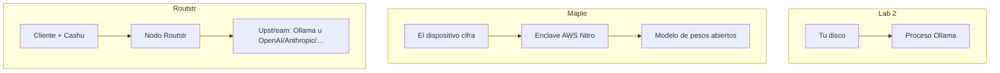

# Maple AI y Routstr (cuando lo local no alcanza)

!!! info "Lab 3 — inferencia remota sin login de ChatGPT"
    Úsalo solo después del [lab 1](cloud-surveillance.md) y, si la máquina puede, del [lab 2](run-local.md).

    LearnNostr **no** es Maple ni Routstr. Esto es lo que dicen **sus docs públicas actuales**, más labs que llaman endpoints **documentados**. Si movieron una URL, vuelve a esas páginas.

!!! warning "Privacidad de pago no es privacidad del prompt"
    Un token Cashu o un recargo en Bitcoin puede ocultar **quién pagó**. No oculta automáticamente **qué tecleaste** de la máquina que corre el modelo. Lee el modelo de confianza de cada producto antes de pegar un borrador de campo.

---

## Dos diseños distintos



| | [Maple](https://www.trymaple.ai) | [Routstr](https://docs.routstr.com/) |
|--|------|---------|
| Trabajo | Chat/API en la nube con **aislamiento de hardware** | **Mercado** de nodos de inferencia |
| Descubrimiento | Su app / API | Anuncios Nostr `kind 38421` ([docs](https://docs.routstr.com/provider/discovery/)) |
| Pago (como lo describen) | Cuentas anónimas: Bitcoin / Lightning / ecash; sin tarjeta en ese camino | **Cashu** o sesión `sk-` fondeada con Lightning; sin tarjeta |
| Dónde se descifra el prompt | Dentro de un **TEE** (AWS Nitro Enclaves), según [trymaple.ai/proof](https://www.trymaple.ai/proof) | En el **nodo proveedor**, que puede **reenviar** a OpenAI, Anthropic, vLLM u Ollama ([overview](https://docs.routstr.com/overview/)) |
| Aún confías | Hardware Nitro, su build open source, **jurisdicción de AWS**, tu IP salvo Tor | El operador del nodo, **y a quien haga de proxy**, más metadatos del mint/pago |

La comparación de Maple dice que un “proxy de privacidad” que igual manda plaintext a un lab de frontera **no** es lo mismo que su diseño TEE. El diagrama de Routstr **incluye** OpenAI/Anthropic como upstream posible. Para una persona en riesgo, esa frase es la lección: **elige el nodo (o no uses Routstr para secretos de columna 1).**

---

## Maple — según su documentación

Desde [How Maple Works](https://www.trymaple.ai/proof) y notas públicas de Maple:

- Los prompts se cifran en el dispositivo y se descifran **solo dentro** de infraestructura aislada por hardware. Su página de proof lista ahora cifrado en el dispositivo, enclave seguro, GPU TEE y atestación open source.
- Publican código cliente/servidor y una página de **atestación en vivo** para comparar hashes PCR con un build. Los hashes rotan; no congelamos un PCR en esta lección.
- Dicen que los datos no se usan para entrenar ni para anuncios.
- **Cuentas anónimas**: ID único que debes guardar, contraseña que pones, pago con Bitcoin / Lightning / ecash — sin correo en ese camino (las [notas 2.0](https://blog.trymaple.ai/maple-2-0-now-with-live-data/) de Maple y su anuncio público de ese alta).
- Corren modelos de **pesos abiertos**; el FAQ de Maple Teams afirma que los prompts no se envían a OpenAI, Anthropic ni Google.
- **Maple Proxy** ([docs](https://blog.trymaple.ai/maple-proxy-documentation/)): proxy local compatible con OpenAI (`localhost:8080/v1`) que hace handshake TEE, atestación y cifrado. La app de escritorio puede arrancarlo; imagen Docker `ghcr.io/opensecretcloud/maple-proxy:latest` con `MAPLE_BACKEND_URL=https://enclave.trymaple.ai`. El streaming es **obligatorio**. Los IDs de modelo cambian — `GET /v1/models` es la fuente de verdad.

Límites que el propio FAQ admite: aún confías en **AWS Nitro** y el código publicado. El enclave está en la nube de AWS. El ISP ve una conexión a Maple salvo que añadas Tor. ID + contraseña son un secreto — trátalos como un `nsec`.

### Lab: verifica, luego una llamada no sensible

1. Abre [trymaple.ai/proof](https://www.trymaple.ai/proof). Confirma que estás viendo **atestación**, no un eslogan. (Los hashes rotan; no congelamos un PCR en esta lección.)
2. Si creas cuenta, usa el camino **anónimo** que documentan — no login de Google. Guarda el ID **fuera de línea**.
3. **No** pegues el `draft.txt` del lab 2. Usa una frase que ya publicarías.

Proxy de escritorio (docs de Maple Proxy) cuando esté escuchando:

```python
from openai import OpenAI

client = OpenAI(
    base_url="http://localhost:8080/v1",
    api_key="your-maple-api-key",
)

stream = client.chat.completions.create(
    model="llama-3.3-70b",
    messages=[{"role": "user", "content": "Una frase: por qué un log de prompts es prueba."}],
    stream=True,
)
for chunk in stream:
    delta = chunk.choices[0].delta.content
    if delta:
        print(delta, end="")
```

Docker (mismos docs):

```bash
docker pull ghcr.io/opensecretcloud/maple-proxy:latest
docker run -p 8080:8080 \
  -e MAPLE_BACKEND_URL=https://enclave.trymaple.ai \
  ghcr.io/opensecretcloud/maple-proxy:latest
```

Si no puedes instalar la app, **párate en el paso 1**. Leer la página de proof igual completa el lab. No inventes un “wrapper web de Maple”.

---

## Routstr — según su documentación

Desde [docs.routstr.com](https://docs.routstr.com/):

- Sin login central. Compras inferencia con **Cashu** o una clave de sesión fondeada con Lightning.
- Los clientes apuntan cualquier SDK OpenAI a un nodo: `base_url` + `api_key` = `sk-…` **o** un token crudo `cashuA…` ([integración](https://docs.routstr.com/client/integration/)).
- Los proveedores **anuncian** en Nostr como `kind 38421` (formato de Routstr, no un NIP que hayamos inventado) con URL, modelos, precios, `.onion` opcional.
- Los nodos pueden sentarse delante de **OpenAI / Anthropic / vLLM / Ollama**.
- Tor: las docs de integración muestran SOCKS5 a un `base_url` onion.

### Lab A — mira el directorio, aún no pagues

```bash
nak req -k 38421 --limit 5 wss://relay.damus.io wss://nos.lol
```

O en JavaScript:

```javascript
import { SimplePool } from 'nostr-tools/pool'

const relays = ['wss://relay.damus.io', 'wss://nos.lol']
const pool = new SimplePool()
const events = await pool.querySync(relays, { kinds: [38421], limit: 5 })
pool.close(relays)

for (const ev of events) {
  console.log(ev.pubkey, ev.content.slice(0, 200))
}
```

Lee `content`: endpoint, modelos. Si ves `gpt-4o` / `claude-*`, ese nodo **no** es solo hardware propio. No envíes texto de columna 1 ahí.

### Lab B — llamada compatible con OpenAI (prompt desechable)

Solo después de elegir un nodo cuyo upstream aceptes. El token es **secreto**. Forma tomada de la página de integración de Routstr:

```bash
curl https://api.routstr.com/v1/chat/completions \
  -H "Content-Type: application/json" \
  -H "Authorization: Bearer cashuA…" \
  -d '{
    "model": "gpt-4o-mini",
    "messages": [{"role": "user", "content": "Reply with the single word: pong"}]
  }'
```

`402` significa saldo insuficiente.

!!! danger "El upstream es el modelo de privacidad"
    Si el nodo hace proxy a OpenAI, **OpenAI recibe el prompt**. Cashu ocultó la tarjeta; no ocultó las palabras. Para notas de campo, prefiere un nodo que liste modelos **autoalojados**, o quédate en el [lab 2](run-local.md) / el TEE de Maple.

---

## Lista

!!! example "El lab 3 está completo cuando"

    - [ ] Puedes explicar TEE vs proxy-a-OpenAI en una frase
    - [ ] Abriste la página [proof](https://www.trymaple.ai/proof) de Maple (o documentaste por qué no)
    - [ ] Trajiste al menos un evento Routstr `kind 38421` y nombraste su upstream probable
    - [ ] Cualquier completion remota usó una frase **desechable**, no `draft.txt`
    - [ ] No mezclaste una tarjeta KYC con un npub de campo para comprar créditos

---

## Siguiente

[Publicar o enseñar sin filtrar el prompt](publish-without-leaking.md)
