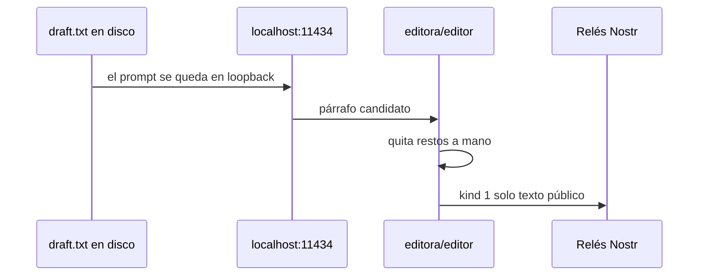

# Publicar sin filtrar el prompt

!!! info "Lab 4 — el ejemplo trabajado"
    Ya sabes [publicar una nota](../tutorials/publish-and-verify.md) y [correr un modelo local](run-local.md). Este lab es la **juntura**: la inferencia se queda en localhost; solo un párrafo **seguro para público** llega a los relés.

    Si saltas lo local, pegas el borrador interno en ChatGPT y luego publicas la respuesta, tienes un `kind 1` bonito **y** un log de vendedor. Ese es el fallo que esta pista de grant existe para evitar.

---

## Cómo chocan los tres sistemas

| Sistema | ¿Ve el **prompt**? | ¿Ve la **nota publicada**? | ¿Ve tu **IP**? |
|---------|--------------------|----------------------------|----------------|
| Ollama en esta laptop | Sí (proceso local) | No | No (salvo que luego subas) |
| TEE de Maple | Sí, dentro del enclave que documentan | No | Borde Maple/AWS, salvo Tor |
| Nodo Routstr + upstream | **Sí, en el nodo; tal vez también OpenAI** | No | El nodo (e ISP) salvo Tor/onion |
| Relés Nostr | Solo si lo pegas en `content` | Sí | Sí, salvo Tor/VPN **antes** del cliente |
| Quien lee tu `npub` | No | Sí | No |

Follows, zaps y NIP-05 siguen enlazando identidades — [guía de campo](../getting-started/high-risk-users.md). La IA no cancela eso.

Reglas:

1. **Nunca** pongas `nsec` en un prompt.
2. **Nunca** pongas el borrador interno en un `kind 1`.
3. No uses el npub de **campo** como login, nombre visible o archivo que luego compartes en ChatGPT/Maple/Routstr.
4. Prefiere inferencia **local** para columnas 1–2. Remoto solo para texto que igual publicarías.
5. Después de la respuesta del modelo, **tú** editas. Publica el párrafo editado, no el chat.



---

## Ejemplo trabajado (copiar y pegar)

La misma ficción del lab 2. El archivo interno se queda en `draft.txt`. El público será `public.txt`.

### Paso 1 — inferir en local

```bash
# Usa el tag local de `ollama list`. Sin :cloud.
curl -s http://localhost:11434/api/chat -d "$(python3 - <<PY
import json
print(json.dumps({
  "model": "gemma4",
  "stream": False,
  "messages": [{
    "role": "user",
    "content": "Rewrite INTERNAL notes into one public paragraph. "
               "Remove names, phones, vehicles, buildings, exact times, minors, quotes that identify a place. "
               "Notes:\\n\\n" + open("draft.txt", encoding="utf-8").read()
  }]
}))
PY
)" | python3 -c "import sys,json; print(json.load(sys.stdin)['message']['content'])" > public.txt
```

Abre `public.txt`. Borra lo que aún apunte a la Fuente A. **Tú** das el visto bueno, no el modelo.

### Paso 2 — publica solo `public.txt`

Llave desechable para el ejercicio (no tu `nsec` de campo):

=== "JavaScript"

    ```javascript
    import { readFileSync } from 'node:fs'
    import { generateSecretKey, getPublicKey, finalizeEvent } from 'nostr-tools'
    import { npubEncode } from 'nostr-tools/nip19'
    import { SimplePool } from 'nostr-tools/pool'

    const body = readFileSync('public.txt', 'utf8').trim()
    if (/INTERNAL|phone|van|minor|19:40|blue building/i.test(body)) {
      throw new Error('public.txt todavía parece el borrador interno — edita a mano')
    }

    const sk = generateSecretKey()
    console.log('npub desechable', npubEncode(getPublicKey(sk)))

    const event = finalizeEvent({
      kind: 1,
      created_at: Math.floor(Date.now() / 1000),
      tags: [['t', 'learnnostr']],
      content: body,
    }, sk)

    const relays = ['wss://relay.damus.io', 'wss://nos.lol']
    const pool = new SimplePool()
    await Promise.any(pool.publish(relays, event))
    pool.close(relays)
    console.log('publicado', event.id)
    ```

=== "Python"

    ```python
    import asyncio, re
    from pathlib import Path
    from nostr_sdk import Client, EventBuilder, Keys, NostrSigner

    body = Path("public.txt").read_text(encoding="utf-8").strip()
    if re.search(r"INTERNAL|phone|van|minor|19:40|blue building", body, re.I):
        raise SystemExit("public.txt todavía parece interno — edita a mano")

    async def main():
        keys = Keys.generate()
        print("npub desechable:", keys.public_key().to_bech32())
        client = Client(NostrSigner.keys(keys))
        await client.add_relay("wss://relay.damus.io")
        await client.add_relay("wss://nos.lol")
        await client.connect()
        await client.send_event_builder(EventBuilder.text_note(body))

    asyncio.run(main())
    ```

=== "Sin código"

    Pega **solo** `public.txt` en un cliente con una llave **desechable**. Luego verifica desde un segundo cliente como en [publicar y verificar](../tutorials/publish-and-verify.md).

### Paso 3 — prueba negativa

No lo hagas con secretos reales. Existe para que reconozcas el antipatrón:

```text
Mal:  ChatGPT("resume draft.txt") → pegar la respuesta en Damus con tu npub de firma
Bien: Ollama(draft.txt) → edición humana → kind 1 en el compartimento que corresponde al modelo de amenaza
```

Si usaste Maple o Routstr en el lab 3, la nota publicada **no** debe citar el prompt. Los relés no necesitan saber que usaste un modelo.

---

## Enseñar a otras personas

Cuando lo muestres a una redacción o una comunidad:

- Demuestra Ollama **offline** con un borrador desechable, no con un archivo de fuente viva.
- Muestra `kind 38421` como “cómo Routstr encuentra nodos”, no como “Nostr es un producto de IA”.
- Muestra la página [proof](https://www.trymaple.ai/proof) de Maple como **su** atestación, no la nuestra.
- Manda a LearnNostr por el camino; a cada repo por el software.

---

## Lista

!!! example "El lab 4 está completo cuando"

    - [ ] `draft.txt` nunca salió de localhost (sin ChatGPT, sin pegar en un LLM web)
    - [ ] `public.txt` no tiene marcadores INTERNAL ni restos identificables
    - [ ] Nota publicada desde una llave **desechable**, o desde el compartimento correcto
    - [ ] Nota traída desde un segundo relé/cliente
    - [ ] Puedes explicar quién habría visto el prompt en el camino malo frente a este

---

## Camino completo

Vuelve al [overview de IA privada](index.md) o sigue con Nostr: [guía de campo](../getting-started/high-risk-users.md) · [llaves sin cuentas en la nube](../getting-started/keys-without-accounts.md).
